# Platform Configuration

::: info Document Information
Version: v2.0
Updated: 2026-11-04
:::

## Feature Overview

| Item | Content |
| --- | --- |
| Applicable Role | Operator |
| Navigation path | Settings > System Settings > Platform Settings |
| Page route | `/user/system/platform-settings/config` |
| Managed objects | General configuration, provider relationships, currency settings, payment channels, accounts and settlement, email, and UI configuration |

#### Beginner Explanation

Platform Settings is the global parameter panel. It controls basic platform behavior, provider relationships, currencies, payments, settlement, email, and UI presentation. A change can affect multiple modules.

#### Terms Quick Reference

| Term | Description |
| --- | --- |
| Platform configuration | A system parameter that affects global behavior.; Confirm the scope before changing it. |
| Provider relationship | Configuration that defines a relationship between the platform and a provider.; Confirm business ownership before changing it. |
| Currency settings | Currency rules used for amount display and settlement.; Verify them before a billing change. |
| Email settings | Configuration for notifications and verification-code delivery.; Compare it with Login Properties during troubleshooting. |

## Prerequisites

1. The current account has permission to manage system configuration.
2. You have opened `System Settings > Platform Settings`.
3. Before editing configuration, you have confirmed the impact scope, change window, and approval requirements.

## Page Description

The Platform Settings page groups global configuration by business impact.

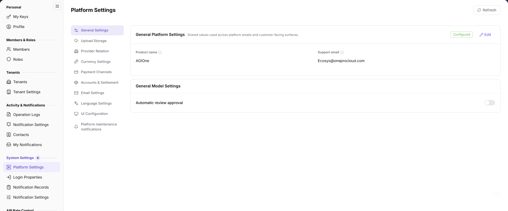

The left side lists 10 platform configuration areas. The menu label is Platform Settings; the page title is Platform Configuration.

| Configuration Area | Main Responsibility | Typical Impact to Verify |
| --- | --- | --- |
| General Settings | Maintains shared platform parameters and default display settings. | Platform-wide defaults and common presentation. |
| Upload Storage | Maintains the object or local storage, object prefix, and credentials used for image and video uploads. | Upload, preview, and file access URLs. |
| Provider Relationship | Maintains provider relationships, enabled status, and settlement ownership. | Provider visibility, business ownership, and settlement relationships. |
| Currency Settings | Maintains available currencies, display rules, precision, and conversion-related settings. | Amount display, recharge, billing, and settlement. |
| Payment Channels | Maintains payment providers, credentials, callbacks, and connectivity. | Recharge, payment callbacks, and settlement. |
| Account & Settlement | Maintains account, settlement cycle, recharge, and Credits-related parameters. | Account balance, Credits calculation, billing, and settlement. |
| Email Settings | Maintains mail service, sender, notification, and verification-email settings. | Login verification and notification delivery. |
| Language Settings | Maintains the languages and default language shared by the sign-in page, console, and notifications. | Language display in the console, sign-in page, and notifications. |
| UI Configuration | Maintains login-page, platform identity, theme, and display settings. | User-visible interface and branding. |
| Platform Maintenance Notifications | Lets an authorized operator manually send pre-maintenance or update-completed notifications. | Target tenants, recipient roles, and notification delivery. |
| Area Actions | Reloads the page or opens the selected configuration for maintenance. | Whether the displayed value is current and whether the account has write permission. |

Use the configuration-area name and its **"Edit"** entry to locate the intended setting before making a change.

## Main Operations

### Common Operation Sequence

Use the same control sequence for each configuration area, then follow the area-specific notes below:

1. Open the target configuration area and confirm the current value, enabled status, and affected modules.
2. For an approved change, open **"Edit"** and change only the intended fields.
3. Before **"Save"**, **"Enable"**, **"Disable"**, **"Reset"**, or **"Test Connection"**, confirm approval, external-system impact, and the rollback method.
4. Follow the page message, then reopen the configuration area and verify the displayed value or enabled status.
5. Validate the affected business module, such as sign-in, recharge, settlement, email delivery, or UI display.

If the task is only to learn the page or capture screenshots, stop after viewing the configuration and do not submit changes.

### Edit General Settings

1. Go to `Settings > System Settings > Platform Settings`.
2. Click **"General Configuration"**.
3. Review general platform display and shared settings.

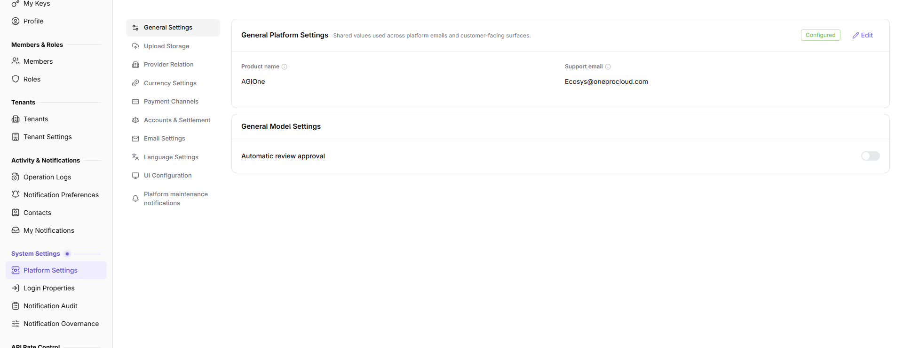

General Configuration shows product name, support email, and automatic review defaults. Changes affect global display and review behavior.

### Edit Upload Storage

1. Go to `Settings > System Settings > Platform Settings`.
2. Click **"Upload Storage"**.
3. Review the object-storage switch, object prefix (environment isolation), Endpoint, Region, Bucket name, and credential status.

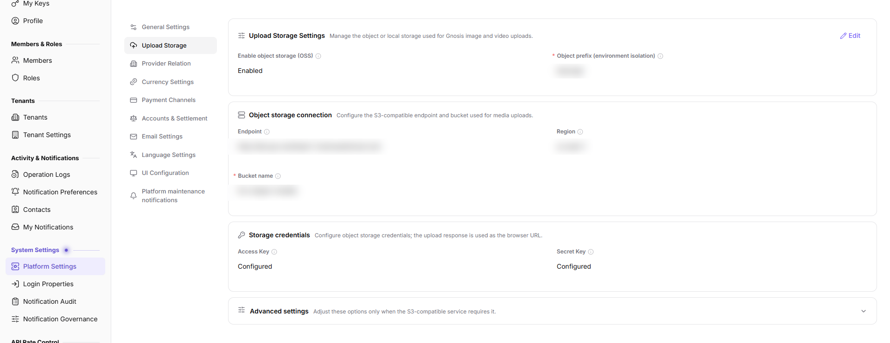
4. If a specific S3-compatible service needs compatibility settings, expand `Advanced Configuration` and review the additional parameters.
5. Before saving, confirm the credential source, object prefix, and access URL. Do not write Endpoint, Bucket, Access Key, or Secret Key values into documentation, tickets, or screenshots.

### Edit Provider Relationship

1. Go to `Settings > System Settings > Platform Settings`.
2. Click **"Provider Relationship"**.
3. Review provider relationships, enabled status, and settlement ownership settings.

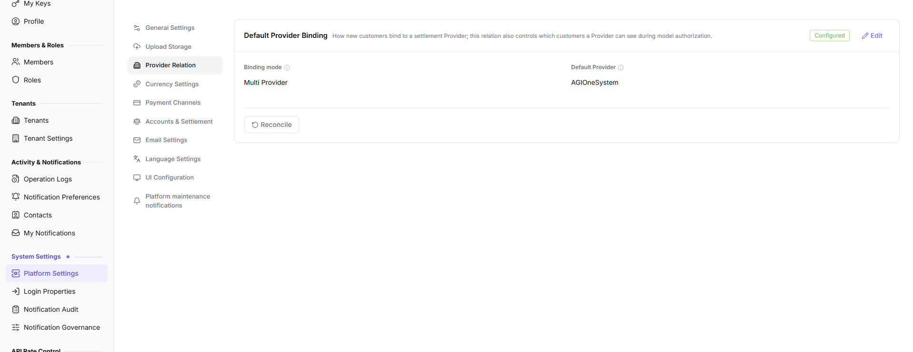

Provider Relationship shows providers, relationships, enabled status, and settlement ownership. Confirm business ownership before changing it.

### Edit Currency Settings

1. Go to `Settings > System Settings > Platform Settings`.
2. Click **"Currency Settings"**.
3. Review default currency, display rules, precision, or conversion-related settings.

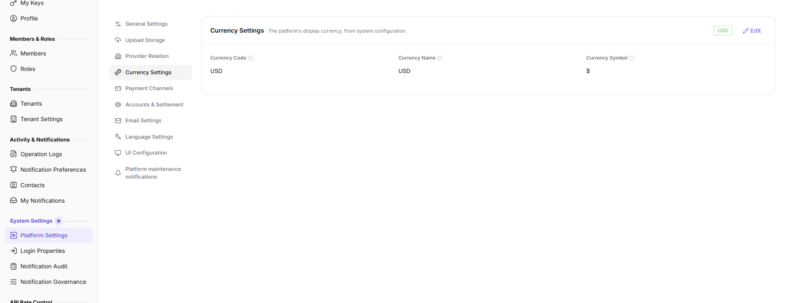

Currency Settings shows the default currency, display rules, precision, and conversion parameters. Confirm the impact on recharge, billing, and settlement.

### View Payment Channel Settings

1. Go to `Settings > System Settings > Platform Settings`.
2. Click **"Payment Channels"**.
3. Review the current top-up and payment mode: account credit request or online payment.

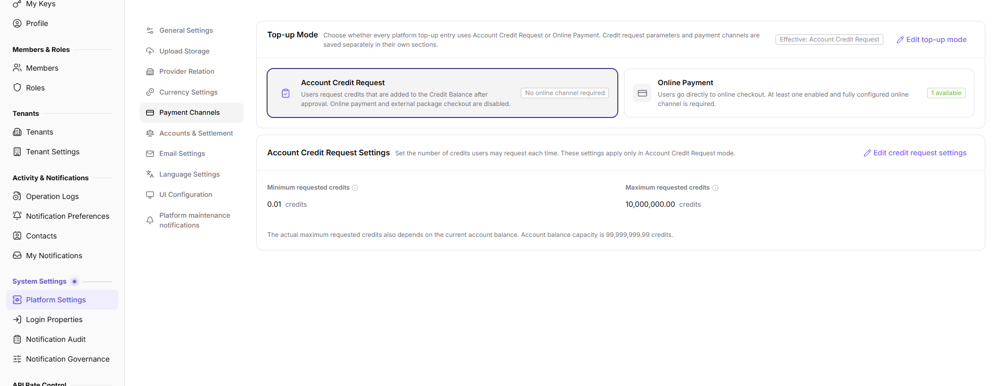
4. Online payment is not enabled in the current test environment. The page only shows the top-up mode and credit-request settings; Stripe and Alipay channels are not displayed.
5. This version of the documentation does not cover Stripe or Alipay channel configuration. If coverage is required, collect evidence in an environment with online payment enabled; do not reuse old screenshots or the old flow.

### Edit Account and Settlement Settings

1. Go to `Settings > System Settings > Platform Settings`.
2. Click **"Account and Settlement"**.
3. Review account, settlement cycle, recharge, or credits-related parameters.

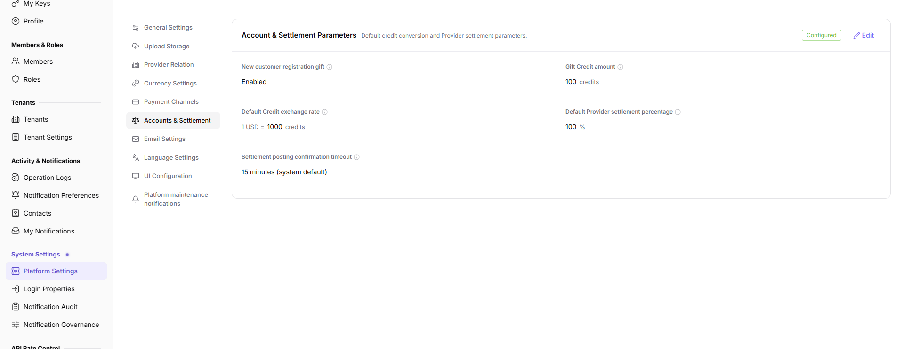

Account and Settlement shows account, settlement cycle, recharge, and Credits parameters. Confirm the impact on billing and settlement.

### Edit Email Settings

1. Go to `Settings > System Settings > Platform Settings`.
2. Click **"Email Settings"**.
3. Review mail service, sender configuration, notification templates, or verification email settings.

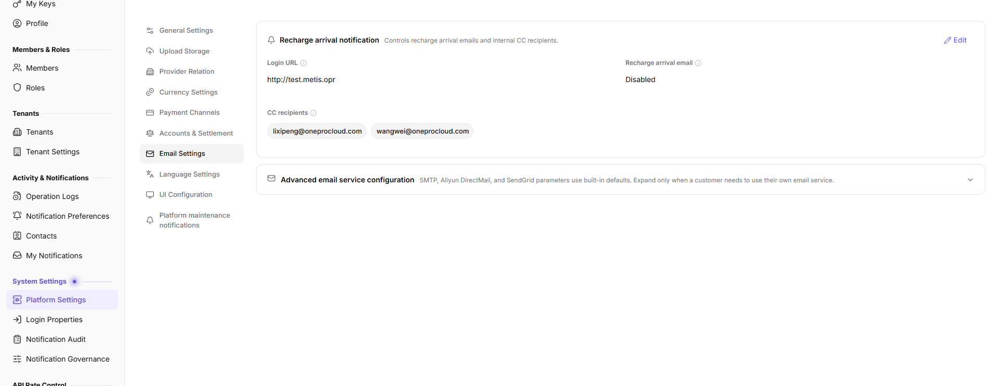

Email Settings shows the mail service, sender, notification templates, and verification email parameters. Verify login codes and notification delivery after changes.

### Edit Language Settings

1. Go to `Settings > System Settings > Platform Settings`.
2. Click **"Language Settings"**.
3. Review `Available Languages` and `System Default Language`; the available languages currently include English, Chinese, and Español.
4. Before changing them, confirm the languages required by the sign-in page, console, and notifications.
5. After saving, verify language display on the sign-in page, console, and notification pages.

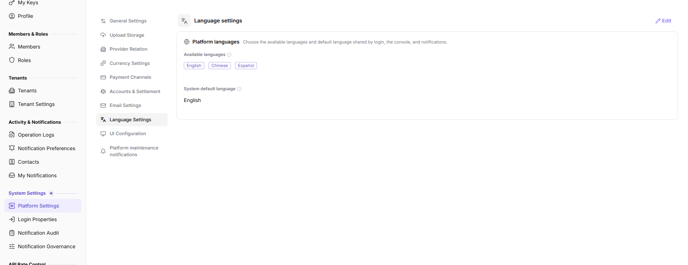

Language Settings shows available languages (English/Chinese/Español) and the system default language. Saving affects the sign-in page, console, and notifications.

### Edit UI Settings

1. Go to `Settings > System Settings > Platform Settings`.
2. Click **"UI Configuration"**.
3. Review login page, platform identity, theme, or display-related settings.

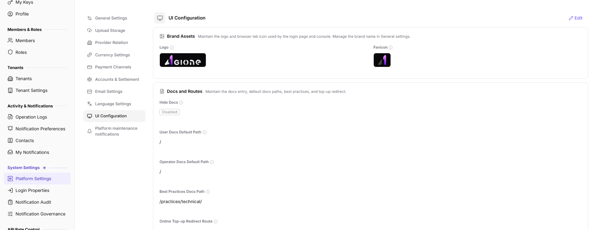

UI Configuration shows login-page, platform identity, theme, and display settings. Verify the user-visible interface and branding after changes.

### Edit Platform Maintenance Notifications

1. Go to `Settings > System Settings > Platform Settings`.
2. Click **"Platform Maintenance Notifications"**.
3. Check whether the current account has send permission. Without permission, the form is view-only and cannot be sent.
4. With permission, select the notification type (pre-maintenance or update-completed), and enter the platform access URL, business cutoff time, maintenance window, and expected impact.
5. Select the target tenants (all valid tenants or specified tenants) and recipient roles (tenant administrators only, or administrators and all valid members).
6. Review the notification content and recipient scope before sending. The cutoff time only controls entry into notification acceptance; it does not guarantee final email or in-app delivery.

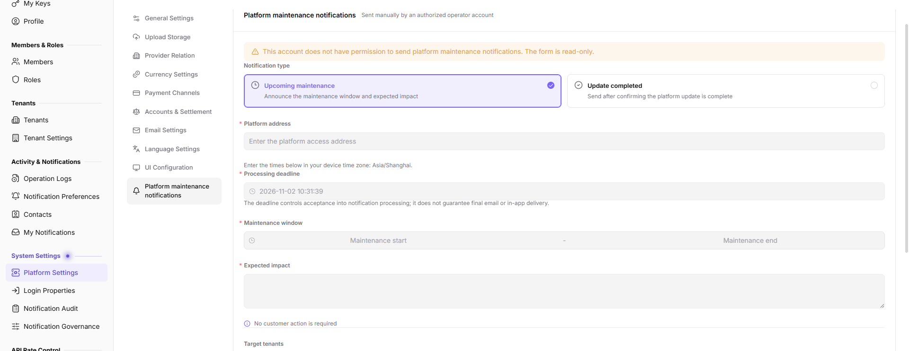

Platform Maintenance Notifications shows type, access URL, business cutoff, maintenance window, expected impact, target tenants, and recipient roles. Without send permission, the form is view-only.

## Parameter Quick Reference

### Basic Configuration Fields

| Field Name | Required | Field Type | Example | Description |
| --- | --- | --- | --- | --- |
| Configuration category | System-generated | Text | General Settings | Configuration group in Platform Settings. |
| Configuration item | System-generated | Text | Default currency | System parameter to view or maintain. |
| Default value | System-generated | Text | CNY | Default or preset value. |
| Current value | System-generated / Editable | Text | CNY | Currently effective value. |
| Enabled status | System-generated / Editable | Enum | Enabled | Whether the item or capability is enabled. |
| Test connection | Action button | Button | Test Connection | Verifies email, payment, or external-service connectivity. |
| Save | Action button | Button | Save | Saves the current configuration change. |
| Reset | Action button | Button | Reset | Restores defaults or the last saved state. |
| Actions | System-generated | Button | Edit / Enable / Disable | Provides configuration maintenance entries. |

### Upload Storage and Language Fields

| Field Name | Required | Field Type | Example | Description |
| --- | --- | --- | --- | --- |
| Object storage switch | No | Switch | Enabled | Controls whether uploads use object storage. |
| Object prefix (environment isolation) | Conditional | Text | Hidden | Environment-isolation prefix in object storage. |
| Endpoint | Conditional | Text | Hidden | S3-compatible service address. |
| Region | Conditional | Text | Hidden | Object-storage region. |
| Bucket name | Conditional | Text | Hidden | Bucket used for uploads. |
| Storage credentials | Conditional | Text | Configured | Access Key and Secret Key configuration status. |
| Available languages | Yes | Multi-select | English, Chinese, Español | Languages for sign-in, console, and notifications. |
| System default language | Yes | Enum | Chinese | Default language for new users and the interface. |

### Platform Maintenance Notification Fields

| Field Name | Required | Field Type | Example | Description |
| --- | --- | --- | --- | --- |
| Notification type | Yes | Enum | Pre-maintenance notification | Type of platform maintenance notification. |
| Platform access URL | Yes | Text | https://example.com | Platform URL provided to tenants. |
| Business cutoff time | Yes | Date time | 2026-10-30 19:03 | Cutoff for entering notification acceptance. |
| Maintenance window | Yes | Date-time range | 2026-10-30 20:00–22:00 | Planned maintenance start and end. |
| Expected impact | Yes | Multi-line text | No customer action required | Impact described in the notification. |
| Target tenants | Yes | Single select | All valid tenants | Tenant scope for the notification. |
| Recipient roles | Yes | Single select | Tenant administrators only | Role scope of recipients. |

## Pitfalls

- Do not change roles, members, login policies, Keys, or API rate-control rules without confirming the affected users and systems.
- UI entries can differ by role and tenant scope; verify the current account context before troubleshooting.
- Never copy complete Keys, AK/SK, tokens, or secrets into documentation, tickets, or screenshots.
- Platform settings affect sign-in, display, provider relationships, currencies, payment, billing, settlement, email notifications, and user-visible UI.
- `Save`, `Reset`, `Enable`, `Disable`, and `Test Connection` are high-risk actions.
- For learning or screenshots, only view configuration items and do not submit real configuration changes.
- Stripe / Alipay keys, private keys, Webhook secrets, SMTP passwords, internal addresses, accounts, tokens, customer names, and settlement parameters must not be written into documentation, screenshots, tickets, or chats.

## Result Validation

| Check Item | Success Signal | If Abnormal |
| --- | --- | --- |
| Categories | Configuration categories are displayed. | Refresh the page and open it again. |
| Configuration values | Configuration items and values are readable. | Check system-configuration permission. |
| Edit entry | Edit is displayed according to permission. | Ask an administrator to make the change when you lack permission. |
| Saved value | After an approved change, reopening the area shows the intended value or enabled status. | Check the page message, permission, approval status, and whether the page needs to be refreshed. |
| Business impact | The affected sign-in, recharge, settlement, email, or UI flow behaves as expected. | Roll back according to the change plan and inspect Operation Logs and the related business module. |
| Screenshots | General configuration, provider relationship, currency settings, payment channel, account and settlement, email settings, and UI configuration screenshots render normally. | Check whether image paths exist. |

## FAQ

#### Which modules does a configuration change affect?

**Symptom:**

Platform Settings contains multiple configuration categories.

**Possible cause:**

Different settings can affect sign-in, billing, email, page presentation, or provider relationships.

**Resolution:**

Identify the configuration category and business impact before choosing a change window.

#### Why is a platform setting missing?

**Symptom:**

The target setting is absent or its area is empty.

**Possible cause:**

The current account lacks system-settings permission, the setting is limited by deployment version or tenant scope, or configuration synchronization is abnormal.

**Resolution:**

Verify operator-admin permission and the current tenant scope. Confirm that the setting applies to the current version. If it is still missing, ask a platform administrator to check the configuration center.

#### Why is Save unavailable for platform configuration?

**Symptom:**

The setting is visible, but Save, Enable, or Reset cannot be selected.

**Possible cause:**

The current account lacks write permission, the setting is version-locked, or approval is required before the change.

**Resolution:**

Verify system-administrator permission and the setting description. Complete the required approval, then ask an authorized administrator to save the change.

## Notes

- Platform configuration can affect global behavior. Do not change it casually during peak business hours.
- Review payment, settlement, and email configuration before saving.
- `Save`, `Reset`, `Enable`, `Disable`, and `Test Connection` are high-risk actions.
- For learning or screenshots, only view configuration items and do not submit real configuration changes.
- Stripe / Alipay keys, private keys, Webhook secrets, SMTP passwords, internal addresses, accounts, tokens, customer names, and settlement parameters must not be written into documentation, screenshots, tickets, or chats.

## Next Steps

1. To maintain sign-in security, go to [Login Properties](../login-properties/).
2. To maintain API rate control, go to [Overview](../../api-rate-control/overview/).
