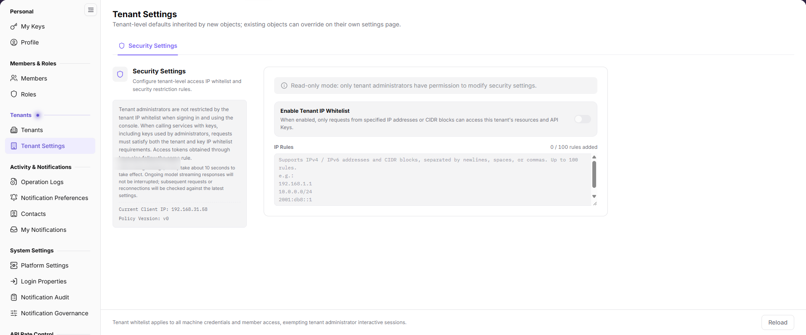

# Tenant Settings

::: info Document Information
Version: v2.0
Updated: 2026-11-04
:::

## Feature Overview

| Item | Content |
| --- | --- |
| Applicable Role | Operator |
| Navigation path | Settings > Tenants > Tenant Settings |
| Page route | `/user/user-space/settings` |
| Managed objects | Tenant-level security settings, IP allowlist, policy version, and current source IP |

#### Beginner Explanation

Tenant Settings maintains tenant-level defaults and security boundaries. Operators currently see the Security Settings tab. The page states that only tenant administrators can modify it, so the operator view is usually read-only.

#### Terms Quick Reference

| Term | Description |
| --- | --- |
| Tenant-level defaults | Default rules inherited by new objects. Existing objects can override them on their own settings pages. |
| IP allowlist | Rules that allow only specified IP addresses or CIDR ranges to access tenant resources. |
| Policy version | The current version of the tenant security policy. |
| Current source IP | The source address used to access the console. |

## Prerequisites

1. The current account can open `Settings > Tenants > Tenant Settings`.
2. Before changing security settings, you have confirmed tenant-administrator permission and the impact.
3. You have collected the IPv4, IPv6, or CIDR ranges for the allowlist.

## Page Description

The page currently shows the Security Settings tab.

| Area | Description |
| --- | --- |
| Security Settings | Configures tenant-level IP allowlist and security restrictions. |
| Enable tenant IP allowlist | When enabled, only listed IPs or ranges can access tenant resources and API Keys. |
| IP rule list | Supports IPv4, IPv6, and CIDR, up to 100 rules. |
| Current source IP | Shows the source address used to access the console. |
| Policy version | Shows the current security policy version. |

The page states that tenant administrators are exempt from the tenant IP allowlist when signing in and using the console. Key-based calls, including administrator keys, must satisfy both tenant and key allowlists. Changes take effect in about 10 seconds.

## Main Operations

### View Security Settings

1. Go to `Settings > Tenants > Tenant Settings`.
2. Keep the `Security Settings` tab selected.
3. Review the allowlist switch, rule count, current source IP, and policy version.
4. If the page is read-only, confirm that the current account is not a tenant administrator.

### Configure the IP Allowlist

1. Confirm that the current account has tenant-administrator permission.
2. Enable `Enable tenant IP allowlist`.
3. Enter IPv4, IPv6, or CIDR ranges in the `IP rule list`, separated by line breaks, spaces, or commas.
4. Confirm the rule count and scope, then save.
5. Wait about 10 seconds. Active model streaming responses are not interrupted; new requests use the latest rules.

### Reload Security Settings

1. Click `Reload` after a change or save.
2. Verify the policy version, current source IP, and rule count.

## Parameter Quick Reference

| Field Name | Required | Field Type | Example | Description |
| --- | --- | --- | --- | --- |
| Enable tenant IP allowlist | No | Switch | Enabled | Allows only listed IPs or ranges when enabled. |
| IP rule list | Conditional | Multi-line text | `192.0.2.0/24` | Supports IPv4, IPv6, and CIDR, up to 100 rules. |
| Current source IP | System-generated | Text | `192.0.2.10` | Source address used to access the console. |
| Policy version | System-generated | Text | `v0` | Current security policy version. |

## Pitfalls

- Tenant administrators are exempt from the tenant IP allowlist for interactive sign-in, but key-based calls are still restricted.
- Key access must satisfy both the tenant and key allowlists.
- The allowlist supports up to 100 rules. Invalid formats cause saving to fail.
- Changes take effect in about 10 seconds. Streaming responses are not interrupted; new requests use the latest rules.
- Before enabling the allowlist, confirm that the current source IP is included so you are not locked out.
- Do not write real IP addresses, tenant IDs, or internal network addresses into documentation or screenshots.

## Result Validation

| Check Item | Success Signal | If Abnormal |
| --- | --- | --- |
| Page access | Security Settings displays normally. | Check account permission and menu visibility. |
| Rule count | The list shows the added count and limit. | Check formats and whether 100 rules are exceeded. |
| Save effect | New rules take effect after about 10 seconds. | Reload and check permission and policy version. |
| Read-only notice | A read-only message appears without modify permission. | Ask a tenant administrator to make the change. |

## FAQ

#### Why can't I modify tenant security settings?

**Symptom:**

Security Settings is read-only, and switches or inputs are unavailable.

**Possible cause:**

The current account is not a tenant administrator, or the operator view has read-only permission.

**Resolution:**

Ask a tenant administrator to make the change. The operator view is for verification only; do not bypass permission.

#### What should I do if I cannot access the platform after enabling the allowlist?

**Symptom:**

The current address cannot access the console or API after enabling the IP allowlist.

**Possible cause:**

The current source IP is not included, or a rule format is invalid.

**Resolution:**

Ask a tenant administrator to sign in from a trusted network and add the rule. Confirm the source IP and CIDR format.

## Notes

- Security settings affect all tenant resources and API Keys. Confirm the scope before changes.
- Tenant administrators are exempt from the allowlist for interactive sign-in, but key-based calls remain restricted.
- Changes take effect in about 10 seconds. Do not submit repeatedly.
- Do not write real IP addresses, tenant IDs, or internal network addresses.

## Next Steps

1. To view tenant information and roles, go to [Tenants](../tenants/).
2. To trace setting changes, go to [Operation Logs](../../activity-notifications/operation-logs/).
