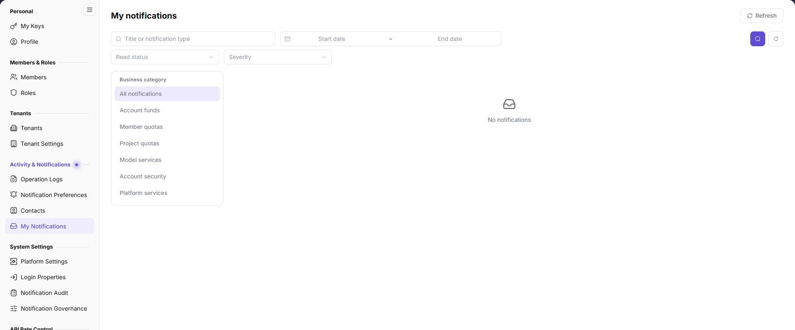

# My Notifications

::: info Document Information
Version: v2.0
Updated: 2026-11-04
:::

## Feature Overview

| Item | Content |
| --- | --- |
| Applicable Role | Model Provider & User |
| Navigation path | Settings > Activity & Notifications > My Notifications |
| Page route | `/user/user-space/notification/inbox` |
| Managed objects | Notifications, business topics, severity, receive time, read status, and notification details |

#### Beginner Explanation

My Notifications is the current account's personal inbox. Use it to review account and fund, product, security, anomaly, activity, and service messages. Notification content may contain result summaries and must be redacted before sharing.

#### Terms Quick Reference

| Term | Description |
| --- | --- |
| Business topic | The business category of the notification. |
| Severity | The notification level, such as Info or Warning. |
| Read status | Whether the notification has been viewed. |
| Notification details | The result, time, affected object, and recommendation. |

## Prerequisites

1. The current account can open `Settings > Activity & Notifications > My Notifications`.
2. Before sharing a notification, you have checked whether it contains sensitive information.

## Page Description

The figure shows the notifications inbox, with title/type, date range, read status, and severity filters, plus business-topic buttons.

| Area | Description |
| --- | --- |
| Search | Search by title or notification type name. |
| Date range | Select a start and end date. |
| Read status | Filter read or unread notifications. |
| Severity | Filter by Info, Warning, and other levels. |
| Business topic | All notifications, Account & Fund Messages, Product Messages, Security Messages, Anomaly Notifications, Activity Messages, Service Messages. |
| List | Shows notification content, business topic, severity, receive time, status, and details action. |

## Main Operations

### View the Notification List

1. Go to `Settings > Activity & Notifications > My Notifications`.
2. Filter by title, date range, read status, or severity.
3. Use business-topic buttons to narrow the list.
4. Review the notification content, business topic, severity, receive time, and status.

### View Notification Details

1. Locate the target notification in the list.
2. Click `Details` on that row.
3. Review the full notification, including the result, time, affected object, and recommendation.
4. If follow-up is needed, open the relevant business page using the recommendation. Do not forward complete content that contains sensitive information.

## Parameter Quick Reference

| Field Name | Required | Field Type | Example | Description |
| --- | --- | --- | --- | --- |
| Notification content | System-generated | Text | Account balance low | Notification title and result summary. |
| Business topic | System-generated | Enum | Account & Fund Messages | The business category. |
| Severity | System-generated | Enum | Info | The notification level. |
| Receive time | System-generated | Date time | 2026-10-28 16:49:57 | When the notification entered the inbox. |
| Status | System-generated | Enum | Read | Whether the notification has been read. |

## Pitfalls

- The list only shows notifications that the current account is eligible to receive. It cannot prove whether other notifications were sent.
- Business-topic and severity filters combine. Clear filters before concluding that a notification is missing.
- Notification content may contain tenants, accounts, amounts, or business results. Redact it before screenshots or external sharing.
- Details show the content generated at notification time; they do not replace the live state of the business page.

## Result Validation

| Check Item | Success Signal | If Abnormal |
| --- | --- | --- |
| List loading | The list and pagination display normally. | Refresh the page; if still empty, check account permission and filters. |
| Filtering | The list refreshes by title, date, status, or severity. | Clear filters and query again. |
| Details | Clicking `Details` shows the complete notification. | Refresh the page; if it still fails, contact an administrator. |
| Business topic | The list scope matches the selected topic. | Check whether other filters are applied. |

## FAQ

#### Why is the target notification missing?

**Symptom:**

The expected notification is absent from the inbox.

**Possible Causes:**

The notification type is disabled, the current account is outside the recipient scope, the date or topic filter is too narrow, or the notification has exceeded its retention period.

**Resolution:**

Clear filters and expand the date range. If it is still missing, check Notification Governance and Notification Audit.

#### Why does the notification status not change?

**Symptom:**

The notification has been viewed, but the status remains unread or unexpected.

**Possible Causes:**

The page state has not refreshed, or the action did not trigger a status update.

**Resolution:**

Refresh the page and view it again. If the status still does not change, record the time and content and contact an administrator.

## Notes

- Notification content may contain accounts, tenants, amounts, Keys, or business data. Do not share it externally.
- Use the current page as the source for notification status and content. Do not rely on old screenshots.
- To troubleshoot delivery, open Notification Records and review the dispatch status.

## Next Steps

1. To change receiving preferences, go to [Notification Preferences](../notification-settings/).
2. To review platform delivery records, go to [Operation Logs](../operation-logs/).
