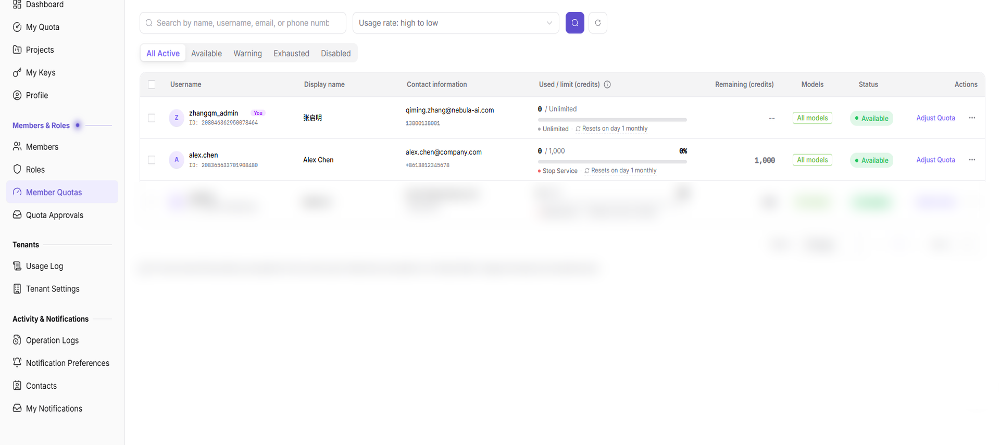
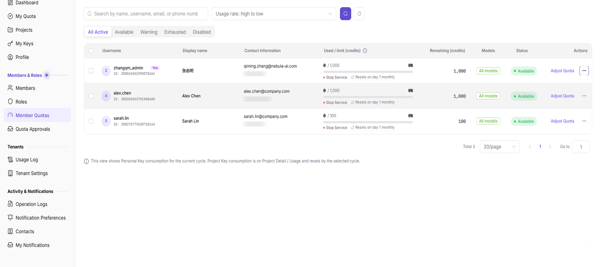
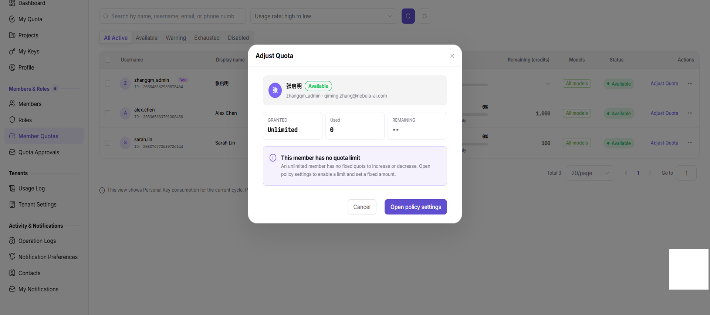
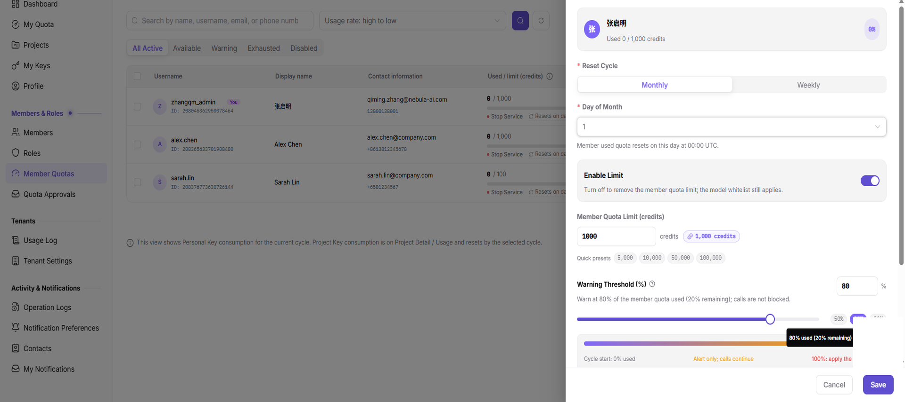

# Member Quotas

::: info Document Information
Version: v2.1
Updated: 2026-11-12
:::

## Feature Overview

| Item | Content |
| --- | --- |
| Applicable Role | Model Consumer |
| Navigation path | Settings > Members & Roles > Member Quotas |
| Page route | `/user/user-space/member-quotas` |
| Managed objects | Member Personal Key usage, authorized quota, and quota details |

#### Beginner Explanation

Member Quotas is the team's quota allocation table. It shows each member's available and used quota and limit policy, and helps determine whether a call failed because of personal quota.

#### Terms Quick Reference

| Term | Description |
| --- | --- |
| Member quota | Quota allocated to a member. Check it when a call fails. |
| Used quota | Quota already consumed by the member. Adjust the limit when usage approaches it. |
| Quota limit | The maximum quota that the member can consume. Confirm the impact before changing it. |
| Quota request | A member's request for additional quota. Direct the member to submit one when quota is insufficient. |

## Prerequisites

1. The current account has permission to view member quotas.
2. Before adjusting quota, you have confirmed the member, amount, and reason.
3. Before setting a limit, you have confirmed the reset cycle, limit-reached policy, and model allowlist scope.

## Page Description

| Area | Description |
| --- | --- |
| Top actions | Export CSV and Quota Requests |
| Filters | Search by name, email, or member ID; status; and Usage sort |
| Table columns | Member, authorized quota, used / limit, remaining, models, status, and actions |
| Row actions | Adjust Quota, Limit, and View Details |
| Detail page | Member quota, Personal Key permissions, joined projects, and audit logs |
| High-risk actions | Adjusting quota, saving member limits, and exporting CSV |

## Main Operations

### View Member Quotas

1. Go to `Settings > Members and Roles > Member Quotas`.
2. Filter by member, project, resource type, or quota status.
3. Check allocated, used, available quota, and update time.
4. If no record is returned, reset filters and check the tenant or project context. Redact quota data before sharing.

### View Member Quota Details

1. Click **"View"** or the details entry for the target member.
2. Compare total, used, and remaining quota and limits to identify near-limit or exceeded status.
3. If metrics differ, check the aggregation period, project, and refresh time.
4. Do not adjust quota during read-only validation. Follow the approval process for changes and verify operation logs.

### Adjust Member Quota

1. Go to `Settings > Members & Roles > Member Quotas`.
2. Use the search box to locate the member.
3. Review authorized quota, used / limit, remaining quota, models, and status.

The following screenshot shows the Member Quotas list. Member identifiers are hidden.

4. Select `View Details` to open member quota details.
5. Review total quota, used quota, remaining quota, Personal Key permissions, joined projects, and audit logs.

The following screenshot shows member quota details.

The figure shows the Member Quotas list; the details panel is not open in this screenshot.

6. Select `Adjust Quota` to open the adjustment dialog.
7. Select Increase or Deduct, and enter the amount and reason.
8. Confirm the impact before selecting `Confirm`.

The following screenshot shows the member quota adjustment dialog.

The figure shows `Adjust Quota` for a member with no quota limit. This state provides `Open policy settings`; the increase/deduct amount and reason fields are not shown in this example.

9. Select `Limit` to open the member limit dialog.
10. Configure the reset cycle, quota limit, and model allowlist.
11. Confirm the configuration before saving it.

The following screenshot shows the member quota limit dialog.

The member quota limit dialog contains the reset cycle, limit switch, cycle limit, and model allowlist. Confirm the affected member scope before saving.

### Set Member Quota Defaults

1. Go to `Settings > Members & Roles > Member Quotas`.
2. Click the `Member Quota Defaults` entry at the top.
3. Review the default quota, reset cycle, alert threshold, and applicable model scope.
4. Confirm the affected member scope before saving. Defaults apply to new members; existing members can be adjusted individually.
5. During read-only validation, do not save default changes.

## Parameter Quick Reference

| Field Name | Required | Field Type | Example | Description |
| --- | --- | --- | --- | --- |
| Member | No | Text | `Example Member A` | Locates the member whose quota is being reviewed. |
| Total quota | System-generated | Credits | `10,000 Credits` | Maximum quota available to the member. |
| Used quota | System-generated | Credits | `3,000 Credits` | Quota already consumed by the member. |
| Remaining quota | System-generated | Credits | `7,000 Credits` | Quota still available to the member. |
| Status | System-generated | Enum | `Normal` | Indicates whether the quota can continue to be used. |

## Pitfalls

- Do not change roles, members, login policies, Keys, or API rate-control rules without confirming the affected users and systems.
- UI entries can differ by role and tenant scope; verify the current account context before troubleshooting.
- Never copy complete Keys, AK/SK, tokens, or secrets into documentation, tickets, or screenshots.

## Result Validation

| Check Item | Success Signal | If Abnormal |
| --- | --- | --- |
| Quota updated | Authorized or remaining quota changes after adjustment. | Verify the member, quota type, and approval state. |
| Audit record | The member detail audit log records the quota adjustment. | Search Operation Logs by member and time. |
| Limit correct | Used / limit matches the configured member limit. | Open member quota details and verify the configuration. |

## FAQ

#### Calls fail even though member quota is sufficient

**Symptom:**

The member has remaining quota, but calls are rejected.

**Possible cause:**

- The Key's own limit was reached.
- The project budget was reached.
- The target model is not in the allowlist.

**Resolution:**

1. Check My Keys or the project Key limit.
2. Review the project budget and model allowlist.
3. Confirm the model scope in the member limit.

#### Why is a member missing from Member Quotas?

**Symptom:**

A member or the member's quota information is absent.

**Possible cause:**

The member has not joined the current tenant, the account is disabled, or the current account cannot view the member's quota.

**Resolution:**

Verify the member status on Members, then check member quota authorization. Ask a tenant administrator to allocate quota or restore the member when required.

#### Why is Adjust Quota unavailable?

**Symptom:**

Quota is visible, but Adjust Quota, Limit, or the adjustment entry cannot be selected.

**Possible cause:**

The current account lacks quota-administrator permission, the member status does not allow changes, or approval is required for that quota type.

**Resolution:**

Confirm the member status and quota-management permission. Submit the required quota request first, then return to Member Quotas after approval.

## Notes

- Adjusting quota affects a member's calling ability. Confirm the member and amount first.
- Exported CSV files may contain member usage data. Handle them according to tenant data-management requirements.

## Next Steps

1. Review member requests on Quota Requests.
2. Adjust default quota for new members in Tenant Settings.
3. Verify quota adjustments in Operation Logs.

Related pages: [Quota Approvals](../quota-requests/)、[Members](../team-members/)
