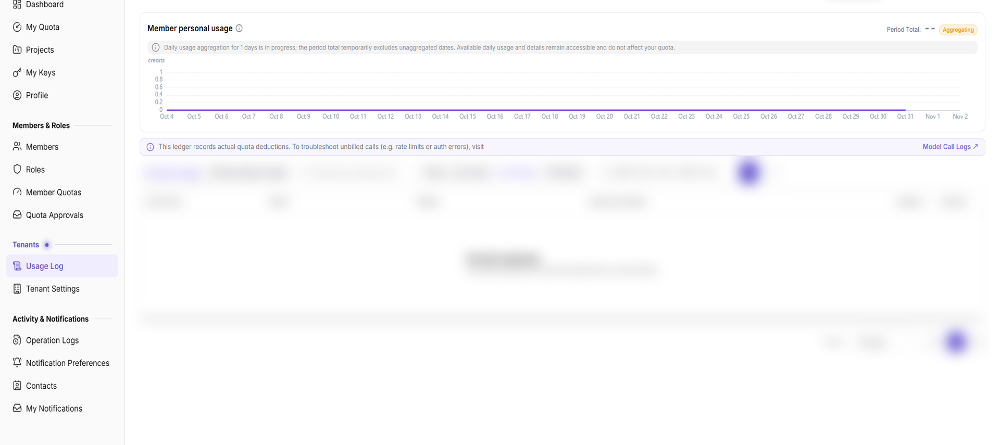

# Usage Log

::: info Document Information
Version: v2.2
Updated: 2026-11-12
:::

## Feature Overview

| Item | Content |
| --- | --- |
| Applicable Role | Model Consumer |
| Navigation path | Settings > Tenants > Usage Log |
| Page route | `/user/user-space/usage-log` |
| Managed objects | Quota usage events and their read-only details |

#### Beginner Explanation

Choose the time and usage scope, query or refresh the list, and inspect the target event and its details.

#### Terms Quick Reference

| Term | Description |
| --- | --- |
| Usage Log | Read-only records of quota usage events. |
| Status | The event processing result, when shown on the current page. |
| Action entry | A visible button, row action, or details entry. |

## Prerequisites

1. The current End User account can access the `Usage Log` entry under Settings.
2. The account has at least one visible quota usage event, or the page is available for an empty-state check.
3. Do not copy or record real API Keys, caller identifiers, project names, subjects, or request details.

## Page Description

The filter bar provides `Start time`, `End time`, `User ID`, and `API Key` fields, together with `Search`, `Reset`, and `Expand` controls.

The table contains:

| Field | Description |
| --- | --- |
| Event Time | Time when the usage event occurred. |
| Caller | Caller identity shown for the event. |
| API Key | The masked or abbreviated Key associated with the event. |
| Project | Project context, when applicable. |
| Subject | Model or request subject associated with the event. |
| Requested Quota | Requested and deducted quota information. |
| Status | Processing result, such as `SUCCESS`. |
| Actions | `Detail` opens read-only event information. |

The usage audit list shows time, member, model, usage, and status. Filters define the aggregation scope.

## Main Operations

### View Quota Usage Events

1. Go to `Settings > Tenants and Settings > Quota Usage Log`.
2. Select a time range and filter by member, project, resource type, action, or result.
3. Check the target event time, quota change, object, and reason.
4. If no record is returned, check the time zone and clear combined filters. Redact quota and member data before sharing.

### View Quota Usage Event Details

1. Click **"Detail"** for the target event.
2. Compare quota before, change amount, quota after, and the related object.
3. Check for a reversal or subsequent adjustment near the same time.
4. If the change cannot be explained, escalate with a redacted event ID and time range. Do not modify quota directly.

## Parameter Quick Reference

| Field Name | Required | Field Type | Example | Description |
| --- | --- | --- | --- | --- |
| Time range | Query criterion | Time option | `Last 7 days` | Queries events within the selected time range. |
| Usage scope | Query criterion | Scope option | `My usage` | Queries the usage scope visible to the current account. |
| Action entry | Page action | Button | `Refresh`, `Detail` | Refreshes the list or opens event details. |
| Usage | Displayed | Displayed value | As shown on the page | Used to review the target event usage, not to edit it here. |

## Pitfalls

- Use this audit view for read-only queries, not quota or billing changes. Available actions depend on the current account and page state.
- A masked or abbreviated API Key is still sensitive. Do not copy it into documentation or tickets.
- Empty results may reflect the selected time range, account scope, or a lack of usage events.

## Result Validation

| Check Item | Success Signal | If Abnormal |
| --- | --- | --- |
| Page is accessible | `Usage Log` opens from the visible Settings menu. | Check account permission and menu visibility. |
| Filters work | `Search` refreshes the list and `Reset` clears the criteria. | Clear criteria and retry. |
| Event fields display | Event time, caller, API Key, project, subject, requested quota, status, and actions are visible. | Check whether the account has visible usage events. |
| Detail is read-only | `Detail` opens event information without a save or submit action. | Close the view and report the restriction. |

## FAQ

#### Why is the target Usage Log missing from the list?

**Symptom:**

The target Usage Log is not shown after the page is opened.

**Possible causes:**

The query is limited by its time and usage scope. Check whether the target event is within the selected scope.

**Resolution:**

Check the visible time and usage scope, refresh the list, and review the target event.

#### Which review actions are available on the current page?

**Symptom:**

A usage event needs review; the current page shows query, refresh, and `Detail` entry points.

**Possible causes:**

This is a usage-event query page. No edit, save, or submit controls were visible in the observed account state.

**Resolution:**

Use the time and usage scope available to the current account, refresh the list, and inspect the event details. Do not change quota or ledger records here.

#### How should unbilled calls be investigated?

**Symptom:**

An unbilled call, such as a rate-limit block or authentication error, needs investigation.

**Possible causes:**

The page states that this ledger records actual quota deductions.

**Resolution:**

Use the visible `Model Call Logs` entry to investigate unbilled calls. Use this page to query and review usage ledger records.

## Notes

- This page was added to the End User Settings menu in the Demo verification.
- The documentation screenshot masks all event records and identity values while retaining filter and column labels.

## Next Steps

1. Return to this page, verify the time and usage scope, and refresh the list.
2. For further event review, use the currently visible `Detail` entry.

Related pages: [Tenant Settings](../org-settings/)、[Member Quotas](../../members-roles/member-quotas/)
