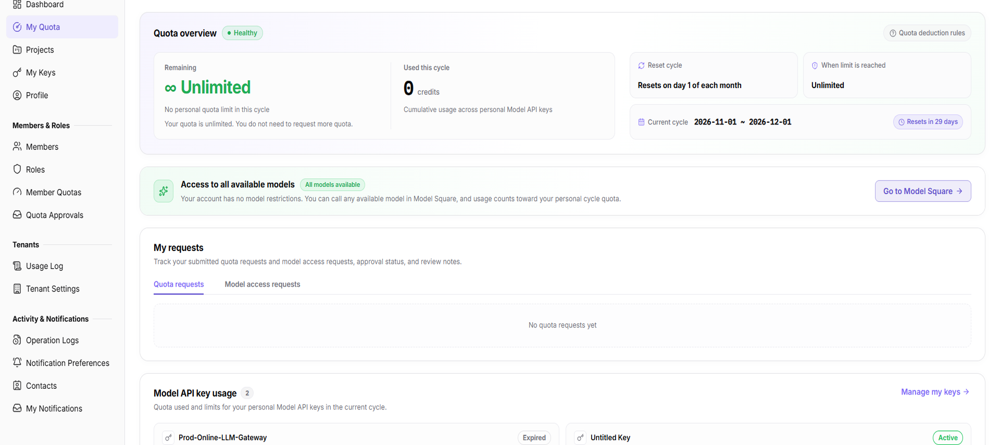

# My Quota

::: info Document Information
Version: v2.0
Updated: 2026-11-04
:::

## Feature Overview

| Item | Content |
| --- | --- |
| Applicable Role | Model Consumer |
| Navigation path | Settings > Personal > My Quota |
| Page route | `/user/user-space/my-quota` |
| Managed objects | Personal cycle quota, reset cycle, used quota, model access scope, quota/model permission requests, and Model API Key usage |

#### Beginner Explanation

My Quota shows the current account's personal quota, used amount, reset time, model access scope, and related quota requests, model permission requests, and Model API Key usage.

#### Terms Quick Reference

| Term | Description |
| --- | --- |
| Personal cycle quota | The quota available to the account in one cycle. It is controlled by the member quota policy. |
| Reset cycle | The cycle in which quota is recalculated. The page shows the current cycle and next reset time. |
| Model access scope | The models the account can call. It can be all models or a specified set. |
| Quota request | A request to increase quota. The approval result is shown here. |
| Model permission request | A request to access a specific model. |

## Prerequisites

1. The current account can open `Settings > Personal > My Quota`.
2. Before viewing quota or submitting a request, you have confirmed the current tenant and personal account.
3. Before submitting a request, you have confirmed the required quota, purpose, and approver.

## Page Description

The page shows a quota overview at the top, followed by model access scope, my requests, Model API Key usage, and quota change history.

My Quota shows the quota overview and reset cycle, followed by model access scope, my requests, Model API Key usage, and quota change history.

| Area | Description |
| --- | --- |
| Quota overview | Shows quota status, remaining quota, used amount, reset cycle, over-limit behavior, and current cycle. |
| Model access scope | Shows all models or the allowed model list and provides `Go to Model Marketplace`. |
| My requests | Contains the `Quota Requests` and `Model Permission Requests` tabs. |
| Model API Key usage | Shows personal Model API Key consumption and limits for the current cycle and provides `Manage My Keys`. |
| Quota change history | Shows quota allocation, adjustment, approved requests, and cycle resets. |

## Main Operations

### View the Quota Overview

1. Go to `Settings > Personal > My Quota`.
2. Review the quota status, remaining quota, used amount, reset cycle, and current cycle.
3. Click `Quota Deduction Rules` to review how quota is deducted.
4. If quota is insufficient, click `Request Quota`. If quota is unlimited, the page states that no request is needed.

### View Model Access Scope

1. Confirm the current scope in the All Models Available area.
2. If the scope is limited, review the allowed model list.
3. To call a new model, click `Go to Model Marketplace` or submit a model permission request.

### View Quota and Model Permission Requests

1. In My Requests, select `Quota Requests` or `Model Permission Requests`.
2. Review the request time, quota/model, approval status, and reason.
3. If no record appears, confirm the account and tab. After submitting a request, return here to verify its status.

### View Model API Key Usage

1. In Model API Key Usage, review the Key count and used/limit for the current cycle.
2. Click `Manage My Keys` to open My Keys.
3. Compare Key names, status, and used quota to decide whether to adjust Key limits or request more quota.

### View Quota Change History

1. Review quota allocation, adjustment, approved requests, and cycle resets in Quota Change History.
2. If there are no records, the page shows “No quota changes”.
3. To investigate differences, compare Member Quotas, My Keys, and Operation Logs.

## Parameter Quick Reference

| Field Name | Required | Field Type | Example | Description |
| --- | --- | --- | --- | --- |
| Quota status | System-generated | Enum | Sufficient | Health status of the current cycle quota. |
| Remaining quota | System-generated | Quota | Unlimited | Remaining quota in the current cycle. |
| Used this cycle | System-generated | Quota | `0 credits` | Personal Model API Key consumption. |
| Reset cycle | System-generated | Enum | Reset on the 1st of each month | Cycle in which quota is recalculated. |
| Over-limit behavior | System-generated | Enum | Unlimited | Behavior after reaching the limit. |
| Current cycle | System-generated | Date range | 2026-11-01 ~ 2026-12-01 | Current quota cycle. |
| Model access scope | System-generated | Text | All models available | Models available to the current account. |
| Request status | System-generated | Enum | Pending approval | Status of a quota or model permission request. |

## Pitfalls

- “Unlimited” means there is no personal quota limit in the current cycle. It does not remove other platform quotas or model permissions.
- Remaining and used quota are calculated per cycle and reset at the next cycle.
- Quota requests and model permission requests are separate records shown in different tabs.
- Model API Key usage covers personal Keys only, not Project Keys.
- Hide accounts, quota values, Key names, and request reasons before screenshots or sharing.

## Result Validation

| Check Item | Success Signal | If Abnormal |
| --- | --- | --- |
| Quota overview | Status, remaining, used, reset cycle, and current cycle display normally. | Refresh the page; if still empty, check account permission. |
| Model scope | All models or the allowed model list is shown. | Check model permission requests and tenant policy. |
| Request records | The selected tab shows the corresponding requests. | Confirm the tab and account; an empty state is normal. |
| Key usage | Key count and used/limit display normally. | Open My Keys and check Key status and limits. |

## FAQ

#### Why is the quota shown as unlimited?

**Symptom:**

Remaining quota and over-limit behavior both show “Unlimited”.

**Possible cause:**

The current member quota policy has no personal quota limit.

**Resolution:**

No quota increase request is needed. Still review platform or project-level quota limits.

#### Why is a quota request missing after submission?

**Symptom:**

After submission, Quota Requests is still empty.

**Possible cause:**

Submission failed, the current tab is not Quota Requests, or the account context is different.

**Resolution:**

Confirm the submission message and current account, switch tabs and refresh. If it is still missing, submit again or contact an administrator.

## Notes

- Quota and model permissions are controlled by tenant policy and cannot be bypassed from this page.
- Do not include passwords, complete Keys, internal addresses, or customer-sensitive information in a request reason.
- Quota data changes by cycle; keep the current cycle visible in screenshots.
- Do not write real accounts, quota values, Key names, or request reasons into documentation or screenshots.

## Next Steps

1. To manage personal Keys, go to [My Keys](../my-keys/).
2. To view member quotas, go to [Member Quotas](../../members-roles/member-quotas/).
