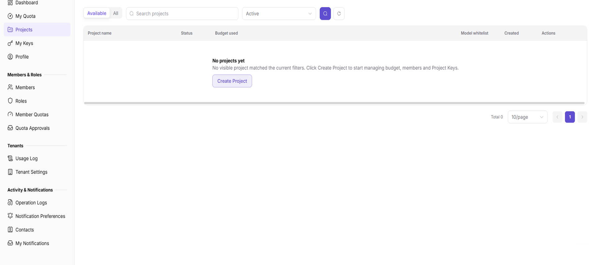
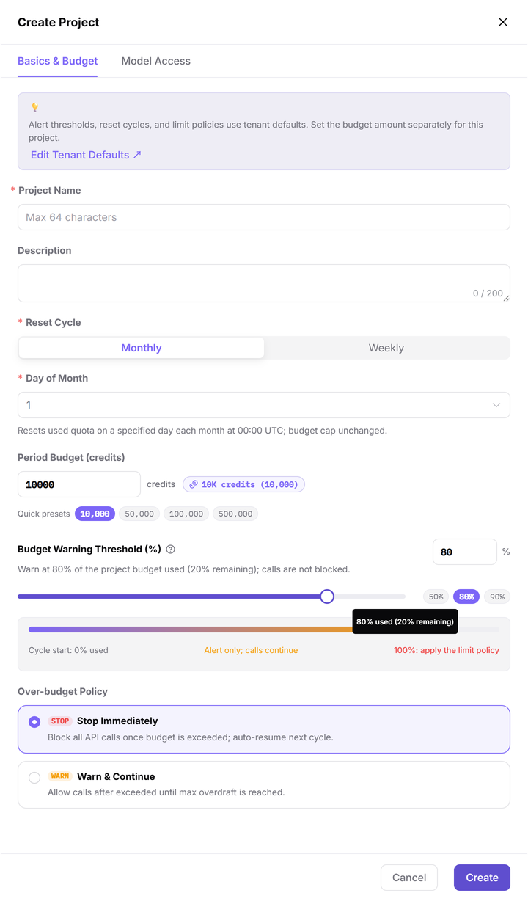
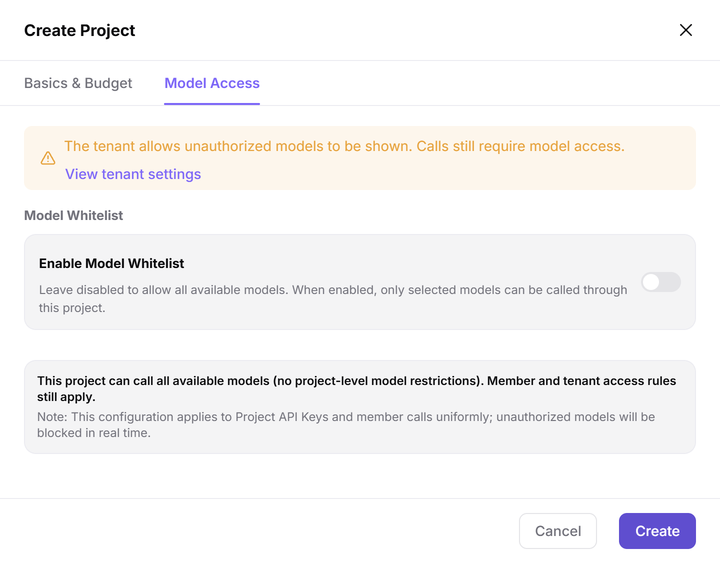
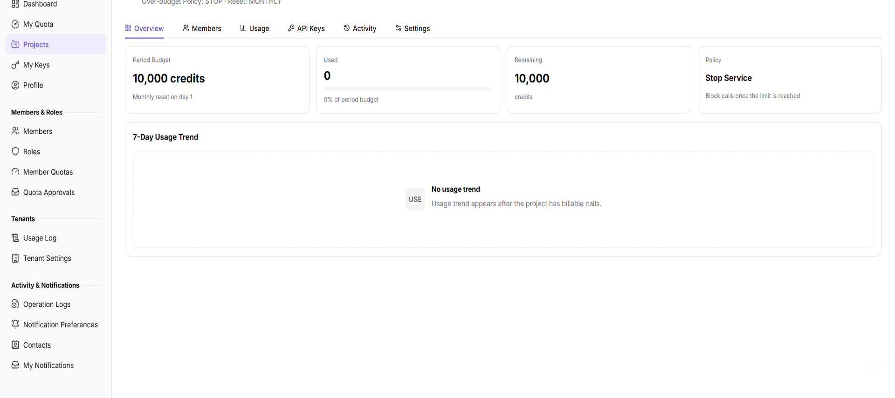

# Projects

::: info Document Information
Version: v2.2
Updated: 2026-11-16
:::

## Feature Overview

| Item | Content |
| --- | --- |
| Applicable Role | Model Consumer |
| Navigation Path | Settings > Personal > Projects |
| Page Route | `/user/user-space/projects` |
| Managed Object | Projects, project status, budget usage, creation time, and project details |

#### Beginner Explanation

Projects is the project ledger for a provider account. It shows project names, budgets, model counts, and member ownership, and helps determine whether a call failed because of project status or budget.

#### Terms Quick Reference

| Term | Description |
| --- | --- |
| Project | A business workspace for model calls, budgets, and member collaboration. Confirm project ownership before creation or troubleshooting. |
| Project budget | The quota or amount limit available to a project. Reaching it can block calls. |
| Model count | The models associated with or available to a project. Check model authorization when it is unexpected. |
| Member | An account that collaborates in a project. Verify the member role for permission problems. |

## Prerequisites

1. The current account has permission to view projects.
2. Before creating a project, you have defined the project name, budget cycle, and over-budget policy.
3. If a model allowlist is enabled, you have defined which models can be called.

## Page Description

| Area | Description |
| --- | --- |
| Top action | `Create Project` |
| Filters | Search projects and availability status |
| Table columns | Project name, status, budget used, creation time, and actions |
| Row actions | View and Archive |
| Detail tabs | Overview, Members, Usage, API Keys, Activity, and Settings |

## Main Operations

### View Projects

1. Go to `Settings > Personal > Projects`.
2. Filter by the `Available` / `All` scope, the search box, and status.
3. Review project name, status, budget usage, model allowlist, and creation time.
4. If no record appears, click `Reset` and confirm the current tenant. Redact project information before sharing.

The project list shows project name, status, budget usage, model allowlist, and creation time. An empty list shows the empty state and create entry.

### Create a Project

1. Click `Create Project` in the upper-right corner.
2. Use `Basics & Budget` for project name, description, reset cycle, period budget, warning threshold, and over-budget policy; open `Model Access` to review the model whitelist. During a read-only review, leave initial values unchanged, do not toggle the whitelist, and use `Cancel` to return to the list.
3. Confirm the member scope and quota impact, then click `Create`.
4. Return to the list and verify the new project. If it fails, check name uniqueness, required fields, and quota limits.

The figure shows the complete Basics & Budget tab of the Create Project drawer, including the title, name, description, cycle, budget, warning, STOP/WARN options, and footer. The 10,000-credit budget, 80% warning, and monthly cycle are untouched form examples, not recommendations or a created project.

The figure shows Model Access in the same empty drawer, with the whitelist disabled and the complete scope help, member/tenant restrictions, and Cancel/Create footer. Help text is not proof of actual API access or enforcement.

### View Project Details

1. Click `View` on the target project.
2. Switch between `Overview`, `Members`, `Usage`, `API Keys`, `Activity`, and `Settings`.
3. Review budget, remaining credits, members, model allowlist, and status.
4. During read-only validation, do not change budgets, members, or Key configuration.

Project details include Overview, Members, Usage, API Keys, Activity, and Settings tabs. Review budget, members, model allowlist, and status.

## Parameter Quick Reference

#### Query and Filters

This group is for queries and filters only. An em dash means the source does not specify required status, type, or example; it is not a backend rule. Grouped controls list their conditions in the Description column.

| Field Name | Required | Field Type | Example | Description |
| --- | --- | --- | --- | --- |
| Filters | — | — | — | Search projects and availability status |

#### Existing Configuration and Result Fields

| Field Name | Required | Field Type | Example | Description |
| --- | --- | --- | --- | --- |
| Project name | Marked required in current form | Text | `Example Project A` | Identifies the project; only the visible required marker was checked, not server-side submission validation. |
| Budget | No | Credits | `10,000 Credits` | Limits the credits available to the project. |
| Model count | System-generated | Number | `5` | Shows the number of models associated with the project. |
| Project status | System-generated | Enum | `Enabled` | Indicates whether the project can continue to be used. |
| Members | System-generated | List | `Example Member A` | Shows the members included in the project scope. |

## Pitfalls

- Do not change roles, members, login policies, Keys, or API rate-control rules without confirming the affected users and systems.
- UI entries can differ by role and tenant scope; verify the current account context before troubleshooting.
- Never copy complete Keys, AK/SK, tokens, or secrets into documentation, tickets, or screenshots.

## Result Validation

| Check Item | Success Signal | If Abnormal |
| --- | --- | --- |
| Project created | The new project appears in the list. | Refresh the list and check the creation result message. |
| Complete details | Project details show budget, remaining credits, policies, and trends. | Reopen project details and confirm view permission. |
| Tabs | Members, Usage, API Keys, Activity, and Settings can be selected. | Check the project role and page loading status. |

## FAQ

#### Calls fail after a project reaches its budget

**Symptom:**

Project calls are blocked or report insufficient quota.

**Possible cause:**

- The over-budget policy is `STOP`.
- The cycle budget is exhausted.
- The next reset time has not arrived.

**Resolution:**

1. Open project details and review budget usage.
2. Adjust the budget or policy when authorized.
3. Confirm that the project Key is still enabled.

#### Why is a target project missing from the list?

**Symptom:**

The expected project is absent, or only some projects are shown.

**Possible cause:**

The current account is not a project member, the project is disabled or belongs to another tenant, or name and status filters limit the list.

**Resolution:**

Clear filters and query again. Confirm the current tenant and project membership. If it is still missing, ask the project administrator to check project status and authorization.

#### Why are Create Project or Settings unavailable?

**Symptom:**

The project list is visible, but Create Project, Edit Budget, Configure Members, or Manage API Keys cannot be selected.

**Possible cause:**

The current account is not a project administrator, the tenant disables self-service project creation, or the project is disabled or frozen.

**Resolution:**

Verify the project role and tenant project policy. Ask a project or tenant administrator to make the change, then verify it in project details.

## Notes

- `Archive` affects later project use. Confirm that the project no longer serves calls before archiving it.
- Do not include customer-sensitive information in a project name or description.

## Next Steps

1. Maintain members and API Keys in project details.
2. Review project usage and activity.
3. Adjust budget, allowlist, and over-budget policy when required.

Related pages: [My Keys](../my-keys/)、[Members](../../members-roles/team-members/)
