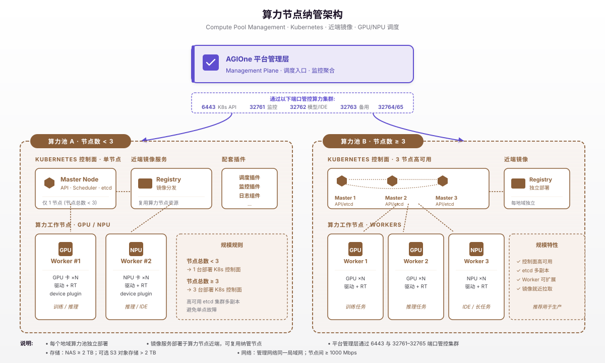

# 部署综述

## 前言

本文用于申请部署资源和制定验收计划。**新部署推荐通过 [ClusterD 安装 AGIOne](./clusterd-agione-best-practices)**。命令行安装文档保留用于既有交付，不要将其节点分工、磁盘要求或中间件参数套用到 ClusterD。

## 阅读路径

| 阶段 | 你需要决定什么 | 准备结果 |
| --- | --- | --- |
| 1. 选拓扑 | 要部署几台 AGIOne 节点？是否要求节点故障时继续服务？ | 确定单节点、主备或企业级高可用 |
| 2. 申请资源 | ClusterD 和 AGIOne 是否同机？目标节点有哪些磁盘？ | 形成主机、磁盘与可用容量清单 |
| 3. 规划网络与资源来源 | 安装人员、节点和业务用户从哪里访问？选择在线还是离线？ | 形成 SSH、网段、入口、证书和交付包清单 |
| 4. 安装并验收 | 需要安装平台、纳管算力，还是配置已装好的平台？ | 打开下方对应的操作指南 |

## 术语速查

| 术语 | 说明 |
| --- | --- |
| ClusterD 控制端 | 运行部署向导、保存任务和交付资源的主机；可与 AGIOne 目标节点同机 |
| AGIOne 目标节点 | 实际运行平台服务及其 Kubernetes 和中间件的机器；拓扑中的节点数只统计这些机器 |
| 算力节点 | 提供 GPU / NPU 等算力的机器；纳管是独立流程，不计入 AGIOne 平台拓扑 |
| 数据根 | AGIOne 持久化数据的统一入口，默认 `/var/lib/agione/local-path`；目录名本身不能证明数据在独立盘 |
| 预检 | 按本次部署的版本、节点、拓扑和服务检查条件；满足单机下限不等于能够部署所选拓扑 |

## 1. 概述

AGIOne 平台安装和算力纳管是两项不同任务，可以分别准备资源和验收：

| 任务 | 何时执行 | 操作指南 |
| --- | --- | --- |
| 安装 AGIOne | 需要新的平台或控制台 | [安装 AGIOne](./clusterd-agione-best-practices)；控制端尚未就绪时，先看 [ClusterD 安装、升级与卸载](./clusterd/) |
| 纳管算力 | 要接入 GPU / NPU，用于训练、推理、IDE 等负载 | [纳管前准备](./deployment-requirements-for-managing-compute-nodes) → [安装算力](./quick-install-with-agione-clusterd) |
| 部署后配置 | 平台已安装，准备开通业务 | [运营版](./post-deployment/operation-edition) 或 [企业自用版](./post-deployment/enterprise-internal-edition) |

## 2. 选择 AGIOne 拓扑

公有云、私有云与 IDC 是**主机所在环境**；单节点、主备和企业级高可用才是 ClusterD 的**部署拓扑**。在公有云上部署不代表要采购托管数据库，也不代表默认获得高可用。

| 向导拓扑 | AGIOne 目标节点数 | 适用场景与限制 |
| --- | --- | --- |
| All in One（单节点） | 1 | PoC、演示或功能验证。平台服务和中间件同机；主机故障会影响整套服务。 |
| 主备模式 | 2 | 需要数据库主备、能接受受控手动切换的环境。控制面仍为单点，不能当作全栈高可用。 |
| 企业级高可用 | 至少 3 | 需要降低单节点故障影响的生产环境。当前 3–4 台生成 3 个控制面节点，5 台及以上生成 5 个；以向导预览为准。 |

高可用还取决于故障域、剩余节点容量、存储、入口和切换方式。生产交付应按选定版本验证节点故障后的服务可用性；不要仅凭节点数量承诺可用性。

## 3. 规划主机资源

| 检查项 | ClusterD 控制端 | AGIOne 目标节点（逐台） |
| --- | --- | --- |
| 系统和架构 | Ubuntu 22.04；按控制端的 x86_64 或 ARM64 选择已发布的 ClusterD 包 | Ubuntu 22.04；同一集群使用相同 CPU 架构，目标架构必须有配套的安装资源 |
| CPU / 内存 | 为控制端服务、解压与资源处理留出余量；同机部署时额外计入目标节点负载 | 每台至少 **8 vCPU / 12 GiB**；**16 GiB** 是节点内存建议起点，仍需通过本次服务和副本的调度容量检查 |
| 系统与交付资源盘 | 下载包、解压目录、ClusterD 数据和离线资源分别计入空间预算 | 为操作系统、系统日志和部署临时文件预留空间；不能用 AGIOne 数据盘容量替代 |
| AGIOne 数据盘 | 仅控制端不需要准备 AGIOne 数据盘；同机部署时也必须规划目标节点存储 | 首次正常安装每台至少 **160 GiB**，空盘看整盘容量，复用文件系统看可用容量；详见下一节 |
| 权限 | 安装 ClusterD 需要 root 或 sudo | 准备每台机器的唯一名称、私网 IP、SSH 端口、账户和认证方式；目标节点账户需能执行安装所需的提权操作 |

**不要按预检下限定生产规格。** 预检还会按拓扑和服务副本检查 CPU、内存及 Pod 调度容量；正式规格应为数据增长、请求量和故障切换保留余量。[安装指南的单节点离线示例](./clusterd-agione-best-practices)使用 16 vCPU / 32 GiB、100 GiB 系统盘和 200 GiB 独立空盘，这是一组实测配置，不是所有部署的最低或推荐规格。

## 4. 规划存储

### 4.1 AGIOne 节点存储

| 存储方式 | 准备要求 | 注意事项 |
| --- | --- | --- |
| 初始化独立空盘 | 每台节点准备符合探测条件的整块空盘，至少 **160 GiB 总容量** | 不是分区或系统盘；不能已有数据、分区、文件系统或挂载。授权初始化前逐台核对设备。 |
| 复用已有文件系统 | 每台节点选择符合探测条件的挂载文件系统，至少 **160 GiB 可用容量**，为 AGIOne 准备专用目录 | 例如复用挂载在 `/data` 的数据盘；不要把该盘按空盘初始化，也不要只看云盘标称容量。 |
| 日志存储 | 单独选择本地归档或 NFS 共享归档 | 选择 AGIOne 数据盘并不会自动迁移日志。NFS 归档需提前确认归档节点能挂载且可写。 |

优先使用独立于系统盘的存储。同机部署仍需分别核算 ClusterD 数据与 AGIOne 数据；安装完成后，用实际挂载源验证数据盘位置。

### 4.2 ClusterD 控制端空间

离线部署会检查 **ClusterD 数据目录所在文件系统**的可用空间：当前正常安装中，1–2 个目标节点至少 **4 GiB**，3 个及以上至少 **12 GiB**。这是部署预检的剩余空间下限，**不包含**下载包、解压和已占用的资源，也不是系统盘采购规格。默认数据目录为 `/var/lib/agione-clusterd`，有自定义时按实际路径核算。

## 5. 选择安装资源和中间件

- **离线安装**：为目标架构准备同一发布版本的离线资源及清单。在完全离线环境中，提前传入发布包、可信 SHA-256 和系统依赖。按 [安装 AGIOne](./clusterd-agione-best-practices) 校验外层压缩包和包内文件，确认向导中的离线资源就绪。
- **在线安装**：先通过向导的发布源连通性与目标架构资源检查。浏览器能上网不代表控制端和目标节点可以拉取资源。
- **中间件**：ClusterD 的推荐路径按拓扑部署版本配套的中间件，不把阿里云或华为云托管服务作为所需资源。“On-Cloud”是业务服务组，不是云托管中间件选项。不要用可连通的外部数据库或其他产品替换交付组件，并将其视为受支持配置。

云托管中间件的历史兼容范围见 [命令行兼容性参考](#_5-1-2-数据库与中间件)，不适用于 ClusterD。

## 6. 规划网络和访问入口

| 通信方向 | 协议 / 端口 | 准备要求 |
| --- | --- | --- |
| 安装人员 → ClusterD | TCP `18093`（默认 HTTP） | 仅向可信运维网络开放 |
| ClusterD → AGIOne 目标节点 | SSH TCP `22`（默认）或实际配置端口 | 确认控制端可通过私网直连或配置的跳板机访问每台节点 |
| AGIOne 节点 ↔ 节点 | 按当前版本和拓扑放行集群内部通信 | 规划私网互通及防火墙规则；中间件和内部 Kubernetes 端口不向公网开放 |
| 用户 → AGIOne | HTTPS TCP `18090`（默认）；HTTP TCP `18091`（仅在启用时） | 放行实际监听端口，以部署详情给出的地址为准；生产若使用域名或外部负载均衡，另行验收 DNS、TLS 和健康检查 |
| AGIOne → 算力集群 | Kubernetes API、配置的算力服务端口 | 仅在需要纳管时放行；详见 [纳管前准备](./deployment-requirements-for-managing-compute-nodes) |

规划 Pod CIDR、Service CIDR 时，避免与节点私网、VPC、VPN 和已有网络重叠。NodePort 是集群内部配置，不等于 AGIOne 对用户的访问端口。在线拉取资源须验证实际需要出站访问的网络，离线安装不因节点没有互联网访问而要求额外开通公网。

## 7. 算力节点纳管

### 7.1 设计原则

- 每个独立的**地域算力池**作为一个逻辑单元独立部署，避免跨地域调度带来的网络抖动。
- 每个地域算力池在算力节点近端部署**镜像服务**，可复用已纳管的节点资源。
- 部署 Kubernetes 集群以及配套调度、监控等插件。

### 7.2 Kubernetes 控制面规模

节点要求：

| 算力池节点总数 | Kubernetes 控制面节点数 | 说明 |
|---|---|---|
| < 3 节点 | **1 节点** | 单点控制面，适用于小规模算力池 |
| ≥ 3 节点 | **3 节点** | 高可用控制面，etcd 集群多副本 |

存储要求：

- 需要至少 2 TB NAS 存储。
- (可选)：支持 S3 协议的对象存储，容量大于 2 TB。

网络要求：

- 管理网络必须在同一个局域网。
- 节点间网络带宽要求 >= 1000 Mbps。
- (可选)互联网网络要求：所有节点均能访问互联网。

### 7.3 架构示意

### 7.4 端口对外暴露

每个算力集群通过 NodePort 形式暴露以下端口给平台管理层调用：

| 端口 | 用途 |
|---|---|
| 6443 | Kubernetes API Server |
| 32761 | 监控接口 |
| 32762 | 模型及 IDE 调用端口 |
| 32763 | 拓展备用端口 |
| 32764 | 拓展备用端口 |
| 32765 | 拓展备用端口 |

### 7.5 部署说明

- 算力节点应预先安装并校验 GPU / NPU 驱动、容器运行时（containerd 等）及对应的 device plugin。
- 镜像服务建议与算力节点位于同一二层或低延迟网络中，加速大体积模型镜像的拉取。
- 多地域部署时，建议每个地域独立维护一套近端镜像，避免跨地域拉取镜像。

## 8. 部署前检查清单

- [ ] 已选定 AGIOne 拓扑与节点数，并保存每台机器的架构、系统、CPU、内存和 SSH 信息。
- [ ] 已分别核算 ClusterD 下载、解压、数据及离线预检空间和每台 AGIOne 节点的数据盘空间。
- [ ] 已确定每台节点使用独立空盘还是复用文件系统；有数据的盘不会被当作空盘初始化。
- [ ] 控制端可 SSH 到所有节点，节点私网互通且时钟已同步；Pod 和 Service 网段无冲突。
- [ ] 已按在线或离线方式确认本次发布资源，目标架构匹配；离线交付已准备可信校验值。
- [ ] 已规划 AGIOne 入口、DNS、证书及日志位置；需要纳管算力时另行确认驱动、网络与存储。
- [ ] 安装时使用实际配置执行预检；有技术阻断先修复，再用同一份配置预检后执行安装。

准备完成后，进入 [安装 AGIOne](./clusterd-agione-best-practices)。

## 附录：命令行兼容性参考（停用中）

以下矩阵只适用于调用 `./agione install` 的既有交付，不作为 ClusterD 的兼容范围。

### 数据库与中间件 {#_5-1-2-数据库与中间件}

通用托管中间件基线要求如下：

| 组件 | 用途 | CPU | 内存 | 磁盘 | 节点数 | 网络要求 |
|---|---|---|---|---|---|---|
| **RDS（MySQL 系关系型数据库）** | 存储 AGIOne 平台主数据 | ≥ 4 vCPU | ≥ 16 GiB | ≥ 100 GiB | 按已验证产品形态 | 与管理节点同 VPC |
| **Nacos** | 服务注册与发现 | Basic 规格 | — | — | 1 | 与管理节点同 VPC |
| **Redis（缓存）** | 缓存数据 | Basic 规格 | — | — | 1 | 与管理节点同 VPC |
| **Kafka（消息）** | 核心服务消息总线 | 集群节点规格 | — | ≥ 100 GiB | ≥ 3 | 与管理节点同 VPC |
| **对象存储** | 存储图片等静态资源 | — | — | — | — | 通过 AK/SK 网络访问 |
| **入口负载均衡（项目级验收）** | AGIOne API 负载均衡 | — | — | — | 1 | 后端与管理节点私网互通；公网可访问，≥ 100 Mbps |

下面的兼容矩阵仅记录命令行安装已验证的云中间件范围。正式采购前还需在客户目标区域确认可用规格、可用区、计费方式和账号权限。

> **兼容性硬边界**：数据库仅支持 MySQL 协议和 SQL 生态，但这不代表所有 MySQL 兼容数据库都已支持。当前只验证了下表中的阿里云 RDS MariaDB `10.3` 和华为云 RDS MariaDB `10.11`。标准 MySQL 的其他版本、其他 MariaDB 版本，以及达梦（DM）、人大金仓、GaussDB、openGauss、OceanBase（包括 MySQL 兼容模式）、TiDB、PostgreSQL、Oracle、SQL Server 等均不在支持范围。任何未列出的云厂商、产品、版本、实例形态或访问协议，在完成同版本端到端兼容性测试并更新本文前，一律按**不支持**处理。仅端口连通或登录成功不能作为兼容性证明。

**阿里云托管中间件清单**

| AGIOne 组件 | 已验证阿里云产品 | 已验证版本 / 形态 | 必要交付约束 | 支持状态 |
|---|---|---|---|---|
| 数据库 | ApsaraDB RDS for MariaDB | MariaDB `10.3`；高可用版；`cloud_essd`；实测规格 `mariadb.n2.small.2c` | 使用 VPC 内网地址；安全组 / 白名单只放行应用节点；初始化账号需具备建库、建表、变更 schema 和读写权限 | 已支持，仅限此基线 |
| Redis | Tair / ApsaraDB for Redis | Redis `5.0`；`Local` 标准主从；实测规格 `redis.master.small.default` | 使用 VPC 内网地址并配置应用节点白名单；Redis `4.0`、`6.0`、`7.0`、集群版及其他产品形态未纳入本次支持范围 | 已支持，仅限此基线 |
| Nacos | Microservices Engine（MSE）Nacos | Nacos `2.0`（`NACOS_2_0_0`）；`mse_dev`；实测规格 `MSE_SC_1_2_60_c`、1 个实例 | 使用原生 Nacos API；运行账号必须具备 `agione-prod` 命名空间的配置发布和服务管理权限；其他版本、专业版或不同实例规模需重新测试 | 已支持，仅限此基线 |
| Kafka | ApsaraMQ for Kafka | 服务版本 `2.2.0`；普通版；`alikafka.hw.2xlarge`；3 broker；VPC `PLAINTEXT` | 必须使用服务返回的 VPC advertised broker；开启服务端自动建 Topic，并创建所需 Consumer Group；SASL / SSL、其他版本和 Serverless 形态未纳入本次支持范围 | 已支持，仅限此基线 |
| 对象存储 | Object Storage Service（OSS） | 云服务无独立引擎版本；Standard 私有 Bucket；内网 S3 兼容 endpoint | 必须使用 virtual-host-style 访问；禁止公开写入；运行凭据只授予目标 Bucket / 前缀所需的上传、下载、列举和删除权限 | 已支持，仅限此接入方式 |

> **阿里云权限重点**：使用可选云资源辅助脚本创建资源时，执行账号 / RAM 角色必须具备对应产品的创建、查询、白名单和服务关联角色授权能力。云资源创建身份必须与 AGIOne 运行时的数据库、Redis、Nacos、Kafka、OSS 账号和密钥分开管理。主安装器只消费最终生成的端点、端口和最小权限运行凭据，不应在主安装 YAML 中保存云账号 AK/SK。权限不足、RAM 策略未生效、服务关联角色缺失或白名单未放行时，不得开始正式安装。

**华为云托管中间件清单**

| AGIOne 组件 | 已验证华为云产品 | 已验证版本 / 形态 | 必要交付约束 | 支持状态 |
|---|---|---|---|---|
| 数据库 | RDS for MariaDB | MariaDB `10.11`；实测为单实例、`CLOUDSSD`、规格 `mariadb.n1.large.2` | 使用 VPC 内网地址；安全组只放行应用节点；账号需具备初始化库表权限。主备高可用形态尚未完成同版本端到端回归 | 已支持，仅限实测单实例基线 |
| Redis | Distributed Cache Service（DCS）for Redis | Redis `7.0`；单机形态；实测规格 `redis.single.au1.large.1`、1 GiB | 使用 VPC 内网地址并配置密码和访问策略。主备、Cluster 和其他 Redis 版本尚未完成端到端回归 | 已支持，仅限实测单机基线 |
| Nacos | Cloud Service Engine（CSE）Nacos | Nacos2，服务版本 `2.1.0.24`；规格 `cse.nacos2.c1.large.10`；RBAC | 使用原生 Nacos API；运行账号必须具备 `agione-prod` 命名空间和配置发布权限；其他 CSE 版本 / 规格未纳入支持范围 | 已支持，仅限此基线 |
| Kafka | Distributed Message Service（DMS）for Kafka | Kafka `2.7`；3 broker；产品规格 `s6.2u4g.cluster.small`；300 GiB 通用存储；`PLAINTEXT` | 使用私网 bootstrap 与 advertised broker；其他版本、SASL / SSL 或不同产品形态需重新完成兼容性测试 | 已支持，仅限此基线 |
| 对象存储 | Object Storage Service（OBS） | 云服务无独立引擎版本；私有 Bucket | 必须使用 virtual-host-style 访问；通过最小权限 AK/SK 或临时授权访问，避免公开读写 | 已支持，仅限此接入方式 |

> **入口服务边界**：阿里云 ALB、MSE 云原生网关和华为云 ELB 不属于当前托管中间件端到端兼容矩阵。需要使用时必须按项目完成 HTTPS、健康检查、会话、上传大小和长连接验收；验收完成前按不支持处理。通用 TCP 负载均衡不能替代 Kafka advertised broker 地址。
