# 安装 AGIOne

本文按“准备主机 → 安装 ClusterD → 创建账户 → 填写部署向导 → 预检 → 安装 → 验证与登录”的顺序，在一台全新主机上安装 AGIOne。ClusterD 已经可用时，从 [4. 创建账户并进入部署向导](#_4-创建账户并进入部署向导) 开始。

ClusterD 是安装时使用的网页程序，安装在控制端。安装人员在网页上填写部署参数、检查目标节点、运行预检并启动安装。说明见 [ClusterD 是什么](./clusterd-overview)。

控制端还没有 ClusterD 时，按 [快捷安装](./clusterd/#quick-install) 安装。主机要求、离线安装、升级和卸载见 [安装、升级与卸载](./clusterd/)。第 2、3 节是本例使用的安装包和命令。

| 项目 | 本文的示例与边界 |
| --- | --- |
| 本例配置 | Ubuntu 22.04.5 LTS、x86_64、16 vCPU / 32 GiB、100 GiB 系统盘、200 GiB 独立空盘 `/dev/vdb`；ClusterD 与 AGIOne 同机，单节点离线安装 |
| 验证包 | `agione-clusterd-full-release-2026.11.14-dev19-r4-linux-x86_64.tar.gz`；其他版本需重新核对字段、资源和校验值 |
| 其他方案 | 多节点、ARM64、在线安装、NAS 和复用已有文件系统的填写方法一并说明；不代表这些组合都已完成本例的实机验收 |
| 阅读方法 | 先按各节的“本例填写”走通主线，需要其他方案时再阅读分支说明 |
| 配图说明 | 本页同时使用流程示意图和页面级实机截图。截图来自 ClusterD 实际页面，敏感凭据已不进入图片；字段含义、按钮动作和完成条件以相邻文字为准 |

> **截图与验收范围：** 本页结合页面级实机截图与流程示意图。单节点安装任务和运行对账均已成功结束，最终状态见第 11 节。截图不展示账户密码；业务授权与技术部署分开验收。

::: warning 先确认目标机器和数据盘
本文的空盘示例会在安装确认后初始化 `/dev/vdb`。 **不要把示例设备名直接用于你的机器。** 如果磁盘已挂载为 `/data`，或已有文件系统、分区和业务数据，应阅读 [8.3 复用已有文件系统](#_8-3-复用已有文件系统)，不要选择空盘初始化。
:::

## 操作时间线

| 阶段 | 操作 | 何时可以继续 |
| --- | --- | --- |
| 1. 规划 | 确认架构、节点数、磁盘、SSH 和入口地址 | 目标清单与网络规划已确认 |
| 2. 安装 ClusterD | 下载、两次校验、安装、检查网页 | 服务为 `active`，网页可打开 |
| 3. 初始化 | 创建 ClusterD 账户，进入“AGIOne 部署 → 部署向导” | 看到拓扑选择页 |
| 4. 填写向导 | 拓扑 → 基础信息 → 网络规划 → 添加节点 → 选择服务 | 必填项完整，每台节点探测结果有效 |
| 5. 预检与确认 | 修复阻断项、逐项确认风险、核对破坏性范围 | 本次配置预检通过，目标节点与设备无误 |
| 6. 安装与验收 | 等待安装任务，检查节点、服务、入口和账户 | 安装成功且运行验证通过；业务登录另行确认 |
| 7. 收尾 | 保存交付记录；按需清理测试环境 | 清理范围与实际资源状态一致 |

## 术语速查

| 术语 | 通俗说明 |
| --- | --- |
| ClusterD 控制端 | 提供安装网页、保存任务与安装资源的主机，不等于 AGIOne 业务服务本身 |
| 目标节点 | 真正运行 Kubernetes、中间件和 AGIOne 的机器；可以与 ClusterD 控制端同机 |
| 拓扑 / Topology | 服务分布在哪几台机器上，以及允许哪类故障；不是界面配色或套餐名称 |
| Bundle / Manifest | Bundle 是部署资源包；Manifest 是配套的版本、文件和摘要清单，必须成套使用 |
| CPU 架构 | `x86_64` 与 `arm64` 是两类不同的处理器架构；程序和镜像必须匹配目标架构 |
| CIDR | 例如 `10.68.0.0/16` 的网段写法；Service 与 Pod 网段不能与节点和现有网络冲突 |
| NodePort | Kubernetes 在节点上预留的服务端口范围，不是 ClusterD 登录端口，也不是控制台的 HTTPS 端口 |
| 独立空盘 | 无分区、无文件系统、无挂载、无已有数据的整块磁盘；安装器可在明确授权后初始化 |
| 复用已有文件系统 | 使用已挂载磁盘上的专用目录，不格式化整块盘；例如 `/data/agione` |
| PVC / PV | 应用申请的持久存储与实际承载它的存储资源；不能通过 Pod 正常就推断数据盘放置正确 |
| NAS / NFS | 通过网络共享的存储；本文日志共享使用 NFS，不支持把 SMB/CIFS 当作同一方案 |
| Runtime verified | 已检查实际节点和服务状态，不只是安装脚本成功退出 |

## 1. 先确定部署方案

### 1.1 本例主机与访问规划

| 项目 | 本例填写或资源 | 你需要确认什么 |
| --- | --- | --- |
| 系统与架构 | Ubuntu 22.04.5 LTS、`x86_64` | 全新主机，架构与安装包、部署资源一致 |
| CPU / 内存 | 16 vCPU / 32 GiB | 这是本次验证规格，不是所有拓扑或业务负载的通用容量承诺 |
| 系统盘 | 100 GiB | 容纳系统、压缩包、解压内容、ClusterD 资源和临时文件，不能只按压缩包大小预留 |
| AGIOne 数据盘 | 200 GiB，整盘 `/dev/vdb` | 安装前为空盘；设备名按实际探测结果选择 |
| 节点名称 / 私网 IP | `node-1` / `10.10.0.11` | 文中的 IP 都是示例；必须替换为真实、唯一、可路由的地址 |
| ClusterD 网页 | `http://<ClusterD-IP>:18093/` | 仅向可信运维来源开放，不直接暴露到不受控公网 |
| AGIOne 网页 | HTTPS `18090` | 与 ClusterD 端口分开；用户访问网络、防火墙、安全组和 DNS 均需匹配 |
| SSH | `22`，通过密码或公钥连接 | ClusterD 能连到目标节点，目标节点间具备所需私网通信 |

本例在华为云主机完成验证，也可以按相同职责划分准备物理机。云主机申请、VPC、安全组和 AK/SK 管理不属于部署向导；不要把云访问密钥填到 SSH 密码、ClusterD 密码或 AGIOne 账户中。

### 1.2 分清安装目录与数据盘

| 路径 | 在哪里 | 用途 |
| --- | --- | --- |
| `/opt/clusterd-packages` | ClusterD 控制端 | 临时存放下载包与解压目录，不是运行数据根目录 |
| `/opt/agione-clusterd` | ClusterD 控制端 | ClusterD 程序与随包执行引擎 |
| `/etc/agione-clusterd` | ClusterD 控制端 | ClusterD 配置；私钥文件按交付策略受控放置 |
| `/var/lib/agione-clusterd` | ClusterD 控制端 | 账户、任务记录、缓存和离线资源等控制端数据 |
| `/var/lib/agione/local-path` | 每台 AGIOne 目标节点 | AGIOne 持久存储根；独立空盘方案将选中盘挂载到这里 |
| `/var/lib/agione/local-path/runtime` | AGIOne 目标节点 | 应用运行根，随节点存储方案派生；不是另一个 ClusterD 安装目录 |

**同机部署仍然通过 SSH 连接本机的实际节点地址。** 不能因为浏览器就在这台机器上，就把节点地址填成安装人员电脑的 `127.0.0.1`。安装 ClusterD 不会自动把 AGIOne 放到数据盘，数据盘必须在向导中单独选择并验收。

### 1.3 单节点、多节点与双架构

- 本例使用单节点。需要多节点时，每台节点都要准备独立的 SSH 资料和存储探测结果；控制端只需安装一次 ClusterD。
- ClusterD 安装包按**控制端架构**选择；向导中的 CPU 架构按**AGIOne 目标节点架构**选择。同一 AGIOne 集群的节点应使用相同架构。
- ARM64 主机要取得实际发布的 ARM64 包和配套摘要。不能只把本例下载链接中的 `x86_64` 改成 `arm64`，也不能沿用本例摘要。
- 跨架构控制端与目标节点组合，必须另有目标架构的完整资源；本例不将其视为已验收组合。正式容量与高可用规划另见 [部署综述](./agione-deployment-requirements)。

## 2. 获取并校验本例安装包

本例安装包和命令如下。其他版本的安装、升级和卸载见 [安装、升级与卸载](./clusterd/)。

**ClusterD 发布包下载页：**

[打开 AGIOne 与 ClusterD 发布包下载页]({{DOCS_RELEASE_PAGE_URL_ZH}})

下载页提供当前 ClusterD 轻量包、全量包和对应的 SHA-256 文件。本次实机验证使用的 x86_64 全量包为 `agione-clusterd-full-release-2026.11.14-dev19-r4-linux-x86_64.tar.gz`。

**该压缩包的 SHA-256：**

```text
51c07623488f10b2364474c6adcac64246b1e7735dacd3b184acf36c2a4956a2
```

这是本例实机验证使用的版本，不表示所有环境的正式生产交付版本；正式交付请以确认的发布版本与验收范围为准。使用其他包时，下载地址、文件名和可信摘要必须同时替换。

以下命令在 **ClusterD 控制端**执行。完全离线的主机先通过交付介质或 `scp` 传入同名压缩包，跳过 `curl`，其余校验仍需执行。

```bash
sudo -i
bash
set -e
mkdir -p /opt/clusterd-packages
cd /opt/clusterd-packages

CLUSTERD_PACKAGE_NAME=agione-clusterd-full-release-2026.11.14-dev19-r4-linux-x86_64.tar.gz
# 从发布包下载页复制对应的安装包 URL 和 SHA-256 值。
CLUSTERD_PACKAGE_URL="<CLUSTERD_PACKAGE_URL_FROM_DOWNLOAD_PAGE>"
CLUSTERD_PACKAGE_SHA256="<TRUSTED_OUTER_ARCHIVE_SHA256>"

curl --fail --location --output "$CLUSTERD_PACKAGE_NAME" "$CLUSTERD_PACKAGE_URL"
printf '%s  %s\n' "$CLUSTERD_PACKAGE_SHA256" "$CLUSTERD_PACKAGE_NAME" | sha256sum -c -
tar -xzf "$CLUSTERD_PACKAGE_NAME"
cd "${CLUSTERD_PACKAGE_NAME%.tar.gz}"
bash verify.sh
```

**完成条件：** 压缩包显示 `OK`，包内 `verify.sh` 整体成功退出。SHA-256 不是 MD5，也不是对刚下载文件自行计算后就可当作可信值。任一校验失败都应停止，重新核对版本与文件完整性，不要修改清单绕过校验。

## 3. 安装并打开 ClusterD

本步的目标只是让安装网页运行起来，还没有开始部署 AGIOne。首次校验仍需要系统 `python3`；全量包内置 Python 不能替代它。工具、架构检查和完整升级/卸载步骤见 [ClusterD 安装、升级与卸载](./clusterd/)。

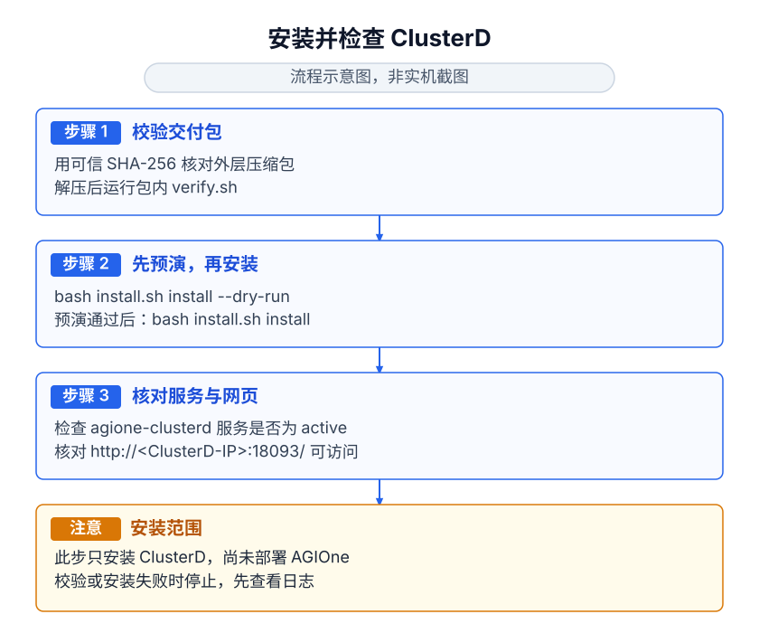

在上一步解压目录、同一个 root Bash 中执行。完整日志写到解压目录之外，避免改变包内容。

```bash
bash install.sh install --dry-run
CLUSTERD_INSTALL_LOG=/var/log/agione-clusterd-install.log
if bash install.sh install > "$CLUSTERD_INSTALL_LOG" 2>&1; then
  tail -n 20 "$CLUSTERD_INSTALL_LOG"
else
  tail -n 100 "$CLUSTERD_INSTALL_LOG"
  false
fi
systemctl is-active agione-clusterd
curl --fail --silent --show-error --output /dev/null \
  --write-out 'HTTP %{http_code}\n' http://127.0.0.1:18093/
```

**成功时：** 预演通过，正式安装显示 `agione-clusterd-install-ok`，服务为 `active`，网页返回 `HTTP 200`。浏览器打开 `http://<ClusterD-IP>:18093/`。 **失败时：** 先看上述日志；本机能打开而远端打不开时，检查监听地址、路由和安全组，不要重复安装。全量包处理多 GB 资源可能需要较长时间，应等待当前命令结束。

## 4. 创建账户并进入部署向导

首次访问的目的是创建 **ClusterD 登录账户**，它不是目标机的 SSH 账户，也不是安装完成后 AGIOne 的账户。

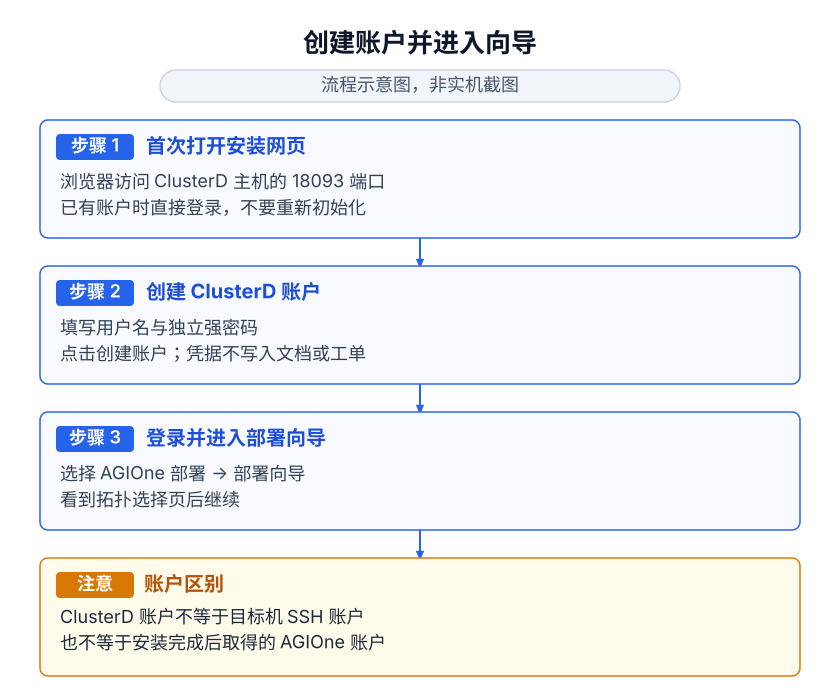

| 页面字段或动作 | 填写示例 | 含义与要求 |
| --- | --- | --- |
| 用户名 / Username | `deploy-user` | 用来登录 ClusterD；按现场账户命名规范填写 |
| 密码 / Password | 在页面输入独立强密码 | 不复用 SSH 密码，不写入文档、命令历史或工单；若页面给出长度要求，按当前校验完成 |
| 创建账户 / Create account | 首次初始化时点击 | 创建 ClusterD 登录账户，不会创建 AGIOne 集群 |
| 登录 / Login | 后续访问时点击 | 使用已经创建的同一组 ClusterD 用户名和密码 |

登录后进入 **AGIOne 部署 → 部署向导**。正常应看到拓扑选择；若仍停留登录页，先检查页面错误和账户输入，不要重新初始化已有实例。

## 5. 选择拓扑

本步决定几台机器如何组成集群。**本例选择 `All in One`，只填写一台节点。**

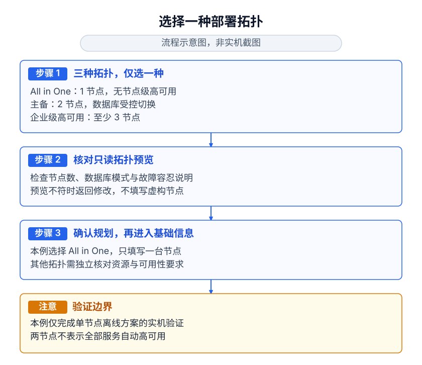

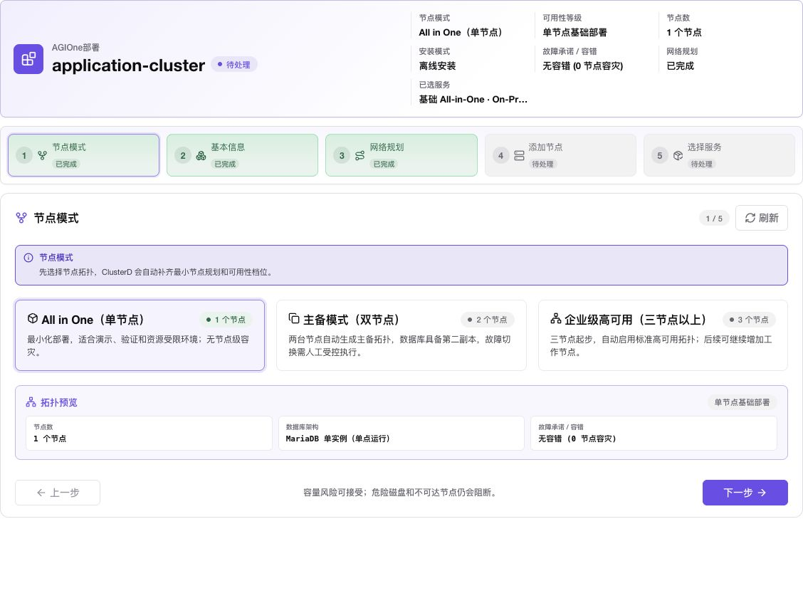

| 选项 | 节点数量 | 如何理解与选择 |
| --- | --- | --- |
| All in One / 单节点 | 1 | 用一台机器运行基础与业务服务；主机故障会影响整套服务，不具备节点级高可用 |
| 主备模式 | 2 | 生成数据库主备拓扑；故障切换需要受控操作，不等同于所有服务自动高可用 |
| 企业级高可用 | 至少 3 | 使用相应高可用拓扑；还需规划故障域、仲裁、容量与节点通信，不能只满足节点数量 |

“节点数、数据库架构、可用性与故障容忍”是拓扑自动推导的**只读结果**，不需要再找输入框填写。确认预览与目标一致，点击下一步。若单节点却预览多个核心节点，返回纠正拓扑；不要用虚构节点凑数。

## 6. 填写基础信息与安装资源

本步把“要部署什么、用哪套资源”写清楚。**本例选择 Offline install、x86_64；运行根保持自动生成值。**

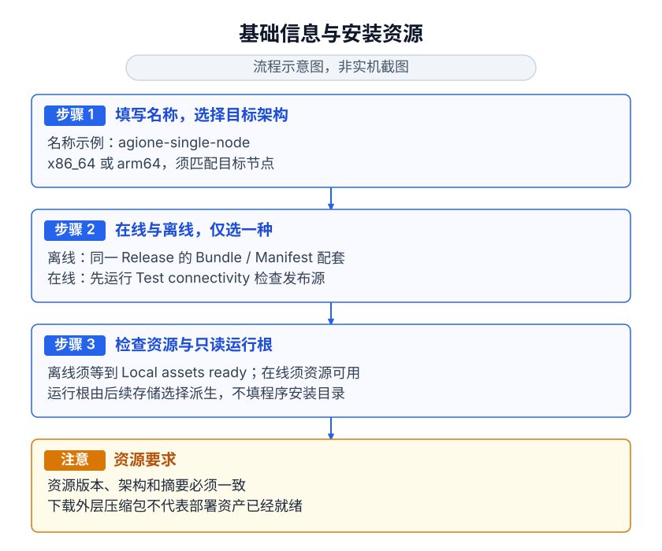

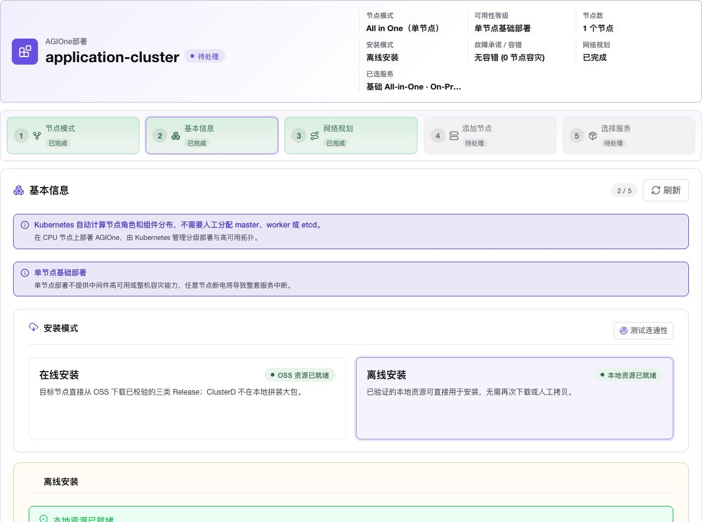

| 字段或状态 | 本例填写 / 常用示例 | 含义、条件与操作 |
| --- | --- | --- |
| 安装模式 / Install mode | `Offline install` | 离线使用控制端已经校验的本地资产；在线使用当前发布源提供的资源，不只是“机器能上网”即可 |
| 测试连通性 / Test connectivity | 在线安装前点击 | 检查发布源配置和目标架构 Release 可用性；检测中或资源不可用时，不应强行选择在线安装 |
| 离线资源状态 | 等待 `Local assets ready` | 只读状态；核对资源版本、架构、来源和校验结果，未就绪时停止并修复资源 |
| Bundle / Manifest | 需要补充资源时取得同一 Release 的配套文件 | Bundle 放资源，Manifest 说明文件和摘要；只放其中一个、混用不同版本或只改文件名都不成立 |
| 离线资源目录 | 默认 `/var/lib/agione-clusterd/offline-bundles` | 按页面显示的目录与导入说明准备资源，不要把解压目录随意复制进去当作已经导入 |
| 集群名称 / Cluster name | `application-cluster` | 标识这次部署；可按现场命名规范修改，后续确认和清理按这个名字核对 |
| 描述 / Description | `Single-node offline deployment` | 可选；写用途与环境，不写密码或云密钥 |
| CPU 架构 / Architecture | `x86_64`；ARM 目标选 `arm64` | 必须与所有目标节点和部署资源一致，不按操作浏览器的电脑架构选择 |
| 应用运行根目录 / Application runtime root | `/var/lib/agione/local-path/runtime` | 只读，由后续存储方案派生；不是让你输入 ClusterD 安装路径 |

**在线分支：** 测试连通性通过后，再确认控制端和目标执行节点能够访问资源所需地址；资源未配置、Release 缺失、签名或摘要不匹配都需要先修复。在线不意味着放开所有入站端口。

**离线分支：** 全量包默认提供与包架构匹配的资源；离线环境的系统依赖也应提前准备。状态卡片显示资产就绪后才能继续，不能用“外层压缩包已经下载成功”替代资源就绪检查。填写完成点击下一步。

## 7. 规划网络、控制台与日志

### 7.1 Kubernetes 网络

本步先避免网段冲突，再确定用户从哪里访问。下面是示例规划，不是要求所有现场照抄的固定网段。

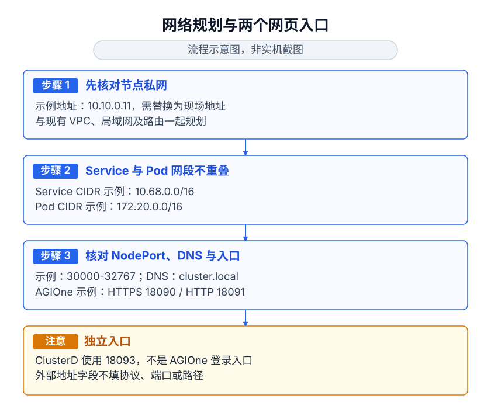

| 字段 | 示例 | 含义与填写要求 |
| --- | --- | --- |
| Service CIDR | `10.68.0.0/16` | 集群服务的虚拟 IP 网段；合法 IPv4 CIDR，不与 Pod、节点私网、VPC 或企业网络重叠 |
| Cluster / Pod CIDR | `172.20.0.0/16` | Pod 使用的网段；与 Service 和现有网络分开规划 |
| NodePort 范围 | `30000-32767` | 用 `起始端口-结束端口`；当前校验需要覆盖 `30080`、`30443`、`30500`、`30889`，且范围不少于 128 个端口 |
| 最大 Pod 数 / Max pods | `110` | 单节点可调度 Pod 数上限，页面范围为 16–250；提高数值不会增加机器实际 CPU 或内存 |
| DNS 域 / DNS domain | `cluster.local` | 集群内部服务发现域；通常保留默认，自定义需符合现场解析规划 |
| 外部访问地址 / External address | 内网可留空，或 `agione.example.com` | 用户可达的节点/入口 IP 或 DNS 主机名，不带 `https://`、端口和路径；填写 DNS 后另行配置解析 |

### 7.2 控制台协议、端口和证书

| 字段 | 本例填写 / 示例 | 含义与条件 |
| --- | --- | --- |
| 控制台访问协议 | `HTTPS` | 可选 HTTPS、HTTP、HTTP + HTTPS；正式交付优先 HTTPS |
| HTTP 端口 | `18091` | 仅 HTTP 或双协议时填写；未占用的 1–65535 端口，避开 SSH/Kubernetes 保留端口及 NodePort 范围 |
| HTTPS 端口 | `18090` | 仅 HTTPS 或双协议时填写；与 HTTP、ClusterD 等服务端口区分，并同步安全组与访问地址 |
| 明文 HTTP 风险确认 | 仅启用 HTTP 时出现 | HTTP 可能明文传输密码和令牌；理解并明确勾选后才允许继续；双协议不表示 HTTP 会自动跳转 HTTPS |
| HTTPS 证书文件 | 现场证书 `.pem` / `.crt` / `.cer` | 使用正式证书时与私钥配对上传；证书应覆盖实际访问域名/IP |
| HTTPS 私钥文件 | 对应 `.pem` / `.key` | 必须与证书匹配；不要提交到 Git、聊天或公共对象存储 |
| 证书名称 | 从文件名带入 | 仅用于识别证书；不是要粘贴私钥内容的输入框 |

本例未上传正式证书，使用安装器生成的自签名证书。若浏览器拒绝信任，应配置可信证书或由现场运维确认信任策略，不能把绕过证书警告作为正式验收。端口或证书不合法时，按页面错误修正后继续。

### 7.3 日志策略

日志配置是网络步骤中的独立区域；**本例启用日志，使用本地持久化**。日志目录需要单独核对，不能因为已选应用数据盘就假定任意日志路径也在该盘。

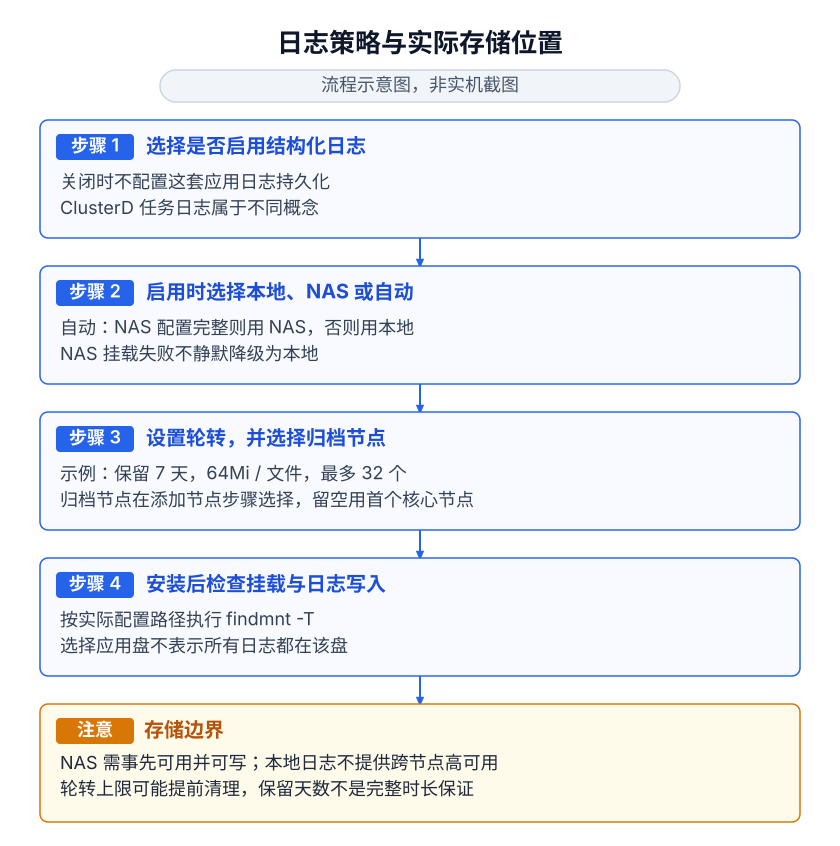

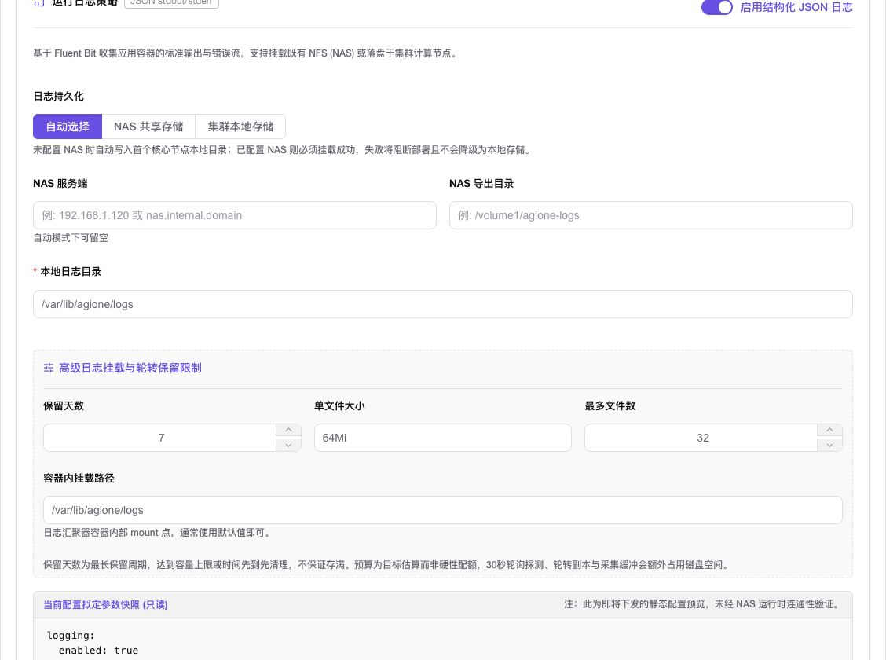

| 字段 | 示例 | 含义与条件 |
| --- | --- | --- |
| 启用结构化 JSON 日志 | 开启 | 收集容器 stdout/stderr 并附加 Kubernetes 信息；关闭时不配置这套应用日志持久化，不影响 ClusterD 自身任务日志的概念 |
| 日志持久化方式 | 自动 / NAS 共享存储 / 集群本地存储 | 自动模式未配 NAS 时使用本地归档；配置完整 NAS 时使用 NAS，挂载失败不会静默退回本地 |
| NAS 服务端 | `10.10.0.120` 或 `nas.example.com` | NAS 模式必填；填写主机名/IP，不写 `nfs://` 或 `http://` |
| NAS 导出目录 | `/volume1/agione-logs` | NAS 模式必填；已经导出并允许归档节点写入的绝对路径；自动模式下 NAS 两项成对填写或都留空 |
| 本地日志目录 | `/var/lib/agione/logs`，或经规划的 `/var/lib/agione/local-path/logs` | 本地归档时填写安全绝对路径；要把日志放数据盘，应选择盘内专用路径并验证挂载，不能填写 `/` 或系统敏感目录 |
| 本地归档节点 | 留空，或在“添加节点”步骤选 `node-1` | 留空使用首个核心节点；多节点时确认日志实际集中到哪一台，不表示每台都自动保留一份 |
| 保留天数 | `7` | 1–365 天；达到容量限制也会清理，不保证一定保留完整天数 |
| 单文件大小 | `64Mi` | 单个轮转文件大小，使用 `Ki`、`Mi` 或 `Gi` 单位，不填不带单位的 `64` |
| 最多文件数 | `32` | 1–100 个轮转文件；与保留天数共同限制，不是整个集群的磁盘配额 |
| 容器内挂载路径 | `/var/lib/agione/logs` | 自动/NAS 模式的高级项；是日志汇聚器容器内部路径，不等于宿主机挂载点；本地模式不显示 |

NAS 必须事先可用，归档节点需有 NFS 客户端、网络权限和导出目录写权限；ClusterD 不替你创建 NAS。本地日志不提供跨节点高可用。预览区域只是**拟下发配置**，不是 NAS 已可写或日志已入盘的证据。确认后点击下一步。

## 8. 添加节点并选择存储

### 8.1 SSH 连接字段

本步让 ClusterD 找到真正的目标机器。**本例一台 `node-1`，私网 IP 使用实际机器地址，关闭跳板机；认证资料现场输入，不出现在文档中。**

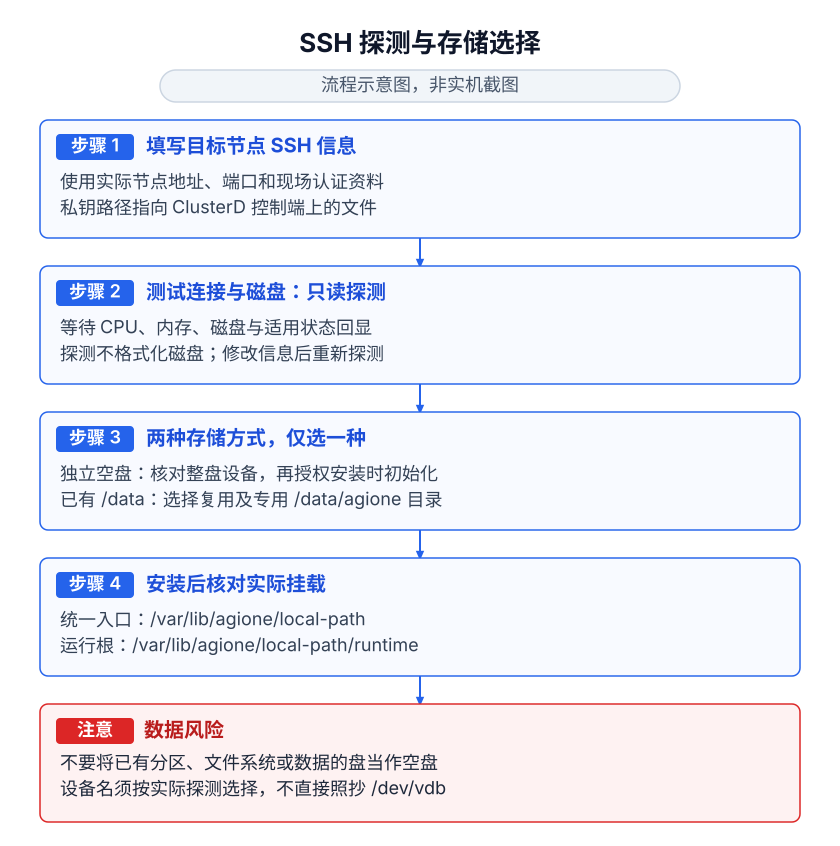

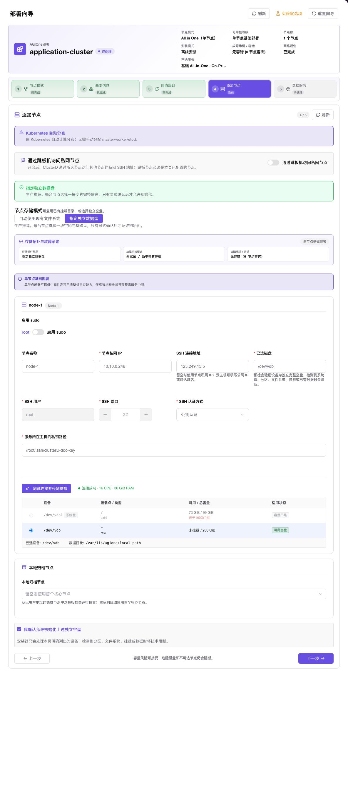

| 字段 | 示例 / 本例选择 | 含义与填写要求 |
| --- | --- | --- |
| 通过跳板机访问私网节点 | 本例关闭 | 关闭时直接 SSH；开启后先通过本页指定的跳板节点访问其他私网节点 |
| 跳板节点 | 开启时选择已配置节点 | 不是任意文本地址；当前经跳板访问的节点需复用匹配的 SSH 用户、端口和认证材料 |
| 节点名称 / Node name | `node-1` | 向导内的稳定标识，避免重复；不是 IP，也不替代实际主机名 |
| 节点私网 IP | `10.10.0.11` | 用于 Kubernetes 拓扑和节点间通信的唯一可路由地址；不能填安装人员电脑的回环地址 |
| SSH 连接地址 | 留空或目标机可达 IP/DNS | 控制端实际 SSH 到哪里；留空用私网 IP，无私网路由时可与私网 IP 不同 |
| 启用 sudo | 按现场策略 | 关闭时使用 root SSH；开启时使用有 sudo 权限的非 root SSH 用户 |
| SSH 用户 | `root`；sudo 模式按实际用户填写 | sudo 开启时不能仍填 root，目标机需要具备对应提权条件 |
| SSH 端口 | `22` | 目标 SSH 监听端口，1–65535；安全组、路由和跳板链路都需可达 |
| SSH 认证方式 | 密码认证 / 公钥认证 | 按主机实际认证方式二选一；不要把云 AK/SK 当成 SSH 凭据 |
| SSH 密码 | 页面中输入，不在文档给出值 | 仅密码认证时填写；不要在截图中点击显示密码 |
| SSH 私钥路径 | `/etc/agione-clusterd/keys/deploy-key` | 仅公钥认证时必填；指向 **ClusterD 控制端**上的文件，不是浏览器电脑或远端节点上的路径；按策略限制文件权限，例如 `0600` |
| sudo 密码 | 按需填写，或留空 | 仅 sudo 模式显示；密码认证下留空会复用 SSH 密码，公钥认证下留空要求目标机允许免密 sudo |

### 8.2 本例：初始化独立空盘

1. 选择 **指定独立数据盘 / Dedicated data device**。
2. 填好节点连接信息，点击 **测试连接与磁盘 / Test Connection & Disks**。这一步是只读探测，不会格式化磁盘。
3. 等待 CPU、内存和磁盘表返回；根据实际结果选择空盘整盘，例如 `/dev/vdb`，不是分区 `/dev/vdb1`。
4. 核对显示的数据目录 `/var/lib/agione/local-path` 和运行根 `/var/lib/agione/local-path/runtime`。
5. 只有确认盘内无数据且设备正确后，勾选 **允许初始化上述独立空盘**。勾选是授权，实际初始化发生在安装阶段。

| 存储字段或表格列 | 如何读 / 如何填 |
| --- | --- |
| 节点存储模式 / Storage mode | 选择空盘初始化或复用现有文件系统；二者不能混用解释 |
| 独立数据盘设备 / Selected disk | 本例 `/dev/vdb`；每台节点单独选择，不输入挂载目录或 URL |
| Device / 设备 | 实际块设备；系统盘和分区不作为独立空盘 |
| Mount / Type | 独立空盘应未挂载、无文件系统和子分区；`raw` 只是展示形式之一，最终看适用状态 |
| Free / Total | 挂载盘显示可用/总容量；未挂载盘显示“未挂载/总容量”，不是可用空间为零 |
| Eligibility / 适用状态 | 需显示适用于当前模式，或给出明确阻断原因；当前普通容量要求为 160 GiB，总容量不等于可用容量 |
| 数据目录 / Data directory | 选择结果的只读回显；复用模式可能显示源路径，不能据此跳过实际挂载验收 |
| 初始化确认 | 只在空盘模式勾选；授权范围是明确列出的设备，不是整台机器所有盘 |

探测失败时先修复 SSH、权限或磁盘状态；修改地址、凭据、模式或设备后，重新探测，不沿用旧结果。安装器发现分区、已有文件系统、挂载或签名等不满足空盘条件时会阻断；不要手工执行擦盘、`mkfs` 或篡改探测结果来绕过检查。

### 8.3 复用已有文件系统

如果磁盘已挂载为 `/data`，应选择 **自动使用现有文件系统 / Existing filesystem**，运行探测并选择允许复用的那一行。页面通常生成专用源目录 `/data/agione`，安装后绑定到统一的 `/var/lib/agione/local-path` 入口；不会格式化 `/data` 整盘。

- 不把已有 ext4/xfs 的 `/dev/vdb` 填入空盘模式。
- 核对可写性、剩余容量、文件系统 UUID 和目录归属；已有非空目录不能假定会被自动迁移或覆盖。
- 未选择其他挂载文件系统时，默认位置仍可能落在系统盘；系统盘共享故障域需按预检明确确认，不是“选了复用”就一定用了数据盘。
- 每台节点都要独立探测和选择；当前版本的探测与预检结果才是是否可复用的依据。

### 8.4 多节点和归档节点

按所选拓扑逐台填写，不要复制同一个 IP。更改拓扑可能改变核心节点、数据库模式和容量要求，需要重新核对所有节点和预检。日志启用时，在本步骤的归档节点选择框中确认目标；留空自动选择首个核心节点。所有连接和存储信息正确后再进入服务步骤。

## 9. 选择服务并运行预检

本步确认要交付的服务组合，**不是任意挑选中间件版本或密码的编辑器**。

| 服务卡片 / 预览 | 当前含义 |
| --- | --- |
| Foundation All-in-One | 本例的基础服务组，包含 MariaDB、ProxySQL、Redis、Nacos、Kafka、RustFS 等随当前目录交付的组件；必选 |
| On-Prem | 本地站点业务服务组；必选 |
| On-Cloud | 云侧业务服务组；必选，不表示自动申请云主机或云中间件 |
| ISync | 当前未交付，展示技术阻断/不可用说明；不能强行启用 |
| CPU、内存、Pod 容量 | 规划或探测摘要；“未采集”不是零容量，也不是容量验收通过 |
| Ingress、数据库、Redis / Kafka | 拓扑派生的只读服务与端口预览；不等于允许从公网访问中间件 |
| 日志保存意图 | 前面填写的策略回显；不是运行时写入证明 |

这些服务使用的组件名称以本版本目录为准，不可据此把未经测试的数据库或托管中间件当作可替代项。服务卡片核对完毕，点击 **运行预检 / Run precheck**。

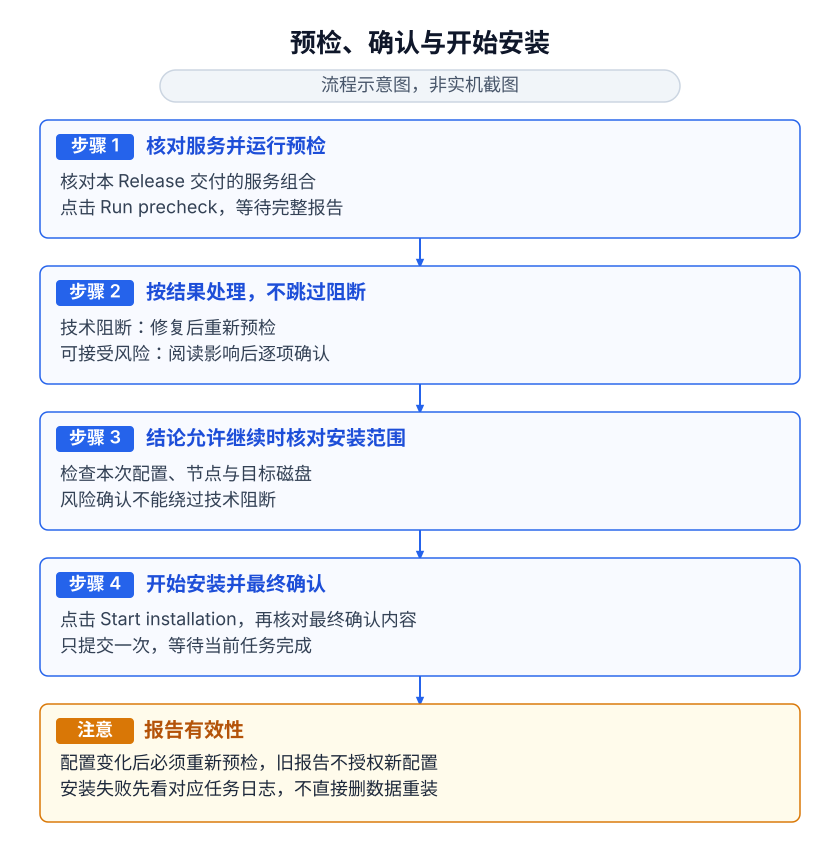

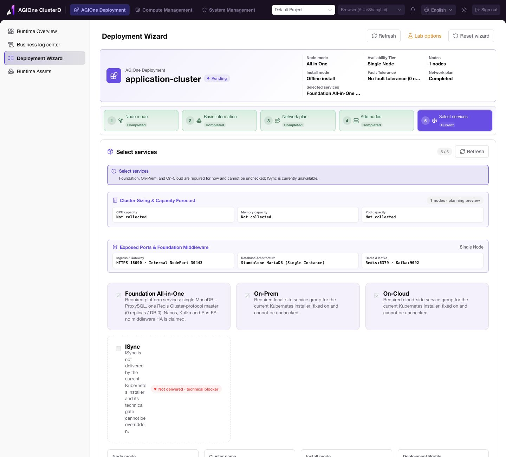

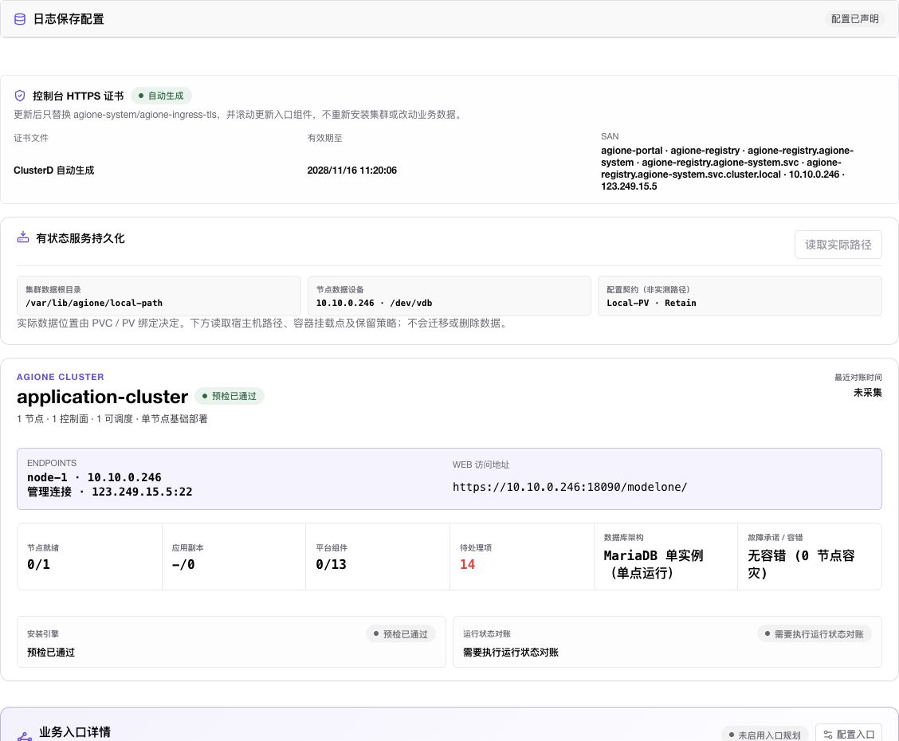

| 结果 | 是否可以继续 | 你要做什么 |
| --- | --- | --- |
| 技术阻断 / Technical blocker | 不可以 | 修复系统、架构、SSH、盘、端口或资源完整性问题，然后重新预检 |
| 可接受风险 / Overridable risk | 需逐项明确接受 | 阅读影响，只接受现场确实可承担的风险；不能靠风险确认绕过技术阻断 |
| 提醒 / Warning | 按报告处理 | 记录并核对，不把提醒全部当成失败，也不把它当成无须关注 |
| 通过 / Passed | 可进入确认 | 仍需检查预检时间、目标设备和实际安装范围 |

预检会核对节点资源、时间同步、存储状态、端口、Kubernetes/AGIOne 配置以及离线资产闭包等。看**报告最终结论与阻断数量**，不要只看某一行日志的颜色。参数发生变化后，重新预检，不能用旧报告授权新配置。

## 10. 确认并安装

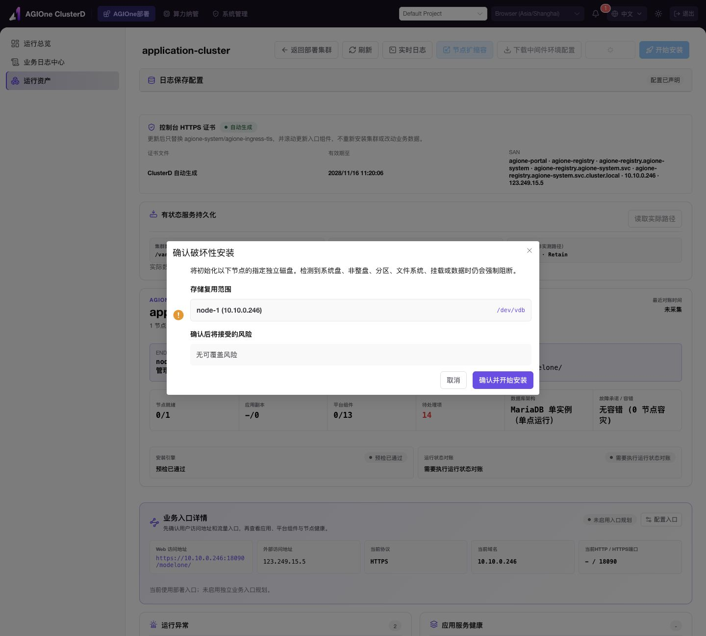

安装确认页/弹窗是最后一次核对目标与破坏性范围的地方。逐项确认：

- 集群名称、拓扑、节点数量与 CPU 架构。
- 在线/离线模式与对应 Release、资源就绪状态。
- 节点私网与 SSH 地址、Service/Pod CIDR、控制台协议和端口。
- 每台节点的存储模式与设备；本例只允许初始化确认过的独立空盘。
- 日志目录/NAS/归档节点、服务组合，以及本次配置的有效预检结果。

确认无误后点击 **开始安装 / Start installation**，核对最终确认内容，再确认安装。不要反复点击、同时运行第二个安装器，或因为某阶段耗时长而再次创建部署。

**成功时：** 安装任务为 `Succeeded`，详情进入安装完成并开始/完成运行验证。本例任务 `#2` 已成功结束，后续 `Reconcile now` 任务 `#3` 也成功结束。 **失败时：** 打开对应任务日志和报告，找到失败阶段；先修复原因，不直接删除数据重装。安装脚本成功退出与 Runtime verified 是两层不同证据。

## 11. 验证运行状态并登录 AGIOne

### 11.1 先验收运行，再验收业务访问

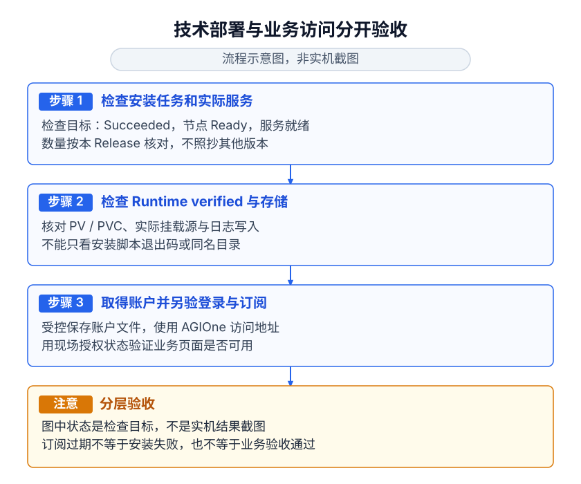

以下是**安装完成后的验收模板**，不是让你手工填入页面的期望状态，也不是每个版本固定不变的服务数量。任务 `#2` 和后续对账任务 `#3` 已到达成功终态，下面的数量是本次单节点实机证据，不能当作其他 Release 的固定值。

| 验收项 | 本例结果 | 你应如何核对 |
| --- | --- | --- |
| 安装任务 | `#2` `Succeeded`，未发现失败阶段 | 打开本次任务，确认你的部署也满足同一条件 |
| 运行对账任务 | `#3` `Succeeded` | 安装完成后按需执行 Reconcile，并检查终态 |
| 节点 | `1/1 Ready`（`node-1`、16 CPU、31 GiB） | 数量与所选拓扑一致；不能只看 ClusterD 网页可访问 |
| 平台组件 | `13/13` 就绪 | 按当前 Release 的实际组件清单核对 |
| AGIOne 应用服务 | `15/15`，页面均显示 `1/1 · UP` | 按当前版本服务清单核对 |
| 运行校验 | `Runtime verified`，注意项 `0` | 必须有运行证据，不能只看安装脚本退出码 |
| 数据盘 | `200 GiB`，`/dev/vdb` → `/var/lib/agione/local-path` | 实际挂载源是数据盘，不是仅创建了同名目录 |
| 应用运行根 | `/var/lib/agione/local-path/runtime` | 由存储方案派生；仍需单独核对 PVC/PV 的实际宿主机路径 |
| 控制台入口 | HTTPS `18090`，页面显示证书为 ClusterD 生成 | 生产使用前确认 DNS、SAN 和证书信任链 |
| 账户凭据 | 详情页显示可查看凭据 | 安全交付账户文件，实际登录与订阅状态另行确认 |

在 **AGIOne 目标节点**执行以下只读检查：

```bash
lsblk -f
findmnt -T /var/lib/agione/local-path
findmnt -T /var/lib/agione/local-path/runtime
df -h / /var/lib/agione/local-path
sudo k3s kubectl get nodes -o wide
sudo k3s kubectl get pods -A
sudo k3s kubectl get pv,pvc -A
```

节点应为 `Ready`，长期运行服务为 `Running`，一次性初始化 Job 可以为 `Completed`，PVC 应为 `Bound`。核对 PV 实际路径和存储保留策略；复用 `/data` 时，还要核对源目录与绑定挂载。启用日志时，对实际配置的日志路径执行 `findmnt -T <日志目录>` 并确认有日志写入，不能仅凭应用盘选择推断日志也在同一盘。

### 11.2 取得账户并打开控制台

1. 在部署详情查看页面提供的 **Web 访问地址**，以它为准，不使用 ClusterD 的 `18093` 登录 AGIOne。
2. 使用详情中的账户凭据查看/下载入口。需要确认时阅读提示；不要在截图中显示密码或复制下载文件到公开位置。
3. 在本地受控位置保存下载文件，按现场密码管理要求交付；不要提交到 Git、聊天、工单或公共对象存储。
4. 打开 AGIOne 地址，使用文件对应的账户登录，核对实际业务页面。

本例 HTTPS 入口形式为：

```text
https://<节点或外部访问地址>:18090/modelone/
```

账户密码应通过产品登录页使用。不要将明文密码拼入 URL、终端命令或自行构造的认证请求；直接构造请求失败不等于账户文件错误。

### 11.3 订阅过期不等于部署失败

业务访问若返回 `platform_license_expired`，应核对有效订阅与授权状态。**技术部署成功与业务授权可用是两项验收**，订阅结果不能单独作为磁盘、Kubernetes 或账户同步失败的证据。

按 [购买与激活](../license/activation-code-activation) 完成适用的授权流程后，再验证登录和业务访问。将授权结果与技术运行验收分开记录。

## 12. 常见问题与下一步

| 现象 | 先检查什么 | 不要这样处理 |
| --- | --- | --- |
| ClusterD 本机网页正常，其他电脑打不开 | ClusterD 监听地址、路由、`18093` 的防火墙与安全组 | 重新安装 AGIOne |
| 在线安装不可选 | 测试连通性、发布源配置、目标架构 Release、签名与摘要 | 只凭浏览器能上网就强制启用 |
| 离线资源不就绪 | Bundle/Manifest 是否配套、架构是否一致、导入与校验是否完成 | 混用不同 Release 或直接改文件名 |
| “新云盘”仍被阻断 | 实际分区、文件系统、签名和挂载；重新只读探测 | 直接擦盘或跳过容量检查 |
| `/data` 已有 ext4/xfs | 使用复用模式，选择符合条件的挂载盘和专用目录 | 把已有文件系统当作 raw 空盘初始化 |
| 系统盘空间不足 | ClusterD 下载/解压/缓存与 AGIOne 存储分别占用多少；确认实际挂载源 | 以为选择应用盘就迁走了 ClusterD 缓存 |
| NAS 挂载或写入失败 | 归档节点的 NFS 客户端、网络、导出目录和写权限 | 假定自动模式会退回本地 |
| 安装任务成功但运行待核验 | 重新核验、节点/Pod/组件状态与详情报告 | 把任务退出码当作全部验收通过 |
| 账户登录失败 | 入口、账户文件、时间、产品认证日志；区分凭据错误与订阅过期 | 在工单贴密码或自行拼接明文认证请求 |
| `platform_license_expired` | 有效订阅与授权状态 | 删除集群或重装数据库 |

安装向导只负责本次拓扑、资源、网络、节点、服务和预检。后续的 **Resource sync（资源同步）**、**Delivery rollout（更新发布）**和**中间件外部访问**是维护操作；不要为了解决登录、订阅或入口问题随意执行资源同步、重新发布或开放中间件端口。ClusterD 升级不等于 AGIOne 业务服务升级，见 [ClusterD 升级说明](./clusterd/#_6-升级-clusterd)。

## 13. 清理测试环境

本节只在不再需要该环境时执行；不是部署完成后必须执行的步骤。**只阅读本页不会自动清理任何机器。**

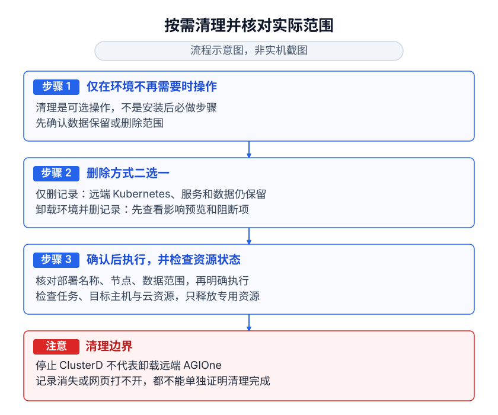

| 目标 | 正确范围与操作 |
| --- | --- |
| 暂时停止使用 ClusterD | 停止 ClusterD 服务不等于卸载远端 AGIOne；按实际停用目标操作 |
| 卸载 AGIOne 环境 | 在对应部署的删除/卸载入口选择“卸载远端环境并删除记录”，先查看影响预览，确认节点、数据删除范围、阻断项与部署名称，再明确执行 |
| 仅删除 ClusterD 记录 | 只移除本地纳管记录，不代表远端 Kubernetes、服务或数据已被删除；不要用于代替环境卸载 |
| 移除 ClusterD 程序 | 先完成需要的远端清理并核实结果，再按 [ClusterD 卸载步骤](./clusterd/#_7-卸载-clusterd) 操作 |
| 释放测试云资源 | 在云平台逐项核对 ECS、数据盘、EIP 等资源归属；只删除本次专用资源，不删除共享 VPC/子网或其他业务资源 |

环境卸载具有破坏性，数据是否保留或删除需事先由数据所有者确认。预览被阻断时先处理原因，不直接 `rm -rf` 运行根、删除 PVC 或格式化磁盘。清理后同时检查任务结果、目标机状态和云资源清单；网页打不开、记录消失或命令退出成功，都不能单独证明远端环境已经清理。

## 14. 交付检查清单

- [ ] 记录安装包版本、架构和可信 SHA-256，外层与包内校验均通过。
- [ ] ClusterD 可登录，目标节点、网络和存储规划与向导一致。
- [ ] 每台节点 SSH 与磁盘探测有效；空盘初始化或复用模式已明确。
- [ ] 预检技术阻断为零，需要承担的风险已逐项确认。
- [ ] 安装任务成功，节点、平台组件与应用服务达到本 Release 的预期，运行核验完成。
- [ ] 验证应用运行根、持久卷与日志实际挂载位置，不只检查目录名。
- [ ] AGIOne 访问地址、TLS、账户文件及登录结果已核对，敏感文件未进入文档仓库。
- [ ] 订阅授权与业务可用性单独记录，未验证的项目未标记为通过。
- [ ] 需要释放测试环境时，记录实际清理范围与最终资源状态。

**已验证范围：** 页面级向导操作、字段说明、独立空盘选择、预检与安装确认、任务 `#2` 成功、对账任务 `#3` 成功、节点 `1/1` Ready、平台组件 `13/13`、AGIOne 服务 `15/15`、生成的 HTTPS 入口以及 `/dev/vdb`/200 GiB 存储选择。凭据未进入截图或仓库。**本例未覆盖：** ARM64 实装、多节点故障切换、跨架构、在线发布源、跳板机/sudo、NAS、已有 `/data` 复用、正式 TLS/公网入口与有效订阅业务验收。相关字段已按当前实现说明，交付时仍需分别验证，不能将本例结论扩展为全组合验收。
