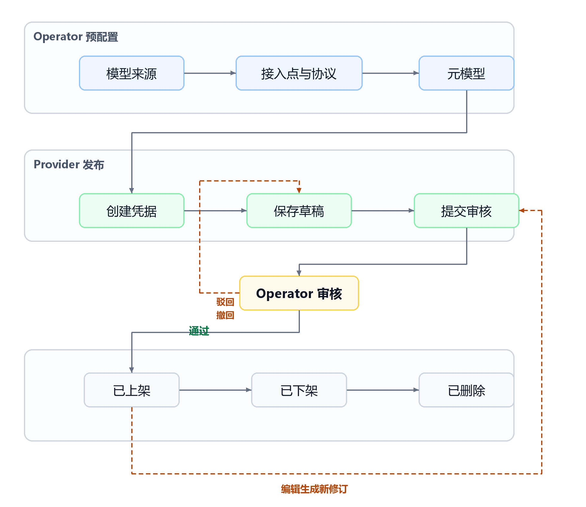

# 模型业务升级说明：Operator 与 Provider 变更及发布流程

::: info 文档信息
适用版本：2026-11-02 模型业务升级
更新日期：2026-11-02
:::

本次升级把模型接入方式从“任何模型皆可配”改为“按市面上成熟、公认的协议对接”。平台只提供通道，不定义任何请求或响应格式；Provider 发布模型时不再配置模型本身的调用细节，只需关心定价。旧入口暂时保留，仅用于兼容存量模型。

## 一、核心变化

| 维度 | 升级前 | 升级后 |
| --- | --- | --- |
| 接入方式 | 每个模型自行配置请求头、输出解析等，“任何模型皆可配” | 按标准协议透传（OpenAI、Anthropic、火山方舟、阿里云百炼） |
| 平台角色 | 定义并转换格式 | 只提供通道，不产生格式和标准 |
| 模型版本 | 一个版本（ModelsVersion）承载全部信息 | 拆为 Basic（基础信息）+ Pricing（定价），同一修订号一起审核、一起生效 |
| 供应商目录 | Provider / Region | 模型来源（Model Source）/ 接入点（Endpoint） |
| AK | 填在每个模型版本里 | 独立的“凭据”统一管理：加密存储、脱敏展示、可轮换，多个模型复用 |
| Provider 发布时填写 | 调用地址、协议、请求头、输出解析、能力参数、定价 | 选择来源、接入点、凭据，填写上游模型 ID 和定价 |

### 平台支持的协议

| 协议 ID | 模态 | 上游路径 | 调用方式 |
| --- | --- | --- | --- |
| `openai/chat_completions` | 文本 | `/v1/chat/completions` | 同步 |
| `openai/responses` | 文本 | `/v1/responses` | 同步 |
| `anthropic/messages` | 文本 | `/v1/messages` | 同步 |
| `openai/images` | 图片 | `/v1/images/generations` | 同步 |
| `volcengine/ark_image_generation` | 图片 | `/api/v3/images/generations` | 同步 |
| `dashscope/image_generation` | 图片 | `/api/v1/services/aigc/image-generation/generation` | 默认异步，也支持同步 |
| `openai/video` | 视频 | `/v1/videos/generations` | 异步 |
| `volcengine/ark_video_generation` | 视频 | `/api/v3/contents/generations/tasks` | 异步 |
| `dashscope/video_generation` | 视频 | `/api/v1/services/aigc/video-generation/video-synthesis` | 异步 |
| `openai/audio` | 语音 | `/v1/audio/speech` | 同步 |
| `openai/embeddings` | 嵌入 | `/v1/embeddings` | 同步 |
| `openai/rerank` | 重排 | `/v1/rerank` | 同步 |

认证请求头按协议配置，`{ak}` 在调用时由凭据中的 AK 替换。常用模板为 `Authorization: Bearer {ak}`，Anthropic 协议为 `x-api-key: {ak}`。

## 二、Operator（平台运营方）需要做的变更

1. **维护模型来源**（权限 `admin_save_model_source`）
   - 来源编码（code）全局唯一，创建后不可修改；名称支持中文、英文、西班牙语。
   - 来源状态由接入点数量自动维护：至少有一个接入点时才可用。
2. **维护接入点**（权限 `admin_save_model_source_endpoint`）
   - 填写名称、区域标签、Base URL、控制台地址、文档地址。
   - Base URL 可包含 `{workspace}` 占位符；此时 Provider 绑定凭据时必须填写工作空间。
   - 从协议目录中勾选该接入点支持的协议，逐个配置上游路径、认证请求头、同步/异步和回调路径。
   - 删除接入点前，先确认没有凭据绑定或模型在使用它（系统目前不会拦截）。
3. **维护元模型**（权限 `admin_save_meta_model`）
   - 元模型承载模型能力：类型、Function/思考/联网能力、上下文窗口、最大输入/输出长度、输入/输出模态、协议。
   - Provider 发布时这些信息从元模型带出，不再由 Provider 填写。
   - 元模型标识（metaModelUid）创建后不可修改；系统会为每个元模型自动生成一个默认聚合模型。
4. **审核模型修订**（权限 `admin_model_audit`）
   - Basic 和 Pricing 作为一次修订整体审核，同时通过或同时驳回。
   - 可开启自动审核；管理员可对已上架模型执行强制下架。
5. **执行存量数据迁移**：见“六、兼容与过渡”。

## 三、Provider（模型提供方）需要做的变更

1. **先创建凭据，不再在模型里填 AK**
   - 选择模型来源，填写 AK，勾选要绑定的接入点；接入点需要工作空间时一并填写。
   - 同一租户、同一来源、同一组接入点下用相同 AK 重复创建，会复用已有凭据，不会产生重复记录。
   - AK 加密存储，页面只显示脱敏值；支持轮换 AK、启用/停用、增加或解除绑定。
   - 有可调用模型在使用的凭据不能停用；有生效模型在使用的绑定不能解除。
   - 算模方、算枢的部署发布：发布页会自动创建对应类型的凭据，无需手工创建。
2. **发布模型时只关心定价**
   - 选择元模型、模型来源、接入点和凭据，填写上游模型 ID，选择公开或私有。
   - 能力、模态、上下文、协议、调用地址由元模型和接入点带出，无需再配置。
   - 填写定价：免费或收费、计量单位（TOKEN / IMAGE / CHARACTER / DURATION）、计费规则。
3. **不再需要做的事**
   - 不再在模型里填写 AK、自定义请求头、输出解析或协议转换配置。
4. **编辑与删除规则**
   - 编辑已上架模型会生成新修订，线上版本不受影响；新修订审核通过后才替换线上版本。
   - 首次生效后，元模型、模型类型、计量单位、公开性固定不变；价格和免费/收费可以修改。
   - 已下架或从未上架的模型可以删除，未提交或审核失败的修订会一并丢弃；审核中的修订需先撤回。

## 四、新的模型发布流程

下图为一个模型从 Operator 预配置到最终上架或删除的完整流转。虚线为回退路径：审核驳回或 Provider 主动撤回都会回到草稿；已上架模型再次编辑会生成新修订，重新进入审核。

图示为模型发布流程，包含 Operator 预配置、Provider 发布、Operator 审核和状态流转四个阶段；蓝色为 Operator 配置项，绿色为 Provider 操作，黄色为审核关卡，虚线表示回退路径。

1. Operator 配置模型来源、接入点（含协议）和元模型。
2. Provider 在凭据管理中创建凭据，并绑定要使用的接入点。
3. Provider 在发布页选择元模型、来源、接入点、凭据，填写上游模型 ID 和定价，保存为草稿。
4. Provider 提交审核；审核中可以撤回，撤回后回到草稿。
5. Operator 审核：通过即上架；驳回后 Provider 修改并重新提交。
6. 已上架模型再次编辑会生成新修订，重复第 4、5 步；下架后的模型可以删除。

## 五、发布前需要预配置的数据清单

| 数据 | 配置方 | 关键字段 | 说明 |
| --- | --- | --- | --- |
| 模型来源 | Operator | code、多语言名称 | code 全局唯一且不可修改 |
| 接入点 | Operator | Base URL、协议配置、认证请求头 | 来源下至少一个接入点，来源才可用 |
| 元模型 | Operator | 类型、能力、上下文、模态、协议 | 发布时自动带出 |
| 凭据 | Provider | AK、绑定的接入点、工作空间 | 算模方、算枢由发布页自动创建 |
| 定价 | Provider | 免费/收费、计量单位、计费规则 | 计量单位首次生效后不可修改 |
| 限流、授权租户（可选） | Provider | RPM、TPM、租户限流、授权租户 | 保存即生效，不经过审核 |

## 六、兼容与过渡

- **旧入口保留**：旧调用入口和旧管理接口暂时保留，只用于兼容存量模型；新模型一律走新流程。
- **存量迁移由 Operator 一次性执行**，三个接口必须按顺序调用，完成后下线：

| 顺序 | 接口 | 做什么 |
| --- | --- | --- |
| 1 | `POST /model-source/migration/providers` | 旧 Provider/Region 迁为模型来源/接入点；接入点默认开启全部协议，认证头为 `Bearer {ak}`（Anthropic 为 `x-api-key`） |
| 2 | `POST /model-source/migration/credentials` | 存量模型的 AK 迁为凭据并建立绑定；同租户、同来源、相同 AK 复用同一凭据 |
| 3 | `POST /model-source/migration/models` | 旧版本拆为 Basic + Pricing；已审核通过的直接生效，未审核通过的进入待审核或草稿；旧图片/视频 OpenAI 协议改为 `openai/images-compatible`、`openai/video-compatible` |

- **迁移中被跳过的模型**（没有模型来源或没有凭据绑定）切换后不可调用，需要 Provider 按新流程重新发布。目前接口只返回跳过数量，具体模型需要从日志中核对。
- 存量预约上下架任务不在迁移范围内。
