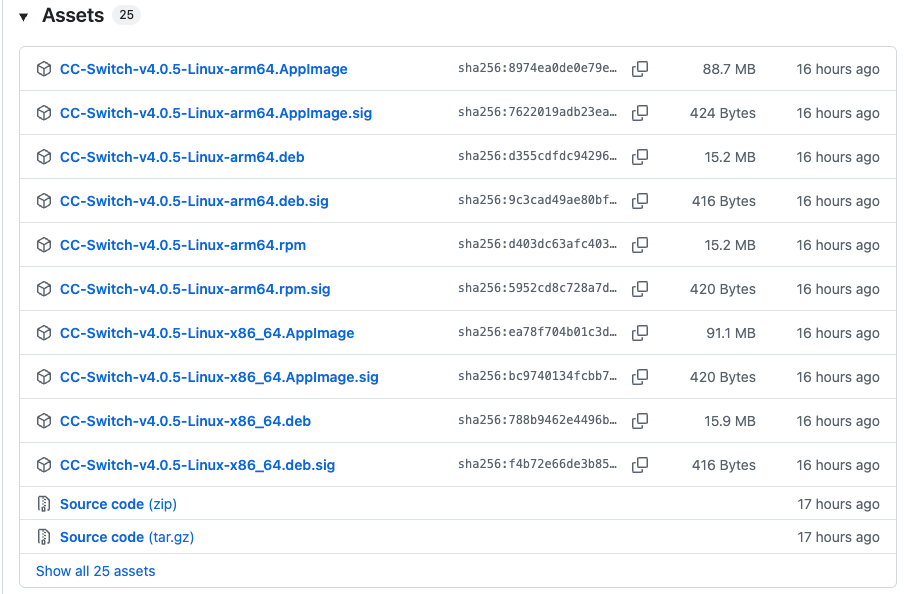
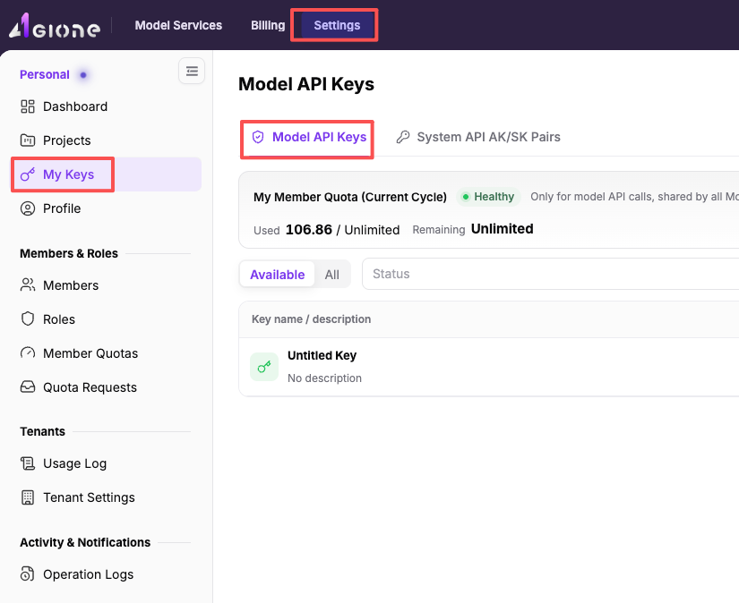
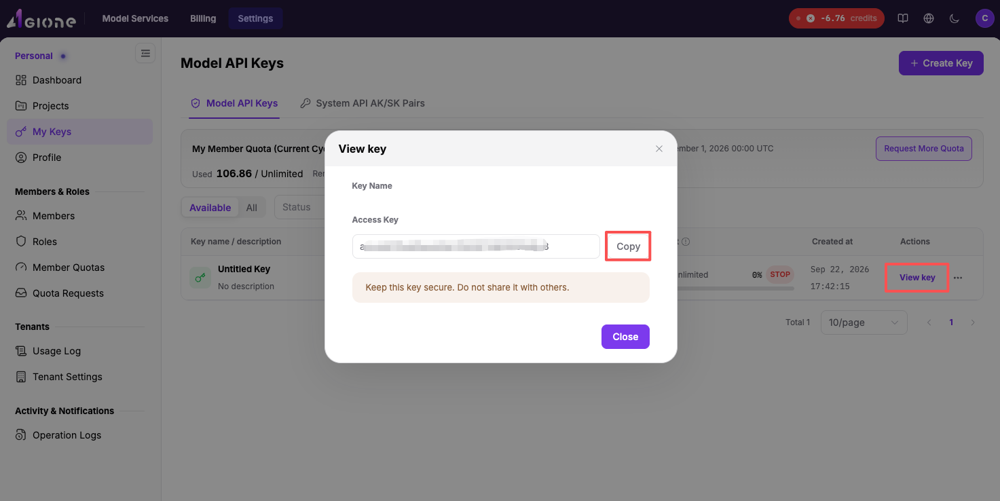
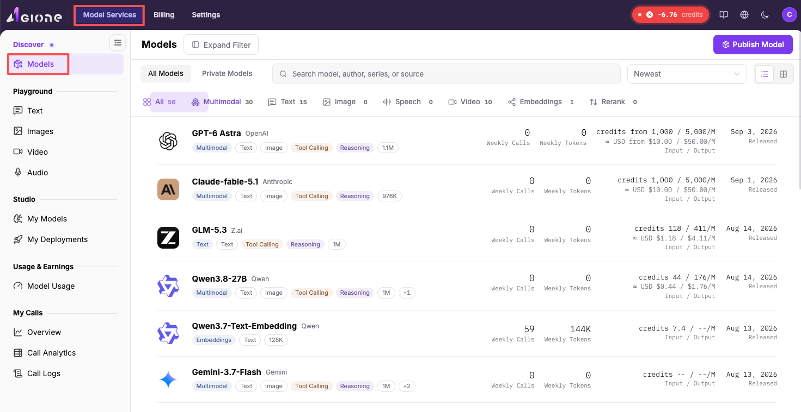
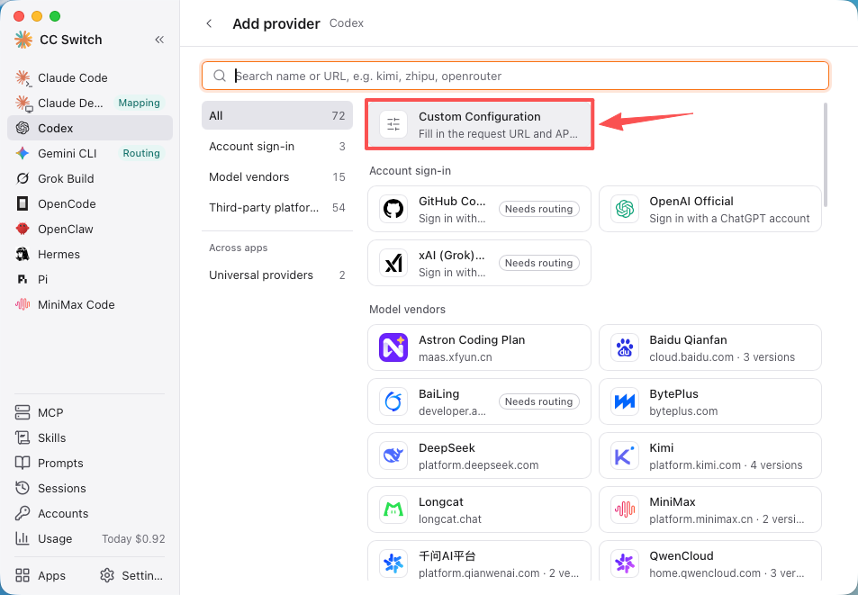
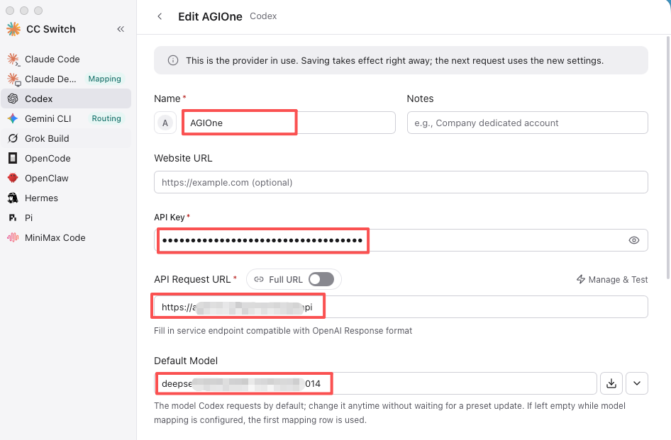
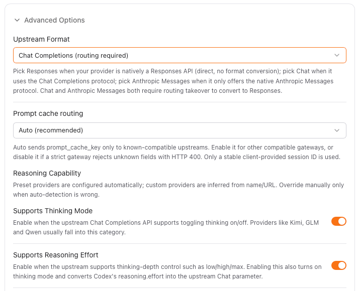
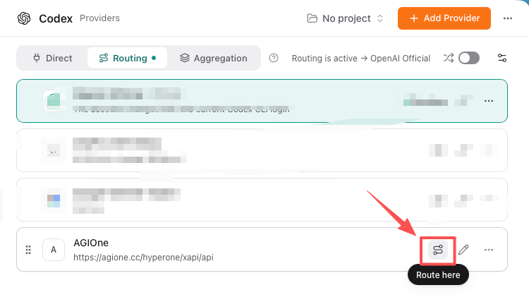
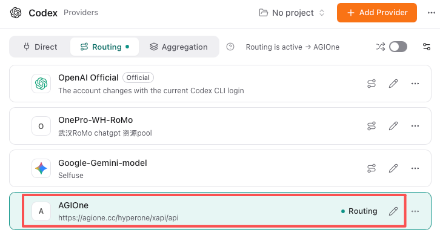
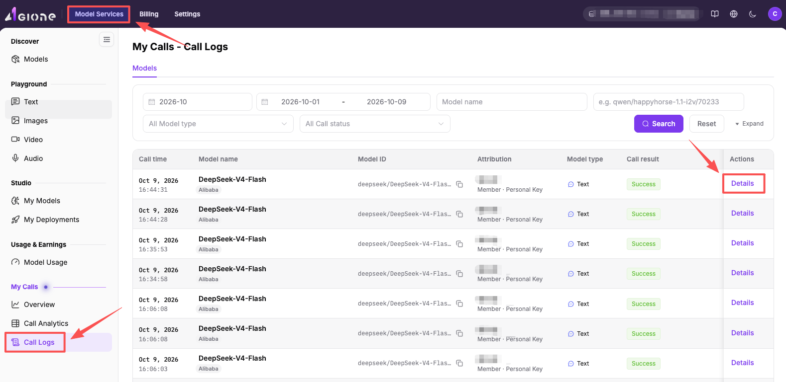

# Codex 与 AGIOne 搭配配置及使用的最佳实践

## Codex + CC Switch + AGIOne — AI 编码设置指南

> 一份清晰的分步指南，用于配置 **Codex Desktop**，使其搭配 **CC Switch** 以及 **AGIOne** API 令牌，以实现 AI 辅助编码。

## 架构概述

```Plain Text
Codex Desktop (AI coding client)
        │
        │  Requests go through local route
        ▼
CC Switch (local proxy — protocol conversion + provider management)
        │
        │  Forwards to upstream API
        ▼
AGIOne (https://agione.cc/hyperone/xapi/api)
        │
        │  Routes to models
        ▼
DeepSeek / GLM / Gemini / GPT, etc.
```

**为什么选择路由模式？** AGIOne 采用 Chat Completions 协议，而 Codex 采用 Responses 协议。CC Switch 的路由模式可自动完成协议转换。

---

## 步骤 1：下载并安装 Codex Desktop

1. 访问 OpenAI 官方网站并下载 [**Codex Desktop**](https://learn.chatgpt.com/docs/app#getting-started)。


    - macOS：`.dmg` 文件
    - Windows 系统：`.exe` 安装程序
    - Linux 系统：`.AppImage` 或 `.deb`

2. 安装并启动 Codex。

3. 系统可能会要求您使用 OpenAI/ChatGPT 账户登录——您可以等待 CC Switch 配置完成后再跳过此步骤。

---

## 步骤 2：下载并安装 CC Switch

1. 前往官方下载页面：[**https://ccswitch.io**](https://ccswitch.io) 或 [**GitHub Releases**](https://github.com/farion1231/cc-switch/releases)。



2. 请选择您的系统平台：

    - macOS（Apple Silicon）：`CC-Switch-v4.0.5-mac-aarch64.dmg`
    - macOS（Intel 版）：`CC-Switch-v4.0.5-mac-x64.dmg`
    - Windows 系统：`CC-Switch-v4.0.5-win-x64-setup.exe`
    - Linux：`.deb`、`.rpm` 或 `.AppImage`

3. 安装并启动 CC Switch。

---

## 步骤 3：访问 AGIOne 并获取 API 密钥

1. 打开浏览器并访问 [**https://agione.cc**](https://agione.cc) 或您的专属 AGIOne 平台。

2. 登录或创建账户。

3. 登录后，依次前往**设置** > **我的 Keys**，进入**模型 API 密钥**页面。



4. 点击**创建 Key**（或 **+ 新建**）。

- 为其指定一个名称（例如 `codex-cc-switch`）


- 复制生成的密钥——以 `ak-` 开头，且仅显示一次。



---

## 步骤 4：查找您的模型信息

1. 在 AGIOne 中，前往顶部菜单的**模型及 AI 服务**。



2. 找到您想要使用的模型。示例如下：

    - **DeepSeek-V4-Flash**：`deepseek/deepseek-v4-flash/02acd`——速度快、成本低，适合日常编码场景


3. 复制 **Model ID** 和 **Base URL**：

- 前往**快速开始**，复制 **Model ID**


- 前往**快速开始**，复制 **Base URL**


- 确认该模型支持的协议类型。


---

## 步骤 5：配置 CC Switch

### 5.1 在 CC Switch 中打开 Codex 页面

1. 在 CC Switch 中，点击左侧边栏中的 **Codex**。


2. 您会在顶部看到三个标签页：**直接 / 路由 / 聚合**（Direct / Routing / Aggregation）。


### 5.2 切换至路由模式

1. 点击**路由**（Routing）标签页。

2. 路由模式会启动本地代理服务，Codex 将通过该代理转发所有请求。

### 5.3 添加 AGIOne 作为提供商

1. 点击 **添加提供商**（Add Provider）。


2. 选择**自定义配置**（Custom Configuration）。



3. 填写以下配置字段：

| 字段 | 数值 |
|---|---|
| 名称 | AGIOne |
| API 密钥 | ak-xxxxxxxx（步骤 3 中获取的密钥） |
| API 请求 URL | 复制 AGIOne 平台的 Base URL |
| 完整URL | **关闭** |
| 默认模型 | 复制 AGIOne 平台的 Model ID |



### 5.4 配置高级选项

展开**高级选项**（Advanced Options）并进行配置：

| 设置 | 数值 |
|---|---|
| 上游格式 | Chat Completions（需配置路由）\| 取决于模型支持的协议类型 |
| 提示词缓存路由 | 自动（推荐） |
| 支持思维模式 | 取决于模型是否支持思维链 \| 如 DeepSeek-R1 支持，可启用 |
| 支持推理工作 | 取决于模型是否支持推理设置 \| 如 DeepSeek 支持，可启用 |



### 5.5 模型映射

1. 点击 **+ 手动添加** 新增您要使用的模型。


> 您可从 AGIOne 平台获取更多模型，并在映射列表中填入对应 Model ID 即可使用。

2. 点击**保存**。

### 5.6 激活路由

1. 在提供商列表中找到 **AGIOne**。

2. 点击 **Route here**（路由至此）。



3. 确认页面顶部显示**路由已激活 → AGIOne**。



---

## 步骤 6：在 Codex 中进行测试

1. **完全退出 Codex**（macOS 系统下按 Cmd+Q 快捷键）后重新打开。

2. 在 Codex 中开启新对话。

3. 发送测试消息：

```Plain Text
Hello! Tell me who you are and which model you are using.
```


4. 如果收到模型的正常回复，说明配置已成功生效！


---

## 步骤 7：在 AGIOne 中验证调用情况

1. 返回至 **AGIOne 控制台**（`https://agione.cc`）。

2. 前往**调用日志**页面，即可查看您的 API 调用记录与 Token 消耗详情。



---

## 配置文件（自动生成说明）

CC Switch 会自动管理以下配置文件：

**`~/.codex/auth.json`**

```JSON
{
  "OPENAI_API_KEY": "ak-xxxxxxxx"
}
```

**`~/.codex/config.toml`**（关键字段示例）

```TOML
model_provider = "custom"
model = "deepseek/deepseek-v4-flash/02acd"
model_reasoning_effort = "high"
model_catalog_json = "cc-switch-model-catalog.json"

[model_providers.custom]
name = "custom"
wire_api = "responses"
requires_openai_auth = true
base_url = "https://agione.cc/hyperone/xapi/api"
```

---

## 常见问题与排查

| 故障现象 | 可能原因 | 解决办法 |
|---|---|---|
| 获取模型失败 | API Key 错误或账户余额不足 | 检查 API Key 是否正确及 AGIOne 账户额度 |
| Codex 返回 401 错误 | API Key 未正确保存 | 在 CC Switch 中重新保存提供商配置 |
| Codex 返回 404 错误 | Base URL 无效 | 确认 Base URL 地址（如 `https://agione.cc/hyperone/xapi/api`） |
| Codex 中无模型 | Codex Desktop 客户端未重启生效 | 完全退出并重新打开 Codex Desktop 客户端 |
| 请求挂起或超时 | 网络故障或模型响应负载较高 | 检查网络连接，尝试切换其他模型 |

---

## 相关链接

| 资源 | URL |
|---|---|
| AGIOne 平台 | [https://agione.cc](https://agione.cc) |
| CC Switch 官网 | [https://ccswitch.io](https://ccswitch.io) |
| CC Switch GitHub | [https://github.com/farion1231/cc-switch](https://github.com/farion1231/cc-switch) |
| CC Switch 版本发布 | [https://github.com/farion1231/cc-switch/releases](https://github.com/farion1231/cc-switch/releases) |

---

*指南生成时间：2026-10-09 | 验证环境：macOS + Codex Desktop + CC Switch v4.0.5 + AGIOne*
