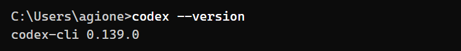

# 安装Codex并使用AGIOne作为模型提供商

> 本文介绍如何在 **Codex（命令行编程助手）** 或 **ChatGPT 桌面端** 中接入 **AGIOne** 模型服务。
> 提供两种配置方式：
> - **基础版（3分钟搞定）**：仅修改几行配置即可直接开始编写代码，适合快速上手。
> - **进阶版（开启全部高级功能）**：配置完整模型参数，开启 100 万字超长对话记忆、深度思考模式与图片识别。

---

## 目录
1. [基础版：3 分钟快速接入](#一基础版3-分钟快速接入)
2. [进阶版：开启全部高级功能（长记忆与深度思考）](#二进阶版开启全部高级功能长记忆与深度思考)
3. [常见问题与排错（FAQ）](#三常见问题与排错faq)
4. [附录：如何添加其他模型？](#四附录如何添加其他模型)

---

## 一、基础版：3 分钟快速接入

> 适合想先简单试用、直接开始对话的用户。此模式只需修改一个配置文件，无需创建复杂的参数定义。

### 1. 安装 Codex（已安装请跳过）
确保电脑已安装 Node.js（建议版本 20 或以上）。在命令行（终端 / CMD / PowerShell）中运行：

```bash
npm install -g @openai/codex@latest
```

检查是否安装成功：
```bash
codex --version
```



### 2. 编辑配置文件 config.toml
找到 Codex 的主配置文件：
- **Windows 系统**：`%USERPROFILE%\.codex\config.toml`（即 `C:\Users\你的电脑用户名\.codex\config.toml`）
- **macOS / Linux 系统**：`~/.codex/config.toml`

*(如果找不到 `.codex` 文件夹或里面的 `config.toml`，新建该文件夹及对应文本文档并重命名即可)*

将以下内容填入并保存：

```toml
model = "openai/gpt-6.1-sol/2e7d6"
model_provider = "agione"
model_reasoning_effort = "high"

[model_providers.agione]
name = "agione"
base_url = "https://agione.cc/hyperone/xapi/api/v1"
wire_api = "responses"
env_key = "AGIONE_API_KEY"
```

### 3. 设置 API Key 密钥
访问 [AGIOne 国内版](https://agione.cc/)，在模型广场或 API Key 页面获取真实密钥（通常是 `ak-` 开头的字符串）。

将下面命令中的 `你的实际Key` 替换为真实密钥：

- **Windows 用户（在 CMD 或 PowerShell 窗口运行一次）：**
  ```powershell
  setx AGIONE_API_KEY "你的实际Key"
  ```
  *(注意：执行完毕后，必须**完全关闭当前命令行窗口并重新打开**，新设置才会生效)*

- **macOS / Linux 用户（在终端运行）：**
  ```bash
  echo 'export AGIONE_API_KEY="你的实际Key"' >> ~/.zshrc
  source ~/.zshrc
  ```
  *(如果你使用的是 bash，请将上面的 `~/.zshrc` 改为 `~/.bashrc`)*

### 4. 验证是否成功
在任意文件夹下打开命令行，运行：
```bash
codex
```
输入测试语句（例如输入 `hi`），按回车。如果模型正常回复，说明已连通并可正常使用：


---

## 二、进阶版：开启全部高级功能（长记忆与深度思考）

### 为什么要配置 `models.json`？
如果不配置该文件，Codex 会将接入的模型当作默认小模型处理（默认仅保留较短记忆空间，多轮对话后会自动裁剪历史上下文）。

配置 `models.json` 后，可为模型开启以下核心特性：
- **100 万字长文本记忆**：分析大型项目代码时，完整保留长周期上下文对话，避免遗忘前期背景；
- **深度思考模式（Thinking Effort）**：遇到复杂排错或系统架构设计时，让模型进行深度推理并列出逻辑链后再生成代码；
- **智能局部改代码（Freeform Patch）**：修改代码时仅改动变更行，避免全量重写大文件；
- **发图片找 Bug（多模态识图）**：遇到前端样式偏差或报错弹窗时，可直接拖入截图供模型分析。

---

### 第一步：创建 models.json 文件
在与 `config.toml` **完全相同的文件夹**（即 `~/.codex/` 或 `%USERPROFILE%\.codex\`）下，新建名为 `models.json` 的文本文件，填入以下内容：

```json
{
  "models": [
    {
      "slug": "openai/gpt-6.1-sol/2e7d6",
      "display_name": "GPT-6.1-Sol (AGIOne 增强版)",
      "description": "AGIOne GPT-6.1 Sol 编程模型，支持 100 万字记忆与深度思考",
      "base_instructions": "You are a coding agent. Follow the user's instructions and use tools when needed.",
      "default_reasoning_level": "medium",
      "supported_reasoning_levels": [
        { "effort": "low", "description": "快速回答，轻度思考" },
        { "effort": "medium", "description": "平衡模式，适合日常编程" },
        { "effort": "high", "description": "深度推理，适合复杂排错和架构设计" },
        { "effort": "xhigh", "description": "极限思考，专解疑难杂症" }
      ],
      "supports_reasoning_summaries": true,
      "default_reasoning_summary": "auto",
      "shell_type": "shell_command",
      "visibility": "list",
      "supported_in_api": true,
      "priority": 0,
      "additional_speed_tiers": [],
      "service_tiers": [],
      "support_verbosity": false,
      "default_verbosity": "medium",
      "apply_patch_tool_type": "freeform",
      "supports_parallel_tool_calls": true,
      "supports_image_detail_original": false,
      "context_window": 1048576,
      "max_context_window": 1048576,
      "auto_compact_token_limit": 996147,
      "effective_context_window_percent": 95,
      "truncation_policy": {
        "limit": 10000,
        "mode": "tokens"
      },
      "input_modalities": [
        "text",
        "image"
      ],
      "output_modalities": [
        "text"
      ],
      "capabilities": {
        "streaming": true,
        "tools": true,
        "function_calling": true,
        "structured_output": true
      },
      "supports_search_tool": false,
      "use_responses_lite": false,
      "experimental_supported_tools": []
    }
  ]
}
```

### 第二步：在 config.toml 中引用该文件
在 `config.toml` 中增加一行 `model_catalog_json = "models.json"`（直接填文件名即可，无需绝对路径）：

```toml
model = "openai/gpt-6.1-sol/2e7d6"
model_provider = "agione"
model_reasoning_effort = "high"

# 引入同目录下的参数定义文件（直接填写文件名）
model_catalog_json = "models.json"

[model_providers.agione]
name = "agione"
base_url = "https://agione.cc/hyperone/xapi/api/v1"
wire_api = "responses"
env_key = "AGIONE_API_KEY"
```

保存配置文件后，重新打开终端运行 `codex`，即可启用 100 万字长文本上下文与深度思考能力。

---

## 三、常见问题与排错（FAQ）

### Q1：ChatGPT 桌面端弹窗报错：“Model provider 'modelrouter' not found”？
- **原因**：ChatGPT 桌面端在恢复之前的历史会话时，会尝试寻找会话中记录的原提供商标识 `modelrouter`。
- **解决方式**：在 `config.toml` 中同时保留新旧两个名称，均指向 AGIOne 即可：
  ```toml
  model_provider = "modelrouter"

  [model_providers.modelrouter]
  name = "AGIONE"
  base_url = "https://agione.cc/hyperone/xapi/api/v1"
  wire_api = "responses"
  env_key = "AGIONE_API_KEY"

  [model_providers.agione]
  name = "AGIONE"
  base_url = "https://agione.cc/hyperone/xapi/api/v1"
  wire_api = "responses"
  env_key = "AGIONE_API_KEY"
  ```

### Q2：运行报错：“500 The requested model ... is unavailable”？
- **原因**：模型名称写成了简写（例如仅写了 `gpt-6.1-sol`）。
- **解决方式**：AGIOne 平台要求填写完整的模型全局标识符（Slug），例如必须完整写为 `openai/gpt-6.1-sol/2e7d6`。

### Q3：已设置环境变量，但终端依然提示没有 API Key？
- **原因**：环境变量设置完成后，已经在运行的旧命令行窗口不会动态更新环境状态。
- **解决方式**：将当前打开的所有命令行窗口（包括 VS Code 内置终端）完全关闭，重新打开新窗口即可生效。

---

## 四、附录：如何添加其他模型？

上述 `models.json` 为标准模型配置模板。若在 AGIOne 上接入其他模型（例如 Gemini、Claude 或 DeepSeek），可直接复制一份模型节点，大部分参数保持默认，仅需按需调整以下 4 项：

1. **`slug`（模型调用标识符，必填）**：
   在 AGIOne 平台的模型列表或 API 调用界面复制完整型号全称，例如 `gemini/gemini-3.8-flash/5aa94`。
2. **`context_window`（上下文记忆容量）**：
   - **100 万 Token 模型**（如 GPT-6.1、Gemini 3.8）：`context_window` 填 `1000000`，`auto_compact_token_limit` 填 `950000`；
   - **20 万 Token 模型**（如 Claude 系列）：`context_window` 填 `200000`，`auto_compact_token_limit` 填 `190000`；
   - **12.8 万 Token 模型**（如 DeepSeek 系列）：`context_window` 填 `128000`，`auto_compact_token_limit` 填 `120000`。
3. **`supported_reasoning_levels`（是否支持深度思考推理）**：
   - 具备思维链推理的模型（如 GPT-6.1、DeepSeek 推理版）：保留 low / medium / high / xhigh 四档；
   - 通用非推理模型：仅保留一个 `medium` 或留空，避免系统发送多余推理参数导致服务端报错。
4. **`input_modalities`（是否支持多模态识图）**：
   - 支持图像分析的模型：填 `["text", "image"]`；
   - 纯文本模型：填 `["text"]`。
