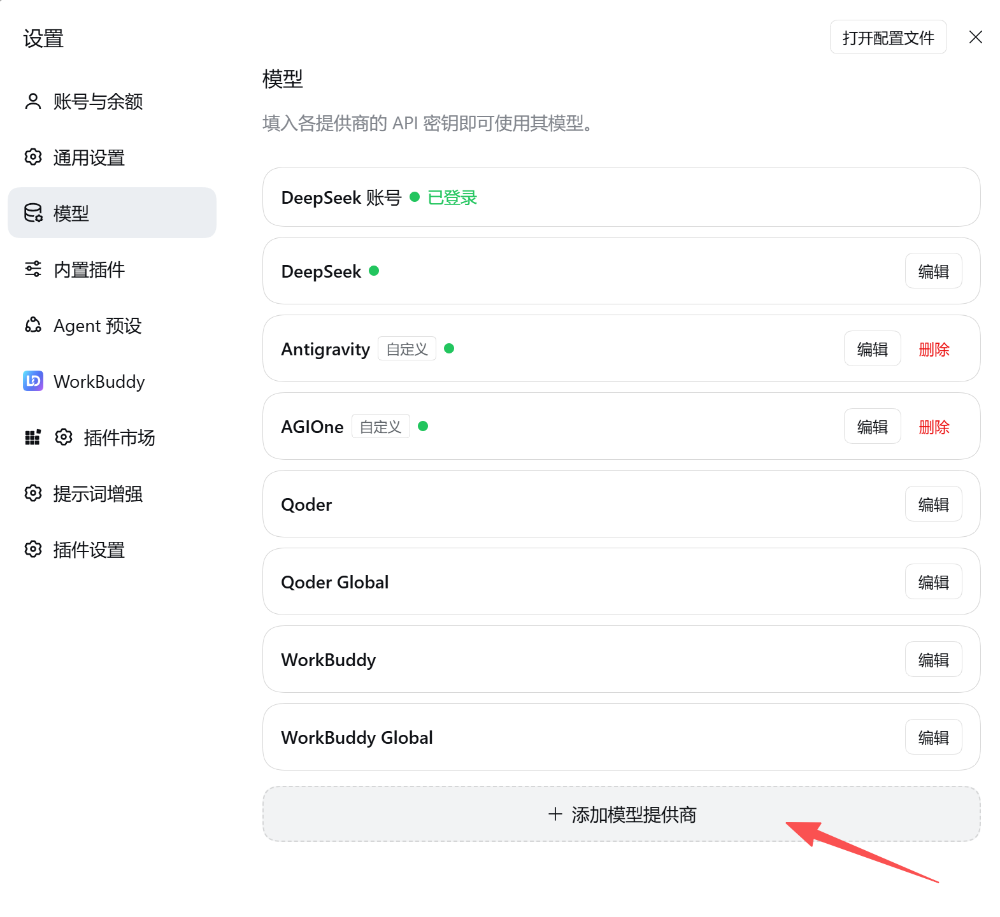
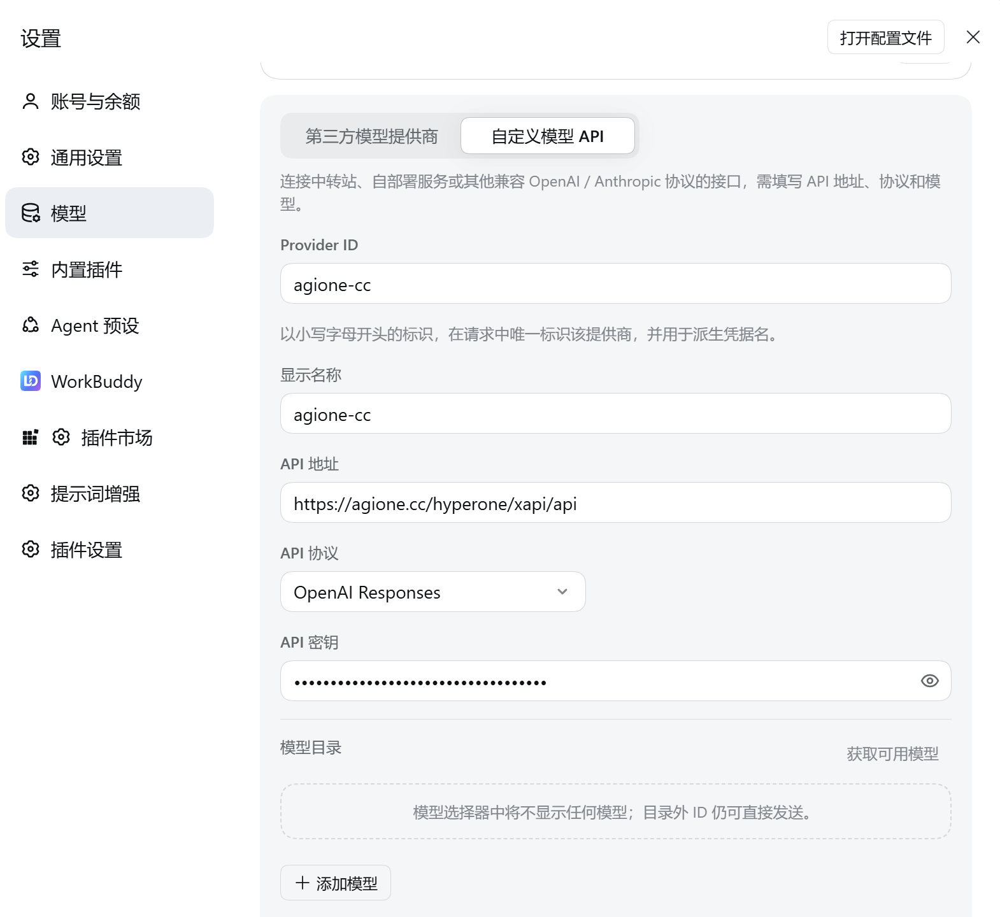
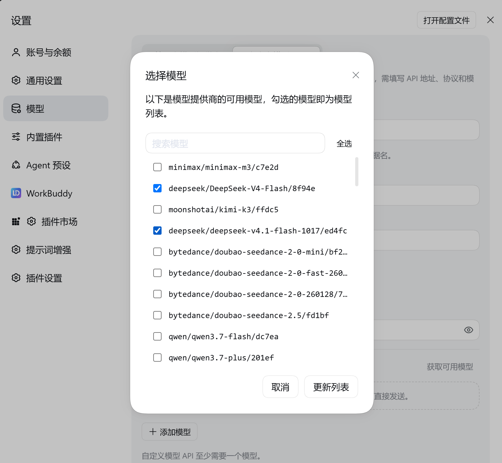
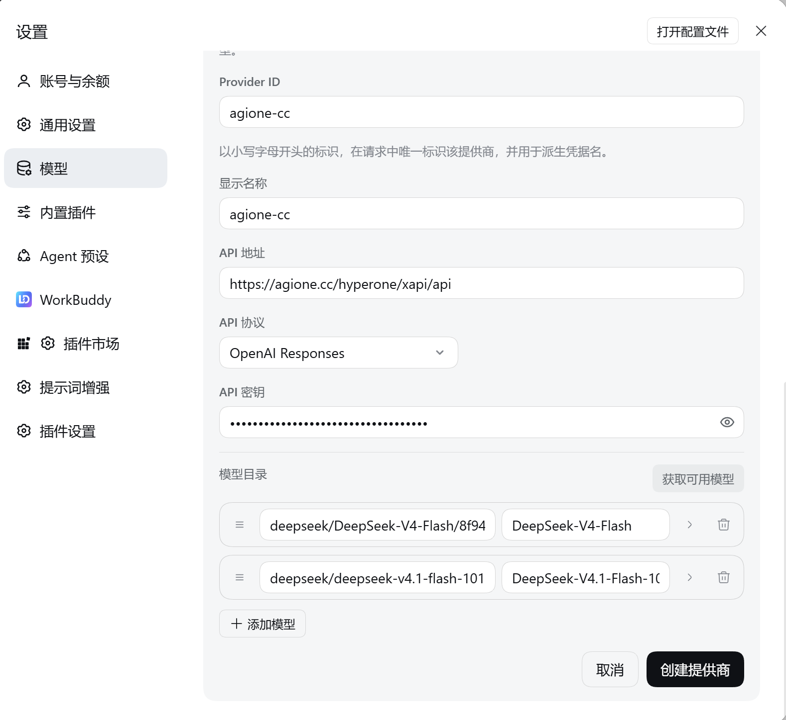

# 在 DeepSeek Harness 中添加 AGIOne 作为模型提供商

本文介绍如何通过 **自定义模型 API**，在 DeepSeek Harness 中配置 AGIOne、获取模型列表并选择模型进行测试。

## 开始前准备

1. 安装并打开 DeepSeek Harness。产品入口为 [DeepSeek Harness](https://harness.deepseek.com/)，下载方式以官方发布说明为准。本文从已安装的客户端开始。
2. 访问 [AGIOne](https://agione.cc/)，注册并登录账号。
3. 在模型广场选择需要使用的模型，进入模型的 API 调用或快速开始页面，获取 **API 地址**、**API Key** 和完整的 **Model ID**，并确认模型支持的协议类型。

> 本文截图展示 AGIOne 中文平台的配置示例，提供商名称和模型列表仅供参考。实际配置时，请使用自己 AGIOne 平台上的调用信息；截图不代表模型响应或工具调用已经验证。

## 配置模型提供商

### 1. 添加自定义模型 API

打开 DeepSeek Harness 的**设置**，在左侧选择**模型**，点击列表底部的 **+ 添加模型提供商**。

在添加区域选择**自定义模型 API**，填写提供商信息。

### 2. 填写 AGIOne 调用信息

| 字段 | 填写说明 |
| --- | --- |
| Provider ID | 提供商的唯一标识，例如 `agione`。以小写字母开头，后续可使用小写字母、数字和连字符；不能与已有提供商重复 |
| 显示名称 | 自定义填写，例如 `AGIOne` |
| API 地址 | 从 AGIOne 的 API 调用页面复制与所选协议对应的基础地址；截图示例为 `https://agione.cc/hyperone/xapi/api`，公共平台和专属部署均以实际页面为准 |
| API 协议 | 截图选择的是 `OpenAI Responses`。使用该选项前，先确认所选模型及 API 地址支持 Responses 协议；其他模型应选择其实际支持的协议 |
| API 密钥 | 填写 AGIOne 的 API Key；若页面显示 `认证 TOKEN`，从该位置获取 |

API 协议下拉框还支持 `OpenAI Chat Completions` 和 `Anthropic Messages`。协议必须与 AGIOne 模型的调用说明一致，不要只根据模型名称选择。

### 3. 获取并选择模型

1. 填写 API 地址和密钥后，点击**模型目录**右侧的**获取可用模型**。
2. 在**选择模型**弹窗中搜索并勾选需要使用的模型。
3. 点击**更新列表**，将勾选的模型加入模型目录。

截图展示了勾选 DeepSeek 模型的示例。用于 AI 编码时，请选择自己平台上支持文本对话及所需工具调用的模型；请从 API 调用页面复制完整 Model ID，不要照抄截图中被截断的字段或将图像、视频模型用于文本编码任务。

如果接口没有返回模型，可点击 **+ 添加模型**，手动填写从 AGIOne 复制的完整 Model ID，并设置显示名称。自定义模型 API 至少需要一个模型。

### 4. 创建提供商

1. 返回配置区域，检查模型目录中的 Model ID 和显示名称。
2. 确认 API 地址、API 协议和密钥填写正确。
3. 点击右下角的**创建提供商**。
4. 返回模型提供商列表，确认出现所填显示名称对应的条目，例如 **AGIOne** 或 `agione-cc`。

> 提供商创建完成或模型列表获取成功，不代表模型对话已验证。请继续完成下面的响应测试。

## 测试响应

1. 返回对话界面，在模型选择器中选择 AGIOne 下已添加的模型。
2. 输入简单任务，例如：`请编写一个 Python 函数，计算两个数的和，并添加注释。`
3. 发送消息，检查是否收到完整的模型回复。
4. 返回 AGIOne 的调用日志页面，核对对应模型的调用记录。

模型返回正常回复，并且 AGIOne 中出现对应的调用记录后，可确认本次模型调用已连通。该测试不代表所有工具调用、图片输入或其他高级能力均已验证。

## 配置检查

- **Provider ID 提示重复**：更换未被使用的标识；若是修改已有 AGIOne 配置，返回列表点击该条目的**编辑**。
- **模型目录为空**：先获取可用模型，或手动添加完整 Model ID；至少保留一个模型。
- **模型已列出但对话未通过**：核对 API 地址、API 协议、API Key 和 Model ID 是否与 AGIOne 调用页面一致，再检查对应调用日志。

> 截图说明：本页保留用户提供的中文原图，未重新采集。原图的窗口尺寸及模型选择弹窗的背景遮罩未按仓库标准化截图规范重制；英文页已补充对应的英文界面原图。

*操作依据：用户提供的中文界面截图；字段及协议选项另与本地 DeepSeek Harness 0.2.2-rc.1 界面实现核对。本文未记录真实 API 联调结果，测试响应一节用于指导读者验证自己的配置。*
