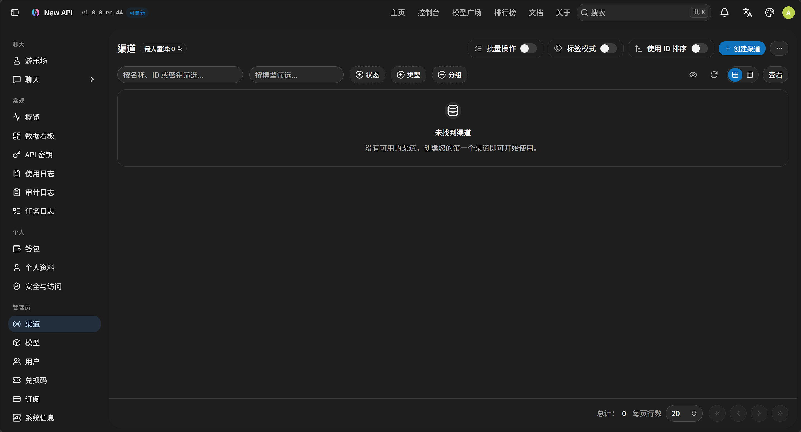
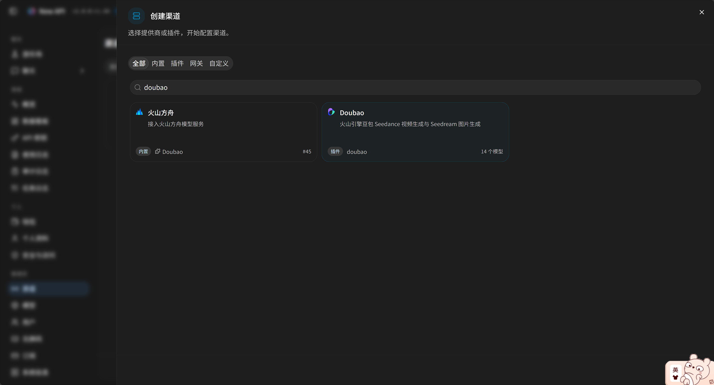
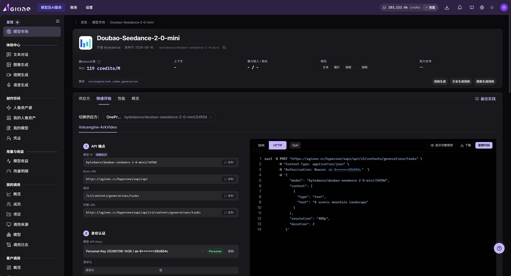
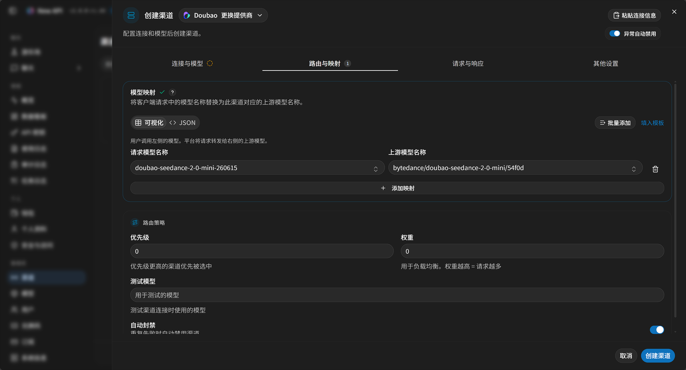
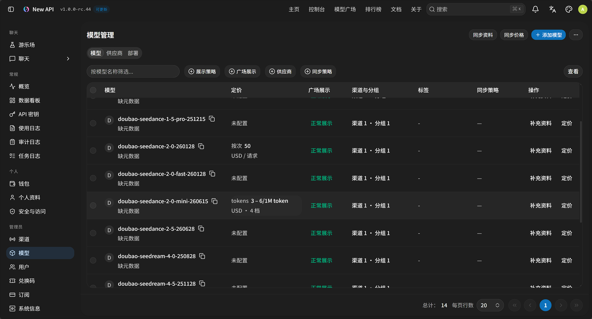
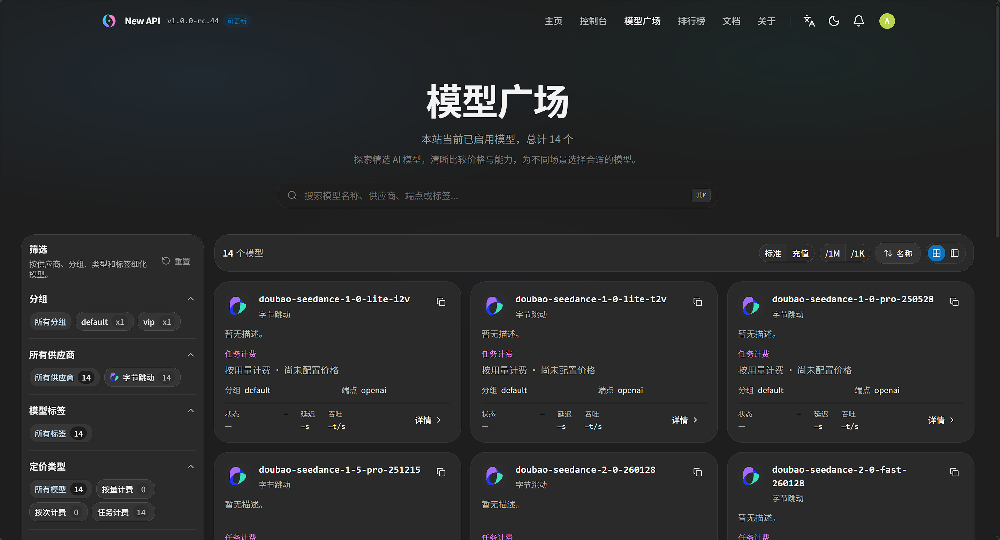

# 在 New API 中接入 AGIOne 豆包（Doubao）视频生成模型

本文介绍如何在 **New API**（API 聚合管理平台）中创建渠道，将 AGIOne 平台上的豆包 Seedance / Seedream 系列视频与图像生成模型接入 New API，供下游用户通过统一的 API 密钥调用。

## 开始前准备

1. 部署并登录 New API 管理后台（本文使用 `v1.0.0-rc.44`）。
2. 访问 [AGIOne](https://agione.cc/)，注册并登录账号，确保账户余额充足。
3. 在 AGIOne 的**模型市场**中找到需要接入的豆包模型，进入模型详情页，获取以下信息：
   - **Base URL**（基础地址）
   - **模型 ID**（Model ID）
   - **API Key**（API 密钥）

> 本文以豆包 Seedance 视频生成模型为例。截图为配置示例，实际操作请以自己 AGIOne 平台上的信息为准。

## 步骤一：进入 New API 渠道管理

登录 New API 管理后台。在左侧导航栏的 **管理员** 分组下，点击 **渠道**，进入渠道管理页面。

初始状态下渠道列表为空，显示"未找到渠道"。点击右上角的 **+ 创建渠道** 按钮，开始添加 AGIOne 渠道。



## 步骤二：选择 Doubao 渠道类型

在弹出的 **创建渠道** 面板中，需要选择提供商或插件来配置渠道。

在搜索框中输入 `doubao`，系统会显示两个相关选项：

| 选项 | 类型 | 说明 |
| --- | --- | --- |
| **火山方舟** | 内置 | 接入火山方舟模型服务，自带 Doubao 适配，共 45 个模型 |
| **Doubao** | 插件 | 火山引擎豆包 Seedance 视频生成与 Seedream 图片生成，共 14 个模型 |

根据需求选择对应的选项。本文选择 **Doubao（插件）**，该插件专门适配 Seedance 视频生成与 Seedream 图片生成模型。



## 步骤三：在 AGIOne 获取模型调用信息

选择 Doubao 插件后，需要填写上游模型的连接信息。切换到 AGIOne 平台获取这些信息。

### 获取 API 端点和密钥

1. 登录 [AGIOne](https://agione.cc/)，进入左侧导航栏的 **模型市场**。
2. 找到并点击目标模型，例如 **Doubao-Seedance-2-0-mini**，进入模型详情页。
3. 点击 **快速开始** 标签页，查看 API 调用信息。

在快速开始页面，可以看到以下关键字段：

| 字段 | 示例值 | 说明 |
| --- | --- | --- |
| 模型 ID | `bytedance/doubao-seedance-2-0-mini/54f0d` | 模型的完整标识，包含供应商前缀和实例 ID |
| Base URL | `https://agione.cc/hyperone/xapi/api` | API 请求的基础地址 |
| 路径 | `/v3/contents/generations/tasks` | 视频生成任务的 API 路径 |
| 完整 URL | `https://agione.cc/hyperone/xapi/api/v3/contents/generations/tasks` | 完整的请求地址 |
| API Key | 从 **身份认证** 区域获取 | Personal Key，用于请求鉴权 |

页面右侧还提供了 SDK、HTTP 和 Curl 三种调用方式的代码示例，可用于验证接口连通性。



> **提示**：点击各字段右侧的 **复制** 按钮可以快速复制对应值。API Key 在 **身份认证** 区域，选择已有的 Personal Key 或创建新的密钥。

## 步骤四：配置连接与模型映射

回到 New API 的创建渠道面板，完成以下配置。

### 连接与模型

在 **连接与模型** 标签页中，填写从 AGIOne 获取的 Base URL 和 API Key 等连接信息。

### 路由与映射

切换到 **路由与映射** 标签页，配置模型映射关系。

**模型映射** 决定了用户请求的模型名称如何映射到上游（AGIOne）的真实模型名称。平台会将客户端请求中的模型名称替换为此渠道对应的上游模型名称。

配置说明：

| 字段 | 示例值 | 说明 |
| --- | --- | --- |
| 请求模型名称 | `doubao-seedance-2-0-mini-260615` | 下游用户在 API 请求中使用的模型名称 |
| 上游模型名称 | `bytedance/doubao-seedance-2-0-mini/54f0d` | AGIOne 平台上的完整模型 ID |

可以点击 **+ 添加映射** 为更多模型配置映射关系，也可以使用 **批量添加** 或 **填入模板** 快速配置。

**路由策略** 控制渠道的调用优先级和负载分配：

| 字段 | 说明 |
| --- | --- |
| 优先级 | 优先级更高的渠道优先被选中（数值越大优先级越高） |
| 权重 | 用于负载均衡，权重越高 = 请求越多 |

> 映射配置支持 **可视化** 和 **JSON** 两种编辑模式，可根据需要切换。



### 其他设置

在 **请求与响应** 和 **其他设置** 标签页中，可根据需要配置请求超时、自动封禁等高级选项。默认配置通常即可使用。

配置完成后，点击右下角的 **创建渠道** 按钮保存。

## 步骤五：确认模型已添加

渠道创建成功后，在左侧导航栏点击 **模型**，进入 **模型管理** 页面，确认豆包模型已正确添加。

下图展示了通过 Doubao 渠道成功接入的 14 个模型，涵盖 Seedance 视频生成和 Seedream 图像生成两个系列：



模型管理页面中的关键信息：

| 列 | 说明 |
| --- | --- |
| 模型 | 模型名称，即下游用户在 API 请求中使用的标识 |
| 定价 | 模型的计费方式和价格（按次、按 Token 量等） |
| 广场展示 | 是否在模型广场中对终端用户可见 |
| 渠道与分组 | 模型关联的渠道编号和用户分组 |

## 步骤六：模型广场验证

最后，点击顶部导航栏的 **模型广场**，从终端用户视角确认模型展示是否正确。

模型广场会展示已启用的所有模型，用户可以在此浏览模型名称、供应商、计费方式、端点类型等信息。



确认以下几点：

- 模型卡片显示正确的模型名称和供应商（字节跳动）
- 计费方式标注正确（任务计费）
- 端点类型显示为 `openai`
- 可以按分组（default / vip）和供应商筛选

> 模型广场展示正常，不代表模型调用已验证。请继续完成下面的调用测试，确保端到端连通。

## 调用测试

渠道和模型配置完成后，建议通过 API 请求验证连通性。

以 Doubao-Seedance-2-0-mini 视频生成为例，使用 Curl 发送测试请求：

```bash
curl -X POST "https://<your-new-api-domain>/v3/contents/generations/tasks" \
  -H "Content-Type: application/json" \
  -H "Authorization: Bearer <your-new-api-key>" \
  -d '{
    "model": "doubao-seedance-2-0-mini-260615",
    "content": [
      {
        "type": "text",
        "text": "A scenic mountain landscape"
      }
    ],
    "resolution": "480p",
    "duration": 2
  }'
```

将 `<your-new-api-domain>` 替换为 New API 的实际域名，`<your-new-api-key>` 替换为 New API 分配给用户的 API 密钥。

如果返回任务创建成功的响应，说明 New API → AGIOne → 豆包模型的完整链路已连通。

## 注意事项

**核心技术陷阱提示：** 在渠道卡片上点击 **测试连接** / **测试渠道连接** 按钮时，控制台和界面都会报错：`Task Plugin channel test is not supported`。原因是 New API 的渠道测试默认发送标准文本对话（Chat/Completions）探测请求，而任务插件专为异步/任务式图像和视频生成设计，其核心不包含对话补全实现。此错误是 New API 的机制限制，并不表示渠道配置有误或插件功能异常。测试和验证必须使用真实的文生图或文生视频 API 请求。

## 常见问题

- **创建渠道时找不到 Doubao 选项**：确认 New API 已安装 Doubao 插件。在创建渠道弹窗中切换到 **插件** 标签页查看已安装的插件列表。
- **渠道创建成功但调用报错**：检查 AGIOne 的 Base URL 和 API Key 是否填写正确；确认 API Key 有对应模型的调用权限；查看 AGIOne 平台的调用日志定位错误原因。
- **模型映射不正确**：确保请求模型名称（下游名称）和上游模型名称（AGIOne 完整 Model ID）配置正确。可在 **路由与映射** 页面编辑或重新添加映射。
- **模型广场不显示模型**：在模型管理页面检查模型的 **广场展示** 是否设置为"正常展示"。

*操作依据：用户提供的 New API v1.0.0-rc.44 管理后台及 AGIOne 平台截图。本文未记录真实 API 联调结果，调用测试一节用于指导读者验证自己的配置。*
