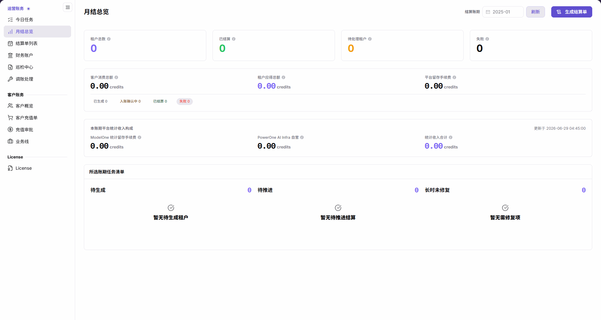
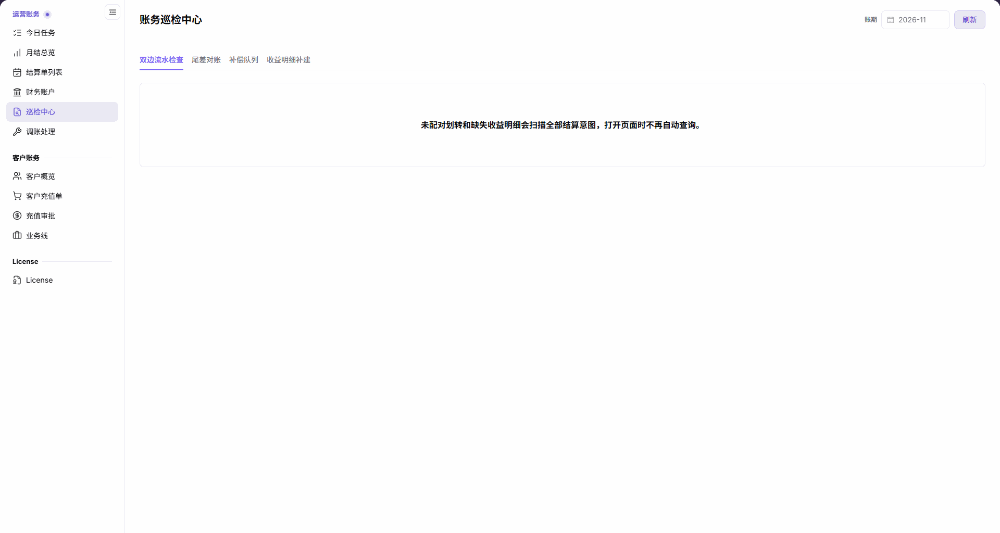
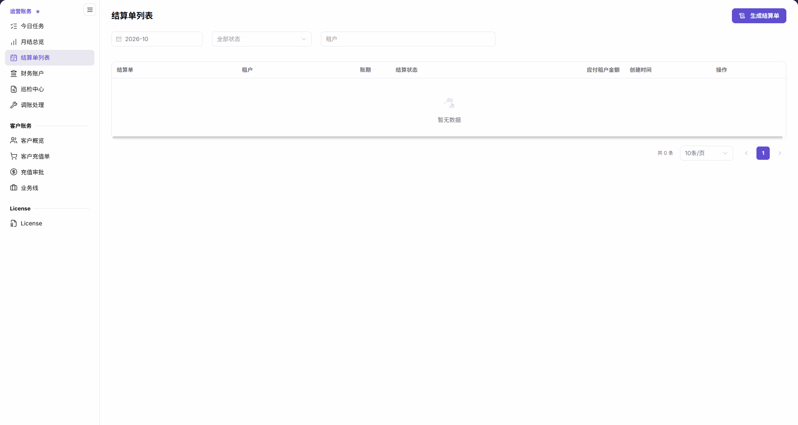

# 运营账期对账与结算

本任务用于完成一次运营侧账期检查、异常处理和结算确认。账期是要核对的结算月份，不是实时余额的统计范围。

账务核对人员负责整理账期、租户、流水与差异；需要生成或补建时，交给具备对应权限且已获业务授权的操作人员执行。需要模型提供方确认时，交付结算单标识、账期和差异说明，由提供方在自己的收益页面复核，不把操作入口已打开当作到账证明。

## 适用角色

- 平台运营方、账务运营人员、财务对账人员

## 开始前准备

1. 确认目标账期、租户、客户和业务线。
2. 确认当前账号具备查看财务账户、巡检和结算单的权限。
3. 对生成结算单、补偿、补建或调账操作完成影响评估。

## 操作流程

### 1. 确认月结状态与待办

进入 `账务 > 运营账务 > 月结总览`，选择目标账期并点击 **刷新**，再核对租户结算统计、客户消费总额、租户应得总额、平台留存手续费及任务清单。仅更改月份不会加载对应统计。需要日常汇总时进入[今日任务](../../../usermanual/billing/operator/finance-operations/today-tasks/)；字段口径见[月结总览](../../../usermanual/billing/operator/finance-operations/monthly-overview/)。

### 2. 核对财务账户

进入[财务账户](../../../usermanual/billing/operator/finance-operations/financial-accounts/)，切换平台清算账户和平台收益账户，选择同一账期并刷新，核对方向、来源系统与流水引用信息。实时余额与账期统计分开阅读；本页没有租户筛选框，不将两个口径直接相减作为差异。

### 3. 处理巡检异常

进入[巡检中心](../../../usermanual/billing/operator/finance-operations/reconciliation-center/)，分别查看双边流水检查、尾差对账、补偿队列和收益明细补建。双边检查扫描全部结算意图，且打开页面不自动查询；初始无结果不是“无异常”。尾差核对来源账期范围、检查时间和五类数量及金额。只读核对不点击“执行补建”；需要写入处理时先确认授权和扫描范围。

### 4. 查看或生成结算单

进入[结算单列表](../../../usermanual/billing/operator/finance-operations/settlement-list/)，按账期、状态和租户搜索。需要生成时，按手册依次完成选择账期与租户、生成检查、结算预览和操作备注。账期须早于当前月，租户须存在未生成收益明细。获得业务授权后才点击“确认生成”；随后返回列表并进入详情核对结算进度、金额、明细与入账确认信息。打开生成入口不代表生成或到账。

### 5. 记录未解决差异与功能边界

[调账处理](../../../usermanual/billing/operator/finance-operations/account-adjustment/)当前是开发中提示页，没有可填写的调账表单。存在未解决差异时，保留账期、租户、流水引用与已核对结论，交由负责人员处理；不要将导航到该页或返回主页记录为“调账完成”。

## 完成检查

按下表核对账期的可追溯结算结果；未通过时先排查再继续。

| 检查项 | 通过标准 |
| --- | --- |
| 核对范围 | 账期与租户对象一致；平台账户、实时余额、账期统计和全历史双边检查按各自范围解释。 |
| 账户流水 | 汇总金额能够回溯到财务账户和交易流水。 |
| 巡检异常 | 阻塞异常已处理，剩余事项有明确结论。 |
| 结算结果 | 结算单金额、状态和入账信息正确。 |
| 未解决差异 | 已记录对象、证据与后续处理人；未把开发中页面写成已完成调账。 |

## 常见失败分支

| 现象 | 优先检查 |
| --- | --- |
| 月结汇总与账户金额不一致 | 账期、租户、交易类型和数据更新时间 |
| 巡检异常长期未消除 | 补偿队列、缺失收益明细和责任人 |
| 结算单无法生成 | 账期是否早于当前月、目标租户是否有未生成收益明细，以及生成检查和授权 |
| 找不到调账表单 | 当前调账处理为开发中提示页，转至财务账户与结算单核对已有信息 |
