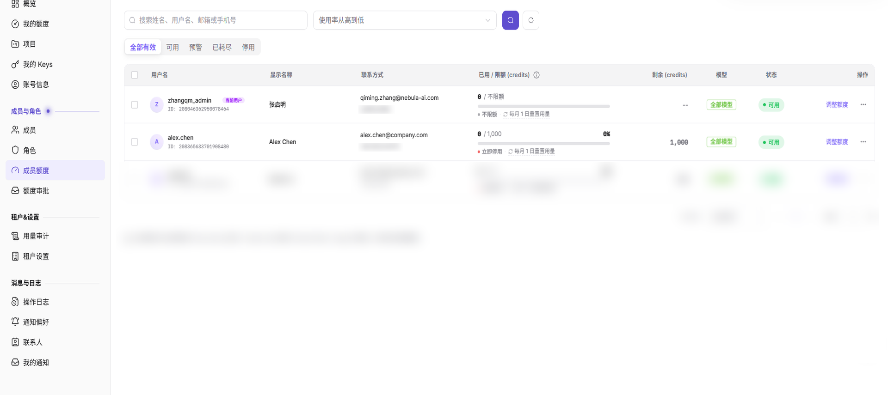
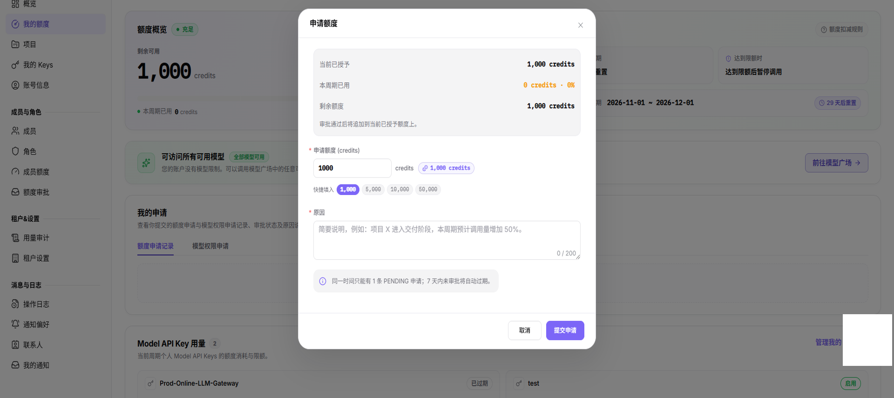
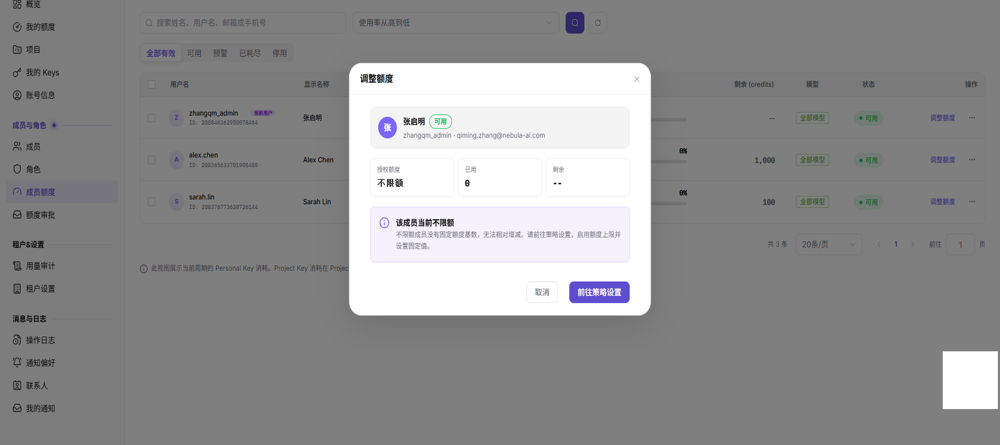

# 成员额度申请与分配

本任务用于为目标成员申请额度、调整额度并设置调用限额。成员额度是该成员可消费的 credits 上限，Key 是调用凭据，二者不是同一层限制。

申请人交付目标成员、所需额度和业务原因，具备审批权限的人员反馈申请状态与处理意见；成员据此核对额度和调整记录。管理员只在仍需独立变更且获授权时调整额度，不把审批通过当成再次调增的指令。

## 适用角色

- 服务商管理员、模型提供方、需要申请额度的平台用户

## 开始前准备

- 明确目标成员、所需额度和业务原因。
- 确认没有重复待审批申请。
- 明确项目预算、Key 限额、模型范围和重置策略。

## 操作流程

### 1. 查看成员当前额度

进入[成员额度](../../../usermanual/settings/user/members-roles/member-quotas/)，定位成员，核对授权额度、已用、剩余、模型范围和状态。

### 2. 发起额度申请

进入 `设置 > 成员与角色 > 额度审批` 的[申请记录](../../../usermanual/settings/user/members-roles/quota-requests/)，确认没有重复待审批记录，点击 **申请额度**，填写额度和业务原因。确认申请对象与数量后才提交；仅查看时关闭弹窗。菜单名为“额度审批”，“申请额度”是页面内按钮。

### 3. 跟踪申请与审批结果

在申请记录中按状态筛选，确认待审批、已通过、已拒绝、已取消或已过期状态。审批完成后返回成员额度页面核对到账结果。

### 4. 调整成员额度和限额

审批后先核对成员授权额度、剩余和调整记录，不因申请通过就再次增加同一笔额度。确需额外调整且当前账号有权操作时，在成员详情中选择增加或扣减并填写原因；按需设置重置周期、限额和模型白名单。确认目标成员、调整数量与业务授权后才保存，并核对项目预算和 Key 限额。只读核对不提交变更。

图示为“不限额”成员分支：当前没有固定额度可增加或扣减，窗口提供取消和前往策略设置，不含数量、原因输入框，也不是额度调整成功结果。准备获准的变更前，先按实际成员状态核对可用入口。

## 完成检查

申请、成员余额和限制未核对一致前，不依赖新额度执行正式调用。

| 检查项 | 通过标准 |
| --- | --- |
| 申请记录 | 额度、原因、状态和审批结果完整。 |
| 成员余额 | 调整后的授权、已用和剩余额度正确。 |
| 限制关系 | 成员、项目、Key 和模型白名单规则一致。 |
| 实际验证 | 成员调用在额度内成功，超限后按策略受限。 |

## 常见失败分支

| 现象 | 优先检查 |
| --- | --- |
| 无法提交新申请 | 是否已有待审批申请、数量和原因是否完整 |
| 申请通过但额度未变化 | 申请对象、同步状态和成员详情 |
| 额度充足但调用失败 | 项目预算、Key 限额、模型白名单和模型状态 |
| 调整按钮不可用 | 当前账号角色和成员额度管理权限 |
