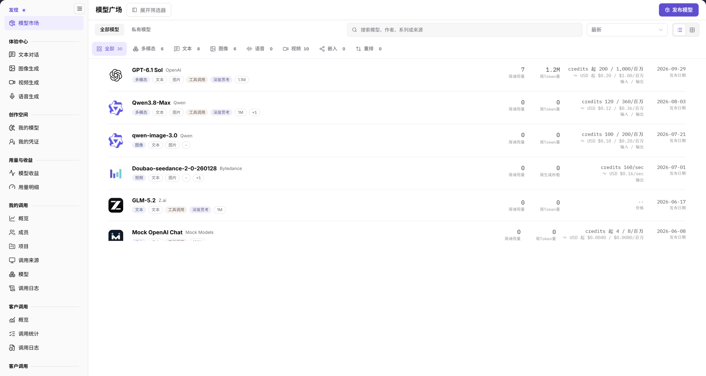
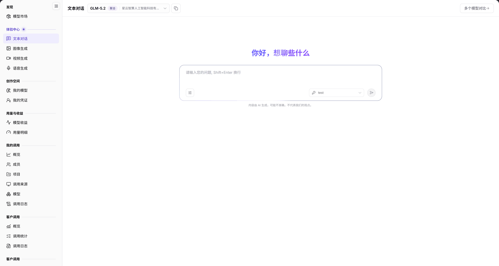

# {{DOCS_PRODUCT_NAME_ZH}} 普通用户指南

本指南串联登录、选择供应方、在线体验、API（应用程序接口）接入和调用日志核对。示例中的密钥与模型标识必须替换为当前账号获授权的值，本文不保证某一示例模型始终可用。

## 适用角色

- 体验和调用模型的平台用户；模型提供方可在自己的权限范围核对客户调用。

调用前由提供方或模型详情页确认模型/供应方、协议、价格及可见范围；调用方使用自己获授权的密钥。协查时交接请求时间和模型标识即可，不在共享材料里交接真实密钥。

## 开始前准备

- 已登录 {{DOCS_PRODUCT_NAME_ZH}}，登录入口为 {{DOCS_LOGIN_URL_ZH}}；账号可访问目标模型。
- 已核对账户额度、目标供应方的价格与计费单位，取得调用授权和个人 Key（调用密钥）。不要把免费配额领取作为所有模型必有的步骤。
- 准备无敏感信息的测试输入。在线体验和 API 请求都可能消耗额度，先确认费用与使用授权。

## 1. 发现模型与选择供应方

1. 进入 **模型及AI服务 > 发现 > 模型市场**，按模型名称、作者、系列或模型源搜索，并根据输入输出能力、计费等条件缩小范围。
2. 点击目标模型名称进入详情，核对模型标识、上下文、协议和输入输出模态。
3. 在 **Providers（供应方）** 页签比较具体实例的价格、能力和路由标识（请求中用于指向具体供应方实例的模型标识）。相同元模型的不同供应方不一定有相同价格和调用权限。
4. 选择目标供应方后，用其 **Playground（体验中心）** 或 **Quick Start（快速开始）** 继续；复制调用标识时使用该供应方显示的路由标识，而不是凭模型展示名称猜测。



图示为当前模型市场的搜索、能力分类与模型列表。模型与数量会随发布和筛选变化，不按图中固定位置定位目标模型。

## 2. 在线体验

1. 文本任务进入 **体验中心 > 文本对话**，选择模型并核对供应方与标签。
2. 输入简短测试问题，使用 **Shift+Enter** 换行，点击发送后检查回答。多模态输入是否可用取决于模型声明，不能把支持图片输入的模型都当成生图模型。



图示为文本对话的模型选择、对话输入与多个模型对比入口；提交前核对实际选中的模型和供应方。

3. 生成其他内容时，按任务选择对应入口：

| 任务 | 菜单与操作依据 | 验证重点 |
| --- | --- | --- |
| 生成图片 | [图像生成](../../../usermanual/model-services/user/playground/images/)：选择模型、尺寸和张数，输入图片描述 | 生成结果、张数与费用单位 |
| 生成视频 | [视频生成](../../../usermanual/model-services/user/playground/video/)：选择模型、分辨率和比例，输入画面描述；通过任务查询回看 | 任务状态和最终视频；不是上传视频进行抽帧分析 |
| 生成语音 | [语音生成](../../../usermanual/model-services/user/playground/audio/)：选择模型并填写需要朗读的文字 | 音频结果与实际试听；不是默认提供录音识别 |

## 3. 使用 API 调用

1. 返回目标供应方卡片，点击 **Quick Start**；核对其模型路由标识、完整 URL（请求地址）、协议和认证说明。
2. 选用当前账号有权使用的密钥，不在共享文档、截图或代码仓库中保留真实值。
3. 对支持 OpenAI Chat Completions（对话补全协议）的模型，可按当前页面确认后的地址执行下方示例。curl 是命令行 HTTP 请求工具；此请求体仅适用于对应对话补全协议，其他模态按当前 Quick Start 提供的格式调用。

```bash
curl -X POST "{{DOCS_API_ENDPOINT_ZH}}" \
  -H "Content-Type: application/json" \
  -H "Authorization: Bearer {API_KEY}" \
  -d '{"stream":true,"model":"{MODEL_IDENTIFIER}","messages":[{"role":"user","content":"Hello"}]}'
```

4. 将占位符替换为当前 Quick Start 的值，核对响应是否为目标模型的有效输出。只有无错误提示、不一定能证明模型生成成功，还需检查结果内容。
5. 需要客户端接入示例时，参考[{{DOCS_PRODUCT_NAME_ZH}} 最佳实践]({{DOCS_OPENCODE_URL_ZH}})。

## 4. 核对调用记录

1. 进入 **我的调用 > 调用日志**，选择调用月份，按需切换 **按日**，限定模型、调用来源或 **名称或 ID**。
2. 在 **分类结果** 中选择全部或相应异常分类，按调用时间定位请求。
3. 核对 **模型 & 平台路由**、**调用归属**、**调用来源**、**使用情况** 与 **执行状态 & 耗时时序**。调用归属与调用来源不是同一维度。
4. 从操作列查看单次调用详情；提供方检查客户调用时按自身权限与相同时间范围核对，不将其设为普通用户完成任务的前提。

## 完成检查

| 检查项 | 通过标准 |
| --- | --- |
| 模型与权限 | 目标模型和供应方可定位，价格与调用授权已确认。 |
| 在线体验 | 对应模态的体验返回可检查结果。 |
| API 请求 | 采用目标协议、路由标识和获授权密钥，返回有效输出。 |
| 日志 | 对应时间、模型和调用状态的记录可定位。 |

## 常见失败分支

| 现象 | 优先检查与继续入口 |
| --- | --- |
| 找不到模型 | 清除筛选并核对全部/私有范围与租户可见性，见[模型市场](../../../usermanual/model-services/user/discover/models/#常见问题)。 |
| 体验与 API 表现不同 | 核对同一供应方、模型路由、协议、价格与 Key，不混用不同实例。 |
| API 认证失败 | 核对当前 Quick Start 的地址、认证格式和账号授权；不要将密钥发到公开工单。 |
| 调用日志为空 | 核对月份、模型、来源、名称/ID及结果分类，见[调用日志](../../../usermanual/model-services/user/my-calls/call-logs/#常见问题)。 |

## 操作手册

- [模型市场](../../../usermanual/model-services/user/discover/models/)
- [我的调用概览](../../../usermanual/model-services/user/my-calls/overview/)
- [调用日志](../../../usermanual/model-services/user/my-calls/call-logs/)
