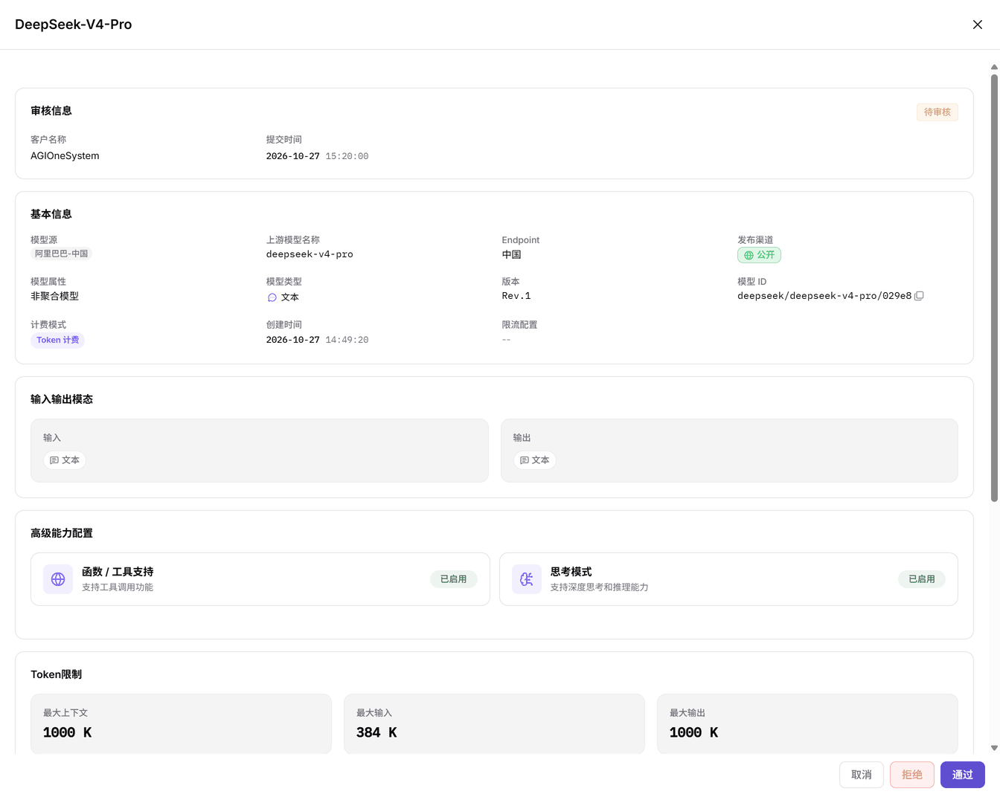

# 模型发布审批

本任务核对提供方提交的模型版本，并由运营管理员在审核抽屉中作出处理。

## 适用角色

- 运营管理员；模型提供方配合核对提交版本与发布状态。

提供方交付模型标识、提交版本、可见范围和配置核对依据；运营管理员按该对象审核，再把处理状态与需补充的材料交给提供方。交接不要求共享真实凭据。

## 开始前准备

1. 当前账号具备 **模型及AI服务 > 审批 > 模型审核** 查看和处理权限。
2. 存在待审核记录，已确认需要审核的模型、客户、版本和可见范围。
3. 已准备发布配置核对依据；共享材料不含真实凭证。

## 操作流程

1. 进入 **审批 > 模型审核**，按模型名称、待审核状态、可见范围、模型类型或客户筛选，点击 **搜索**。提交时间和版本在列表中核对，不把它们当成必有的筛选控件。
2. 在目标行核对客户、版本、提交时间及可见范围，点击 **审核** 打开右侧抽屉；列表没有独立 **详情** 按钮。
3. 在抽屉检查模型源、上游模型名称、Endpoint（服务接入点）、模型 ID（平台模型标识）、发布渠道、版本、计费和限流，再核对模态、高级能力、Token（模型处理的文本单元）限制及协议。

图示为审核抽屉，底部提供取消、拒绝和通过；打开抽屉用于核对，并不等于已经提交审核决定。

4. 确认对象和版本后，按业务授权选择 **通过** 或 **拒绝**。暂不处理时点击 **取消**。不要假定页面必有意见输入框或承诺意见会自动展示给提供方；需要补充材料时按既定协作渠道交接。
5. 处理后重新查询记录并核对状态与审核时间。由提供方回到[我的模型](../../../usermanual/model-services/user/studio/my-models/)检查发布状态与版本；已通过的模型再用目标账号在[模型市场](../../../usermanual/model-services/user/discover/models/)核对范围与调用权限。

## 完成检查

| 检查项 | 通过标准 |
| --- | --- |
| 审核对象 | 模型 ID、客户、版本与预期可见范围一致。 |
| 配置依据 | 模态、协议、计费与限流已逐项核对。 |
| 处理结果 | 重新查询后能核对审核状态和审核时间。 |
| 发布核对 | 提供方核对版本，目标用户按授权范围验证可见性与调用。 |

## 常见失败分支

| 现象 | 优先检查与继续入口 |
| --- | --- |
| 找不到记录 | 重置条件，再从待审核状态逐项增加条件，见[模型审核](../../../usermanual/model-services/operator/approvals/model-reviews/#常见问题)。 |
| 找不到详情按钮 | 点击行内审核打开抽屉；只查看时使用取消。 |
| 发布后不可见或不能调用 | 核对版本、发布方式和 Access Mode（访问控制模式），见[我的模型](../../../usermanual/model-services/user/studio/my-models/)与[模型市场](../../../usermanual/model-services/user/discover/models/)。 |
