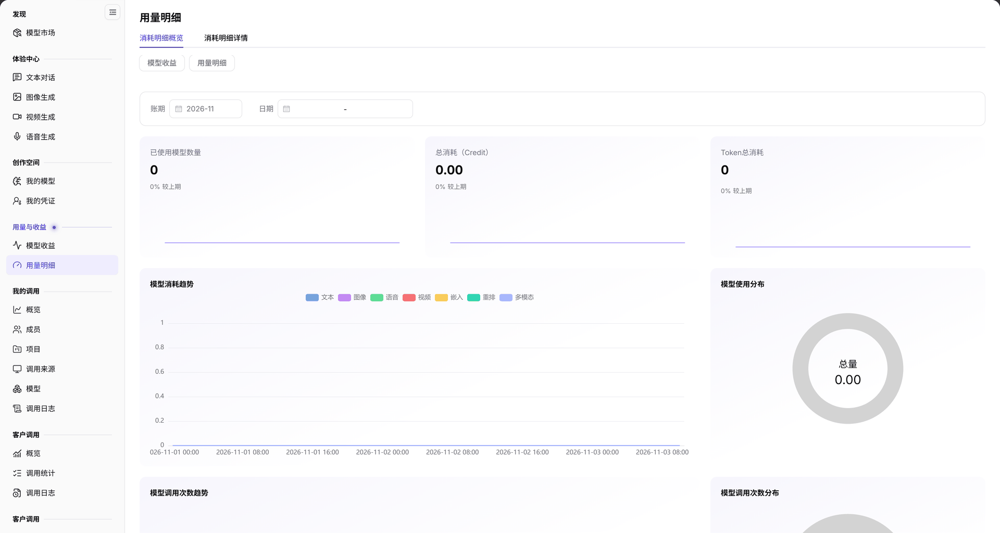
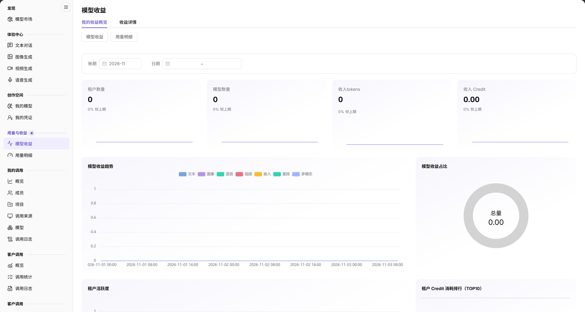

# 模型的消费与收益

调用方核对自己的消耗，模型提供方核对本方模型收入。两页统计口径不同，不将用户消费总额直接视为提供方收入。Credit 是平台计价单位，Token 是模型处理的文本单元，两者不能直接当作同一数量。

## 适用角色

- 平台用户、模型提供方；需要进一步财务核对时由运营方参与。

交接时，调用方给出目标时间范围和日志标识，提供方补充生效版本、价格与收益记录；运营方接手尚未解释的差异。共享材料只包含核对所需信息，不包含凭据。

## 开始前准备

1. 确认当前账号的调用方或提供方角色，记录目标模型、供应方、账期、日期与计费单位。
2. 准备不含密钥或完整请求正文的调用时间/标识，核对已生效发布版本和价格。

## 操作流程

1. 调用方进入[我的调用日志](../../../usermanual/model-services/user/my-calls/call-logs/)，按月份、模型和来源缩小范围，核对调用时间、模型路由、调用归属、使用情况及执行状态。归属是成员/项目，来源是应用来源，不能混为一个字段。
2. 进入 **用量与收益 > 用量明细**，选择相同账期和日期，读取 **已使用模型数量**、**总消耗（Credit）** 和 **Token总消耗**，再进入 **消耗明细详情** 核对明细。不要假定概览存在模型 ID 或成员/项目筛选器。

图示为账期与日期条件下的消耗概览，指标与趋势反映当前统计范围，并不是单次请求的完整账单。

3. 提供方进入 **用量与收益 > 模型收益**，对齐账期与日期，核对租户数量、模型数量、收入 Token 与收入 Credit，再进入 **收益详情**。

图示为提供方收益概览，收入指标与调用方消耗指标属于不同统计口径，需要分别读取。

4. 需要核对客户流量时，提供方进入[客户调用](../../../usermanual/model-services/user/provider-calls/overview/)及其[调用日志](../../../usermanual/model-services/user/provider-calls/call-logs/)，按自身权限比较相同模型与时间范围。
5. 数值存在疑问时，由提供方核对[我的模型](../../../usermanual/model-services/user/studio/my-models/)中生效版本、计费单位、价格及限流，并将当前页面记录交给运营方进一步核对。不要从汇总金额反推某种失败/取消请求的必然计费规则。

## 完成检查

| 检查项 | 通过标准 |
| --- | --- |
| 范围 | 账号、模型/供应方、账期、日期和单位已对齐。 |
| 调用 | 目标日志可定位，路由、归属、来源与状态分别核对。 |
| 消耗与收入 | 消耗概览/详情和收益概览/详情分别读取，不直接等同。 |
| 差异 | 疑问有具体记录、时间范围和价格依据可交接，不含凭据。 |

## 常见失败分支

| 现象 | 优先检查与继续入口 |
| --- | --- |
| 用量为空 | 检查账期、日期及是否有调用，见[用量明细](../../../usermanual/model-services/user/usage-earnings/model-usage/#常见问题)。 |
| 收益为空 | 检查账期、日期及对应模型收费情况，见[模型收益](../../../usermanual/model-services/user/usage-earnings/model-earnings/#常见问题)。 |
| 找不到日志 | 核对月份、来源和结果分类，见[调用日志](../../../usermanual/model-services/user/my-calls/call-logs/#常见问题)。 |
| 消耗与收益不一致 | 先对齐角色和统计范围，再核对生效价格；未解释差异交由运营方处理，不直接判定平台计费错误。 |
