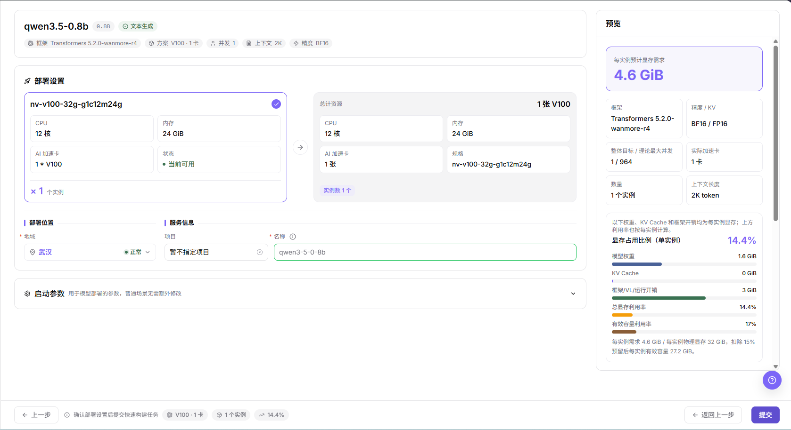
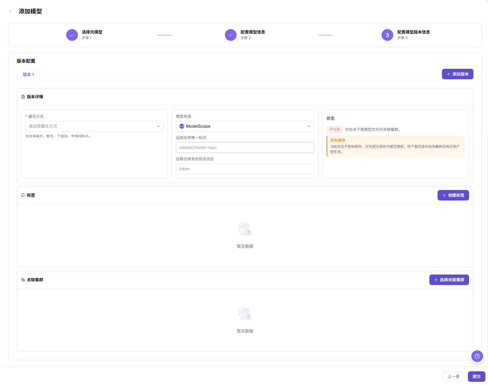

# 新模型模板准备与端到端部署调用指引

本任务串联 On-Prem（本地算力纳管）的模型文件、推理模板、模型实例和模型服务登记。已有可部署模板时从场景 A 开始；需要引入新模型版本时，先由运营管理员执行场景 B，再交给提供方执行场景 A。

## 适用角色

- 运营管理员：模型配置、框架与推理模板准备。
- 模型提供方：选择部署模板、创建实例、登记服务与受控调用验证。

运营管理员交付模型版本、框架关联和适配卡型；提供方接手后先核对模板与规格，再创建实例。服务登记完成后，提供方向目标用户交付模型标识、协议和授权范围，不交接共享明文密钥。

## 开始前准备

- 目标集群、加速卡、框架镜像和资源规格已就绪，租户具备所需地域配额。
- 已确认模型授权、版本、量化方式、仓库信息以及业务并发和上下文需求。昇腾 910B 与 vLLM 只是可选适配组合，不作为所有环境的固定值。
- 创建实例、登记发布和连通性测试前确认资源、费用与调用授权。测试会发起真实请求。API 是应用程序接口；冒烟检测仅作最小连通性检查，不代替发布完成和授权调用验证。
- 不将仓库凭据、实例 Endpoint（服务接入地址）或请求令牌复制到共享材料。

## 场景 A：使用已有模板部署与调用（模型提供方）

### 1. 从部署模板创建实例

1. 进入 **On-Prem > 模型部署 > 部署模板**，搜索并选择状态为 **可部署** 的目标模型，不从模型服务的我的模型页面寻找 Start 按钮。
2. 核对加速卡、业务参数与推荐规格。按实际负载确认并发、上下文、精度和预留，不照搬其他硬件的数值。
3. 在部署设置中核对资源总量、地域、项目与实例名称；预览确认后点击 **提交**。
4. 进入 **On-Prem > 模型部署 > 模型实例**，按名称和地域找到实例，核对模型、框架、资源与状态，待 **推理服务已就绪** 后继续。

图示为部署模板的设置与预览示例，包含资源、部署位置和服务信息；示例规格不代表当前账号必定可用。

详细部署参数见[部署模板](../../../usermanual/ai-infra-on-prem/user/model-deployment/templates/)，实例状态和服务端口见[模型实例](../../../usermanual/ai-infra-on-prem/user/model-deployment/instances/)。

### 2. 检测连通性并进入私有模型登记

1. 在目标实例卡片的 **…** 菜单选择 **发布模型**，核对发布对象和 **所选服务端口**。
2. 使用 **发布为私有模型** 进入检测；公共模型卡片提供 **联系我们**，不能将其视为可直接完成公有发布的证明。
3. 核对使用的推理服务端口和协议，取得请求授权后执行冒烟检测。只在出现 **API 冒烟检测通过** 后点击 **跳转发布**。
4. 在带私有标签的 **我的模型** 登记页继续完成基本信息、计费和限流；跳转成功或检测通过，都不等于发布完成。
5. 返回发布列表核对状态和版本，需要审核时按[模型发布审批](../model-publishing-approval/)交接。

### 3. 使用目标账号验证调用

1. 进入 **模型及AI服务 > 发现 > 模型市场**，在授权范围搜索模型并核对供应方。
2. 从供应方卡片进入 **Playground（体验中心）** 验证相应模态的输出，或进入 **Quick Start（快速开始）** 核对调用地址、协议与模型路由标识。
3. 按当前接入示例执行受控请求，检查有效输出，再在 **我的调用 > 调用日志** 定位对应时间和模型的记录。具体步骤见[模型的体验与调用](../model-experience-api-calling/)。

## 场景 B：准备新模型版本与推理模板（运营管理员）

### 1. 维护模型文件与关联集群

1. 进入 **On-Prem > 模板 > 模型配置**，确认目标模型是否已存在；新建时点击 **添加模型**，依次完成选择元模型、配置模型信息和配置模型版本信息。
2. 配置模型类别和参数量，在版本信息中核对量化方式、**模型来源**（模型文件来源，如 ModelScope、HuggingFace 或 Local）及远程仓库信息；该字段不是模型服务子系统的 **设置 > 模型源**。
3. 选择关联集群，核对状态后提交；回到列表检查 **模型下载** 的进度和目标版本。先保存并不证明文件已经下载完成或对用户侧可用。

图示为模型版本配置，量化方式、模型文件来源和关联集群需要结合目标环境填写。不要将另一模型仓库标识作为默认值。

### 2. 维护推理模板与框架关联

1. 进入 **On-Prem > 模板 > 推理模板**，点击 **创建推理模板**，选择模型、模型版本、框架版本并核对名称，再保存。
2. 打开模板详情，分别检查 **模型版本切换**、**框架关联**、运行镜像和绑定加速卡；需要时维护 **关联显存计算因子表单**（用于配置显存估算参数的表单）。
3. 核对每条框架关联的状态和列表的 **可部署 / 不可部署** 结论。不能把某个框架关联的 **可用** 等同于整个模板已可部署。
4. 确认依赖与可见范围后，将模型版本、框架和规格信息交给提供方，按场景 A 检查用户侧是否可选择和部署。

## 完成检查

| 检查项 | 通过标准 |
| --- | --- |
| 模型文件 | 模型版本与来源正确，目标关联集群文件状态已核对。 |
| 模板 | 目标模型/框架组合、镜像、加速卡与因子表单一致，用户侧可部署。 |
| 实例 | 实例卡片与预览配置一致，推理服务已就绪且端口与协议正确。 |
| 登记 | 冒烟检测通过后完成登记，发布状态和版本已复核。 |
| 调用 | 目标授权账号获得有效输出，调用日志可定位。 |

## 常见失败分支

| 现象 | 优先检查与继续入口 |
| --- | --- |
| 模型文件未就绪 | 核对版本来源、仓库信息与关联集群下载状态，见[模型配置](../../../usermanual/ai-infra-on-prem/operator/templates/models/#常见问题)。 |
| 模板不可部署 | 核对模型版本、框架关联、镜像、加速卡与依赖，见[推理模板](../../../usermanual/ai-infra-on-prem/operator/templates/inference-templates/#常见问题)。 |
| 规格不可选或实例找不到 | 核对地域、配额、名称与筛选，见[部署模板](../../../usermanual/ai-infra-on-prem/user/model-deployment/templates/)与[模型实例](../../../usermanual/ai-infra-on-prem/user/model-deployment/instances/)。 |
| 发布检测不通过 | 核对服务就绪状态、端口和协议，见[模型实例发布流程](../../../usermanual/ai-infra-on-prem/user/model-deployment/instances/#发布模型)。 |
| 登记后无法调用 | 先检查发布状态、版本和访问范围，再按[调用指南](../model-experience-api-calling/)排查。 |
