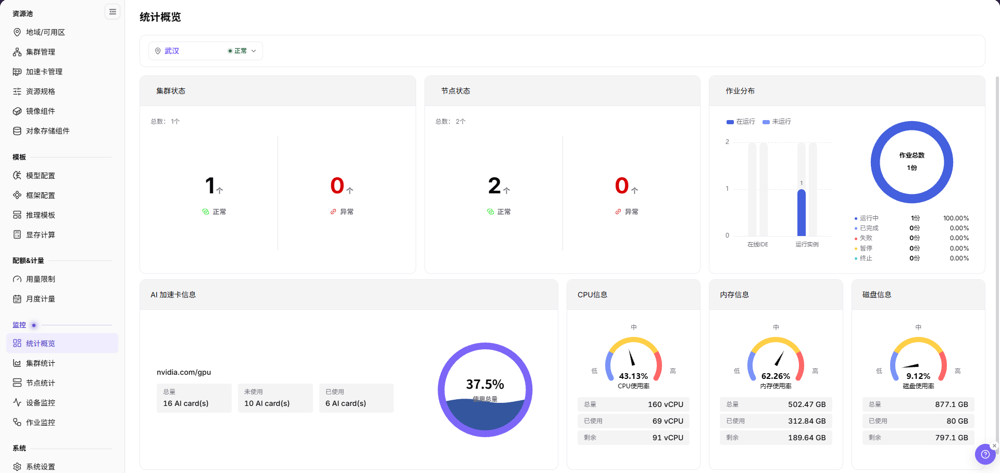

# 可观测与问题排查

本场景指导运营方、模型提供方和调用方先判断问题属于调用、模型服务、云上部署、异构卡纳管资源还是计量，再进入对应日志和监控页面，避免在错误子系统中反复搜索。API 是应用程序接口；用量中的 Token 是模型计量单位，认证 token 或 Key 是访问凭据，不能混作同一类信息。

## 适用角色

- 在各自权限范围排查问题的平台用户、模型提供方和平台运营方

## 场景目标

- 问题具备角色、时间范围、模型或资源编号和可复现现象。
- 能把问题定位到调用、部署、作业、节点、设备或计量层。
- 日志、事件、监控和用量数据使用相同时间范围进行关联。
- 排障材料脱敏且足以交接给下一责任方。

## 开始前准备

1. 记录发生时间、账号角色、租户、子系统和操作入口。
2. 记录脱敏后的模型、部署、实例、作业或请求标识。
3. 区分“不可见、创建失败、运行失败、调用失败、性能下降、用量异常”。
4. 不在工单或群聊中发送完整 Prompt、响应、Token、密钥或内部 接口地址。

**角色交接：** 调用方提供发生时间、对象或请求标识、可见错误和脱敏现象；模型提供方先核对自己权限范围内的服务与调用记录。涉及平台、集群或节点时，再交给有权限的运营人员；处理后由原调用方按相同条件复测，不共享密钥或完整请求、响应。

## 问题分流

| 现象 | 首要入口 | 参考手册 |
| --- | --- | --- |
| 模型 API 调用失败或响应异常 | 我的调用 / 客户调用日志 | [调用日志](../../../usermanual/model-services/user/my-calls/call-logs/)、[客户调用日志](../../../usermanual/model-services/user/provider-calls/call-logs/) |
| 调用成功率、时延或 Token 异常 | 我的调用 > 概览 / 客户调用 > 概览 | [我的调用概览](../../../usermanual/model-services/user/my-calls/overview/)、[客户调用概览](../../../usermanual/model-services/user/provider-calls/overview/) |
| 云上部署失败或不可访问 | 我的部署详情、事件和监控 | [我的部署](../../../usermanual/ai-infra-on-cloud/user/model-services/my-deployments/) |
| 异构卡纳管作业排队或失败 | 作业监控、实例事件和日志 | [作业监控](../../../usermanual/ai-infra-on-prem/operator/monitoring/jobs/)、[模型实例](../../../usermanual/ai-infra-on-prem/user/model-deployment/instances/) |
| 节点或加速卡异常 | 节点统计、设备监控 | [节点统计](../../../usermanual/ai-infra-on-prem/operator/monitoring/nodes/)、[设备监控](../../../usermanual/ai-infra-on-prem/operator/monitoring/devices/) |
| 配额、用量或金额异常 | 配额、计量明细和模型用量 | [异构卡纳管：资源计量与监控](../on-prem-resource-metering-monitoring/)、[模型的消费与收益](../model-usage-revenue/) |

## 通用排查顺序

1. 复现并记录第一条错误，不要只记录最后的连锁错误。
2. 确认账号、租户、地域、模型和时间筛选正确。
3. 从用户可见状态进入事件和日志，再进入节点或设备监控。
4. 对调用问题同时核对请求日志和模型服务状态。
5. 对资源问题同时核对作业状态、节点容量和设备健康。
6. 对用量问题先核对真实运行记录，再核对计量明细和账期汇总。

判断故障层级时，从[On-Prem 统计概览](../../../usermanual/ai-infra-on-prem/operator/monitoring/overview/)读取所选地域的当前卡片，再进入专项监控。节点统计没有时间范围控件，记录观察时点，并统一地域、集群和对象；只有实际提供时间筛选的日志或趋势页面才设置相同时间范围，不能把当前快照当作故障发生时的历史结果。

图示为所选地域当前的集群状态、节点状态、作业分布和资源水位汇总。这是地域当前快照，不是故障发生时的历史结果。

## 完成检查

核对下表；任一项未满足时，先按“常见失败分支”排查。

| 检查项 | 通过标准 |
| --- | --- |
| 1 | 已明确问题层级和当前责任方。 |
| 2 | 错误时间与日志、事件、监控时间一致。 |
| 3 | 已确认是否影响单个请求、单个实例、单个租户或整个平台。 |
| 4 | 修复或规避后已用相同条件重新验证。 |
| 5 | 交接材料包含入口、步骤、期望、实际、时间和脱敏证据。 |

## 常见失败分支与误区

- 只看汇总监控，不查看失败事件或请求日志。
- 时间范围、地域或租户筛选不一致，导致数据无法对应。
- 把权限不可见误判为资源不存在。
- 把配额不足、账户额度不足和集群容量不足混为一类问题。
- 复制完整请求或凭据作为排障材料。
