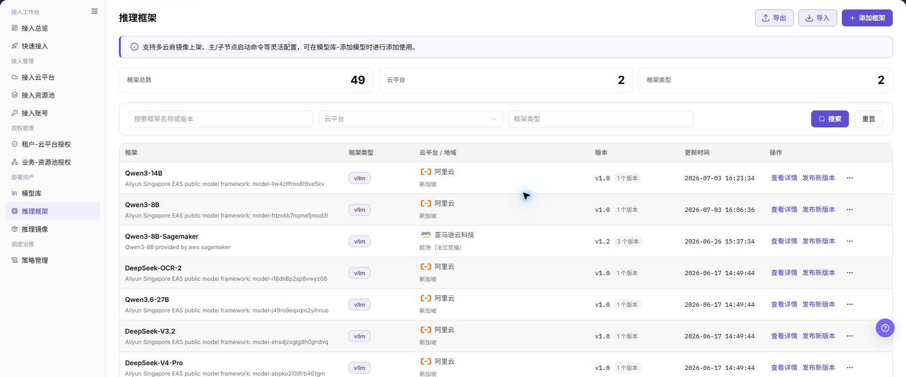
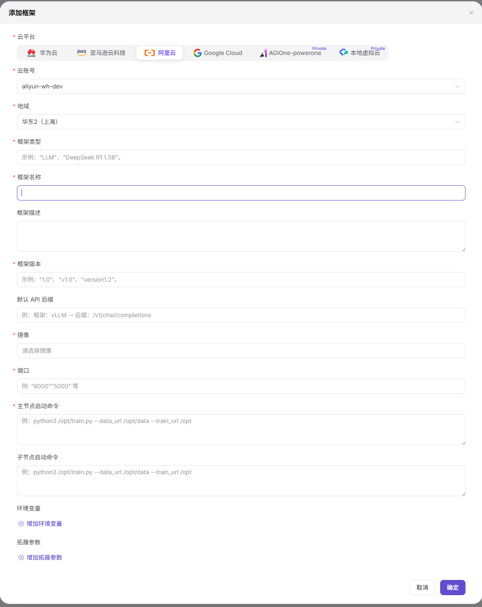

# 推理框架

本任务把推理镜像、启动命令、服务端口和框架类型组合为可复用的部署运行时。

## 场景目标

框架版本关联目标镜像与启动配置，发布后可由模型库引用；服务能否启动还需部署验证。

## 适用角色

- 平台运营方

## 开始前准备

- 已准备并验证推理镜像。
- 已确认框架类型、启动命令、模型占位符、服务端口和健康检查方式。

## 操作步骤

### 添加框架并发布版本

1. 进入 **On-Cloud > 部署资产 > 推理框架**，核对云平台及现有框架版本。

2. 点击 **添加框架**，填写云账号、地域、框架名称与类型等基础信息，并添加初始版本。
3. 选择已准备的运行镜像，核对服务端口、主节点启动命令；按框架需要补充子节点命令、环境变量和拓展参数。不要把真实密钥写入命令或描述。
4. 点击 **确定**，打开详情读回版本、镜像与启动配置。

5. 在框架详情定位目标版本，点击 **发布**，核对版本、镜像及适用范围后确认；到模型库确认发布后的版本可选。创建配置不等于已经发布或验证服务启动。

## 完成检查

核对下表；任一项未满足时，先按“常见失败分支”排查。

| 检查项 | 通过标准 |
| --- | --- |
| 1 | 镜像、框架类型、启动命令和端口相互兼容。 |
| 2 | 服务健康和 API 行为可验证。 |
| 3 | 模型资产配置可以选择该框架。 |

## 常见失败分支

| 现象 | 优先检查 |
| --- | --- |
| 框架启动失败 | 镜像兼容性、命令参数、模型路径和端口 |
| 模型资产选不到框架 | 框架状态、框架类型和目标云兼容性 |

## 操作手册

[查看“推理框架”的完整字段、校验规则和常见问题](/zh-CN/usermanual/ai-infra-on-cloud/operator/deploy-assets/frameworks/)
