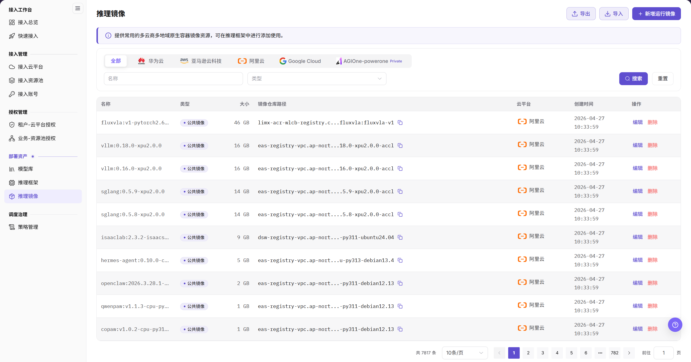
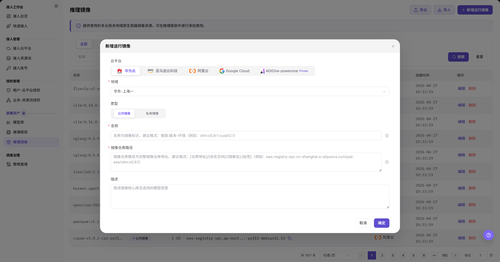

# 推理镜像

本任务登记推理框架运行时使用的云端镜像，镜像可用性会直接影响后续服务启动。

## 场景目标

目标云环境可以拉取该镜像，推理框架配置时能够选择它。

## 适用角色

- 平台运营方

## 开始前准备

- 确认完整仓库地址、受控版本 Tag（镜像版本标签）和支持的框架类型。
- 确认目标云环境具备镜像仓库的网络和拉取权限。

## 操作步骤

### 添加镜像

1. 进入 **On-Cloud > 部署资产 > 推理镜像**，先检查目标云平台和地域下的现有记录。

2. 点击 **添加推理镜像**，选择云平台、地域与公共/私有镜像类型，填写镜像名称、完整仓库路径及描述，按页面核对适用架构和资源池范围。
3. 完整路径应包含明确版本，例如 `registry.example.com/ai/runtime:example-tag`；示例不能代替实际可访问镜像。
4. 点击 **确定**，返回列表核对名称和归属范围，再到框架版本中验证该镜像可选。

若入口仅显示功能未开放提示，停止本项配置，不把登记镜像当成已具备的能力；由运营方确认部署所需镜像来源。完整字段和编辑流程以文末手册为准。

## 完成检查

核对下表；任一项未满足时，先按“常见失败分支”排查。

| 检查项 | 通过标准 |
| --- | --- |
| 1 | 仓库地址和 Tag 能唯一定位受控镜像。 |
| 2 | 目标云环境可以拉取镜像。 |
| 3 | 推理框架配置可以选择该镜像。 |

## 常见失败分支

| 现象 | 优先检查 |
| --- | --- |
| 镜像拉取失败 | 仓库地址、Tag、拉取权限、网络和架构 |
| 能拉取但服务启动失败 | 镜像内容、框架兼容性、启动命令和端口 |

## 操作手册

[查看“推理镜像”的完整字段、校验规则和常见问题](/zh-CN/usermanual/ai-infra-on-cloud/operator/deploy-assets/runtime-images/)
