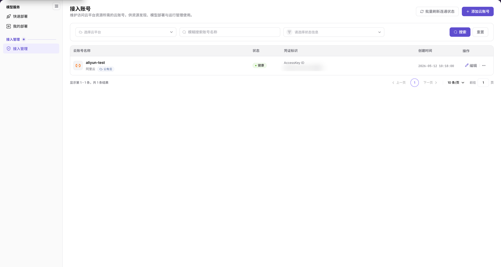
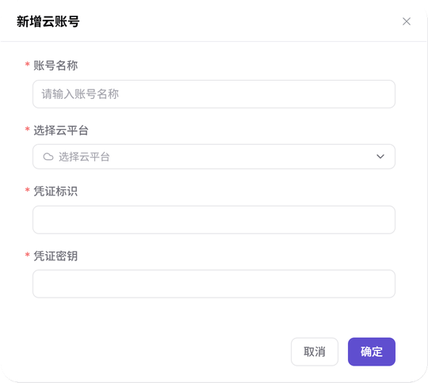

# 接入账号

本任务由模型提供方添加自己的云账号，供快速部署在已授权地域中创建资源。

## 场景目标

用户云账号校验成功，并能在快速部署的授权范围内被选择。

## 适用角色

- 模型提供方

## 开始前准备

- 平台运营方已为租户授权目标云平台和地域。
- 已准备专用的最小权限云凭证。

## 操作步骤

### 添加云账号

1. 进入平台首页，点击左侧导航栏的 **On-Cloud > 接入管理 > 接入账号** 菜单，进入接入账号管理页面；右上角另有 **"批量刷新连通状态"**，用于批量复核账号连通性。
2. 点击页面右上角的 **"添加云账号"** 按钮，弹出「新增云账号」窗口。

3. 配置账号信息：
   - 填写 **"账号名称"**（如 `aliyun-wh-dev`）；
   - 在 **"选择云平台"** 中选择当前版本已支持并已授权的云平台（如阿里云或 AWS）；
   - 输入 **"凭证标识"**（如 `<CREDENTIAL_ID>`）；
   - 输入 **"凭证密钥"**（如 `<CREDENTIAL_SECRET>`）。

   两个凭证字段是空白表单的通用名称，按所选云平台的实际要求填写，不要一律理解为 AK/SK。

4. 确认所有信息配置无误后，点击 **"确定"** 完成添加；如需放弃，点击 **"取消"**。

#### 参数说明

| 字段名称 | 字段类型 | 示例 | 说明 |
|----------|----------|------|------|
| 账号名称 | 文本 | `aliyun-wh-dev` | 必填，自定义账号标识 |
| 选择云平台 | 下拉选择 | `阿里云` | 必填，选择账号所属的云平台 |
| 凭证标识 | 文本 | `<CREDENTIAL_ID>` | 必填，凭证标识；具体含义随所选云平台而定 |
| 凭证密钥 | 密码 | `<CREDENTIAL_SECRET>` | 必填，与凭证标识配对使用；不要写入文档或工单 |

## 完成检查

核对下表；任一项未满足时，先按“常见失败分支”排查。

| 检查项 | 通过标准 |
| --- | --- |
| 1 | 账号校验成功。 |
| 2 | 账号仅在预期用户或租户范围可见。 |
| 3 | 快速部署可在授权地域使用该账号。 |

## 常见失败分支

| 现象 | 优先检查 |
| --- | --- |
| 账号校验失败 | 凭证有效性、云权限、网络访问和云平台选择 |
| 快速部署选不到账号 | 租户授权、地域范围和账号校验状态 |

## 操作手册

[查看“我的接入账号”的完整字段、校验规则和常见问题](/zh-CN/usermanual/ai-infra-on-cloud/user/access-management/access-accounts/)
