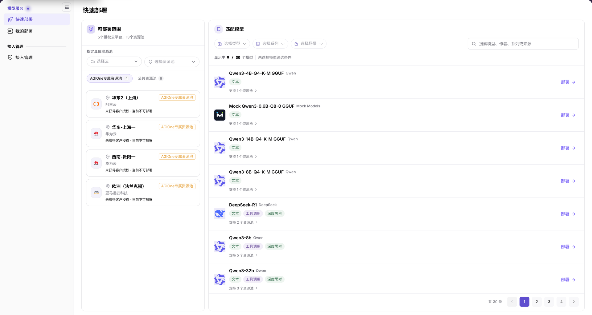
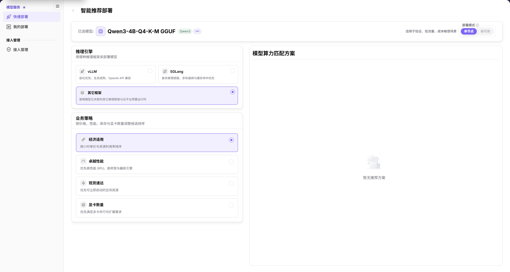
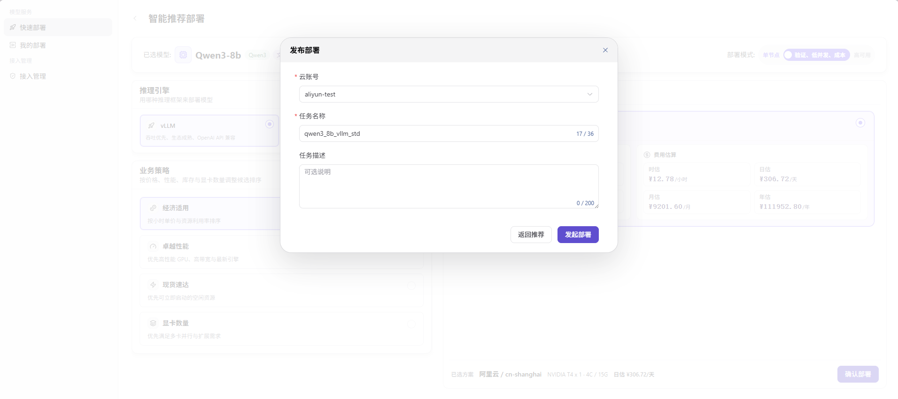

# 快速部署

本任务通过已授权账号、模型、推理引擎、业务策略和计算方案创建云上模型服务。

## 场景目标

部署请求按预期资源方案和费用提交，并出现在“我的部署”中。

## 适用角色

- 模型提供方

## 开始前准备

- 已有可用的接入账号、授权地域和可部署模型。
- 已确定单节点或高可用模式，并明确可接受的费用上限。

## 操作步骤

### Step 1：选择云账号与模型

1. 进入 **On-Cloud > 模型服务 > 快速部署**。
2. 在“可部署范围”中用 **选择云** 和 **选择资源池** 定位目标资源，页面分为 **AGIOne专属资源池** 和 **公共资源池** 两个分区，卡片上会显示授权与可部署提示。
3. 在“匹配模型”中用 **选择类型** / **选择系列** / **选择场景** 筛选，或在搜索框输入模型、作者、系列或来源。
4. 核对模型名称、能力标签和支持资源池，点击模型卡片上的 **部署**，进入 Step 2 智能推荐部署页。

#### 参数说明

| 字段名称 | 字段类型 | 示例 | 说明 |
|----------|----------|------|------|
| 可部署范围 - 选择云 | 下拉 | `阿里云` | 用于定位云，缩小可部署资源范围 |
| 可部署范围 - 选择资源池 | 下拉 | `华东 2（上海）` | 必填，决定后续可选模型和算力范围 |
| 资源池分区 | 卡片分区 | `AGIOne专属资源池` / `公共资源池` | 分区展示资源池，卡片上带授权与可部署提示 |
| 匹配模型 - 选择类型 | 下拉 | `文本生成` | 选填，按模型类型筛选 |
| 匹配模型 - 选择系列 | 下拉 | `Qwen` | 选填，按模型系列筛选 |
| 匹配模型 - 选择场景 | 下拉 | `通用对话` | 选填，按应用场景筛选 |
| 搜索框 | 文本 | `Qwen` | 选填，按模型名称、作者、系列或来源搜索 |
| 模型卡片 | 卡片行 | `Qwen` 系列模型 + 能力标签 | 必填，单击 **部署** 进入智能推荐部署 |

### Step 2：智能推荐部署

1. 点击模型卡片上的 **部署** 后进入“智能推荐部署”页，顶部展示已选模型信息。
2. 页面顶部提供 **部署模式** 单选（**单节点** / **高可用**），按当前页面可选状态操作。
3. 在“推理引擎”中单选 **vLLM**、**SGLang** 或 **其它框架**，即用于部署该模型的推理框架。
4. 在“业务策略”中单选 **经济适用**、**卓越性能**、**现货速达** 或 **显卡数量**，右侧随即展示模型算力匹配方案。
5. 核对“模型算力匹配方案”中的云平台、地域、资源规格与费用估算。若显示 **暂无推荐方案**，说明当前结果区没有可确认的方案，此时不能确认资源规格、费用或部署结果。

6. 点击 **确认部署** 打开 **发布部署** 弹窗；此时尚未提交任务。选择用于执行的 **云账号**，填写 **任务名称**，按需补充 **任务描述**，最后点击 **发起部署**。不提交时选择 **返回推荐**。提交后到 **我的部署** 核对新记录及状态，失败时不要重复提交相同任务。

#### 参数说明

| 字段名称 | 字段类型 | 示例 | 说明 |
|----------|----------|------|------|
| 部署模式 | 单选 Tab | `单节点` / `高可用` | 按当前页面可选状态选择部署架构模式 |
| 推理引擎 | 单选卡片 | `vLLM` / `SGLang` / `其它框架` | 必填，选择部署该模型使用的推理框架 |
| 业务策略 | 单选卡片 | `经济适用` / `卓越性能` / `现货速达` / `显卡数量` | 必填，按价格、性能、库存与显卡数量调整候选方案排序 |
| 模型算力匹配方案 | 推荐卡片 | `阿里云 / cn-shanghai` / `vllm` / `ecs.gn6i-c4g1.xlarge` | 展示云平台、地域、资源规格与费用估算；不可确认时显示 `暂无推荐方案` |
| 发布部署 - 云账号 | 下拉 | `阿里云` | 必填，选择执行本次部署的云账号 |
| 发布部署 - 任务名称 | 文本 | `qwen-demo-deploy` | 必填，用于在“我的部署”中识别该任务 |
| 发布部署 - 任务描述 | 文本域 | `验证快速部署流程` | 选填，补充本次部署的用途 |
| 发布部署 - 操作按钮 | 按钮 | `返回推荐` / `发起部署` | 提交前可返回修改方案；提交后不要重复发起相同任务 |

## 完成检查

核对下表；任一项未满足时，先按“常见失败分支”排查。

| 检查项 | 通过标准 |
| --- | --- |
| 1 | 云、资源池、模型、推理引擎和算力方案均可选择。 |
| 2 | 已核对费用和使用范围后提交请求。 |
| 3 | “我的部署”出现新记录。 |

## 常见失败分支

| 现象 | 优先检查 |
| --- | --- |
| 选不到模型或计算方案 | 账号授权、地域、资产兼容、配额和当前容量 |
| 创建部署失败 | 必填项、费用方案、云账号状态和事件详情 |

## 操作手册

[查看“快速部署”的完整步骤、校验规则和常见问题](/zh-CN/usermanual/ai-infra-on-cloud/user/model-services/quick-deployment/)
