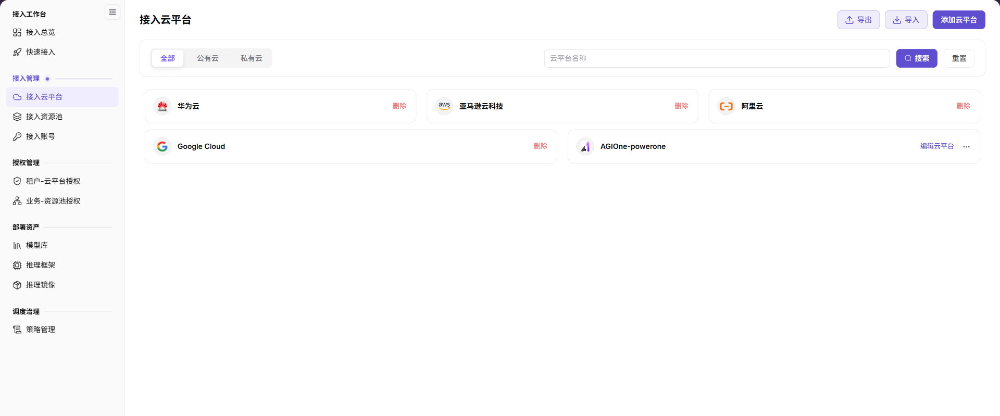
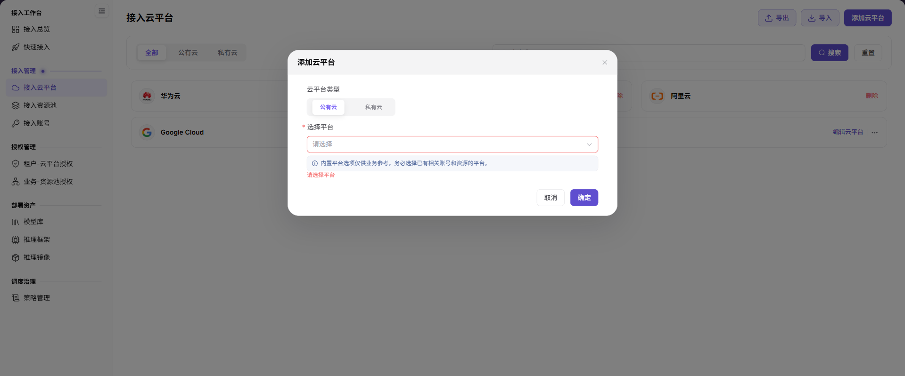

# 接入云平台

本任务先登记 {{DOCS_PRODUCT_NAME_ZH}} 可接入的公有云或私有云类型，为后续账号接入、资源池同步和授权建立基础。

## 场景目标

目标云平台保存成功，并能在接入账号等后续页面中被选择。

## 适用角色

- 平台运营方

## 开始前准备

- 确认云平台类型、厂商标识和中英文显示名称。
- 私有云还需确认访问地址、网络连通性和证书要求。

## 操作步骤

### 添加平台

1. 进入 **On-Cloud > 接入管理 > 接入云平台**，先确认列表中没有目标平台的重复记录。
2. 点击 **添加云平台**，选择 **公有云** 或 **私有云**，再从 **选择平台** 下拉中选择目标平台。

3. 核对类型和平台后点击 **确定**，返回列表确认记录。

新增时选择已有平台；平台标识、显示名称、链接地址和 Logo 属于已有私有云的编辑配置，不应作为新增平台必填项。需要维护这些信息时，从目标私有云卡片进入 **编辑云平台**，按[操作手册](../../../../usermanual/ai-infra-on-cloud/operator/access-management/cloud-platforms/)核对后保存。

## 完成检查

核对下表；任一项未满足时，先按“常见失败分支”排查。

| 检查项 | 通过标准 |
| --- | --- |
| 1 | 云平台标识和中英文名称准确。 |
| 2 | 私有云访问地址可达。 |
| 3 | 新增接入账号时可以选择该平台。 |

## 常见失败分支

| 现象 | 优先检查 |
| --- | --- |
| 接入账号页找不到平台 | 平台状态、厂商标识和保存结果 |
| 私有云页面无法打开 | 访问地址、DNS、网络路由和证书 |

## 操作手册

[查看“接入云平台”的完整字段、校验规则和常见问题](/zh-CN/usermanual/ai-infra-on-cloud/operator/access-management/cloud-platforms/)
