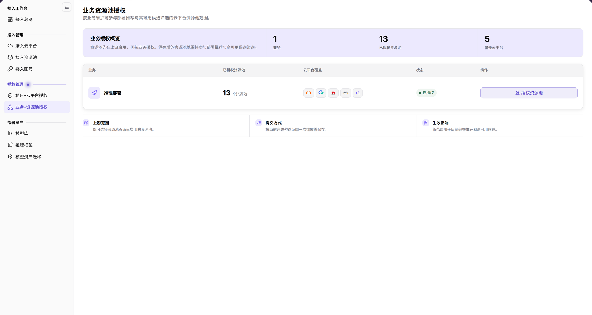
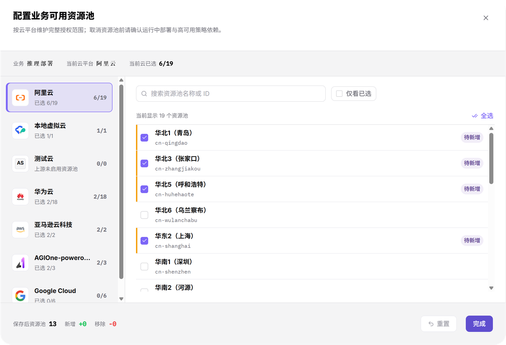

# 业务-资源池授权

本任务按业务类型限制可使用的云地域，例如只允许推理部署使用指定资源池。

## 场景目标

每类业务只能调度到已批准的云平台和地域。

## 适用角色

- 平台运营方

## 开始前准备

- 需要授权的资源池地域已启用。
- 已明确每种业务类型允许使用的地域范围。

## 操作步骤

### 配置业务可用资源池

1. 进入平台首页，点击左侧导航栏的 **On-Cloud > 授权管理 > 业务-资源池授权** 菜单，进入业务资源池授权页面。
2. 在业务列表核对目标业务的已授权资源池、云平台覆盖和状态；页面下方说明“上游范围”“提交方式”“生效影响”，其中提交方式为按完整勾选范围一次性覆盖保存。

3. 点击目标业务的 **"授权资源池"**，打开「配置业务可用资源池」弹窗。
4. 核对弹窗顶部显示的 **业务**、**当前云平台** 和 **当前云已选**，确认正在维护目标业务与对应云平台。
5. 在弹窗左侧切换云平台，用 **搜索资源池名称或 ID** 定位资源池，按需勾选；**仅看已选** 用于复核已选项，**全选** 位于资源池列表上方。未勾选的资源池不授权。
6. 查看弹窗底部 **保存后资源池**、**新增** 和 **移除** 摘要，确认提交的是完整勾选集合而不是本次新增项。
7. 确认无误后点击 **"完成"** 提交；需要清空本次调整时使用 **"重置"**，它只重置当前勾选，不是关闭按钮。仅查看时用弹窗右上角的关闭按钮退出，不保存配置。

图示为“配置业务可用资源池”弹窗：顶部为业务、当前云平台与当前云已选，左侧切换云平台，右侧为资源池搜索与勾选列表，底部为保存后资源池、新增与移除摘要，以及“重置”“完成”。这不是提交成功或下游授权已生效的证明；保存后需返回业务列表与部署入口核对。

> 业务-资源池授权限定当前业务可用的资源池；租户是否有权使用对应云平台，还需同时核对租户-云平台授权。

#### 参数说明

| 字段名称 | 字段类型 | 示例 | 说明 |
|----------|----------|------|------|
| 业务 | 只读信息 | `推理部署` | 弹窗顶部显示当前正在授权的业务 |
| 当前云平台 | 只读信息 | `阿里云` | 左侧切换云平台后，右侧列表所属的云平台 |
| 当前云已选 | 只读信息 | `3 / 8` | 当前云平台已选资源池数量与可选数量 |
| 资源池 | 复选框 | `华东2（上海）` | 按云平台勾选需要授权的资源池；未勾选即不授权 |
| 保存后资源池 / 新增 / 移除 | 只读摘要 | `5 / 2 / 1` | 提交前的范围核对信息，不是保存结果 |

## 完成检查

核对下表；任一项未满足时，先按“常见失败分支”排查。

| 检查项 | 通过标准 |
| --- | --- |
| 1 | 目标业务只包含预期云平台与资源池。 |
| 2 | 刷新页面后授权结果仍然存在，业务列表的云平台覆盖已更新。 |
| 3 | 用户部署范围与授权资源池一致。 |

## 常见失败分支

| 现象 | 优先检查 |
| --- | --- |
| 没有可选资源池 | 资源池启用状态和云平台状态 |
| 部署出现非预期地域 | 业务类型、已保存的资源池集合和租户云平台授权 |

## 操作手册

[查看“业务-资源池授权”的完整规则和常见问题](/zh-CN/usermanual/ai-infra-on-cloud/operator/auth-management/business-region-auth/)
