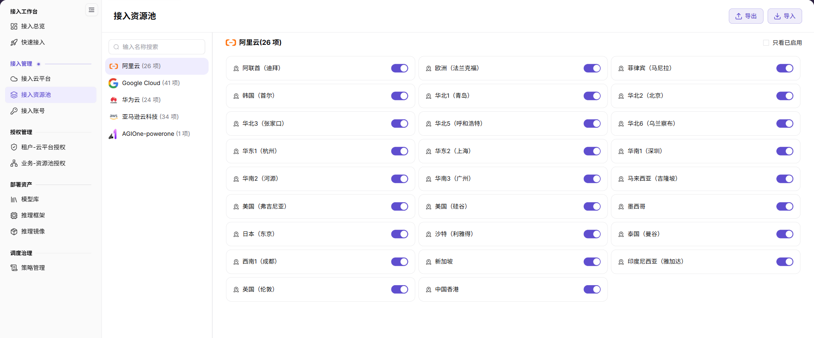

# 接入资源池

本任务从云账号已同步的地域中启用业务允许使用的资源池，并维护便于识别的显示名称。

## 场景目标

只有经过批准的云地域处于启用状态，并能被后续授权流程选择。

## 适用角色

- 平台运营方

## 开始前准备

- 云账号已同步出预期地域。
- 已明确允许使用的地域清单和中英文命名规则。

## 操作步骤

### 启用 / 禁用资源池地域

1. 进入平台首页，点击左侧导航栏的 **"接入资源池"** 菜单，进入资源池管理页面。
2. 在左侧云平台列表上方输入关键字搜索当前版本已支持的云厂商，列表会显示各平台已同步的地域数量；点击目标云平台（如阿里云或 AWS）。
3. 右侧展示所选云平台的地域资源池，核对目标地域名称和启用状态。
4. 找到需要启用 / 禁用的地域，点击地域卡片右侧的开关按钮：
   - 开关为开启状态时，表示该地域已启用；
   - 点击开关即可切换地域的启用 / 禁用状态。

### 核对地域与变更结果

启用或禁用前，先确认租户授权、业务授权、调度策略和已有部署的影响。切换开关后阅读地域名称与动作的二次确认提示，再点击 **确定**；刷新后到授权页和部署页核对范围。需要缩小列表时使用 **只看已启用**。

当前手册明确的维护操作是查看和启用/禁用资源池，不能把旧版“编辑名称”流程当作当前必需步骤。地域名称有误时，先由资源负责人核对云侧地域与平台记录，再按页面实际提供的入口处理。

## 完成检查

核对下表；任一项未满足时，先按“常见失败分支”排查。

| 检查项 | 通过标准 |
| --- | --- |
| 1 | 需要的地域已启用且名称清晰。 |
| 2 | 未批准地域保持禁用。 |
| 3 | 授权页面可以选择已启用地域。 |

## 常见失败分支

| 现象 | 优先检查 |
| --- | --- |
| 列表缺少目标地域 | 云账号同步、云权限和平台地域支持情况 |
| 地域无法授权 | 地域启用状态和资源池保存结果 |

## 操作手册

[查看“接入资源池”的完整字段、校验规则和常见问题](/zh-CN/usermanual/ai-infra-on-cloud/operator/access-management/resource-pools/)
