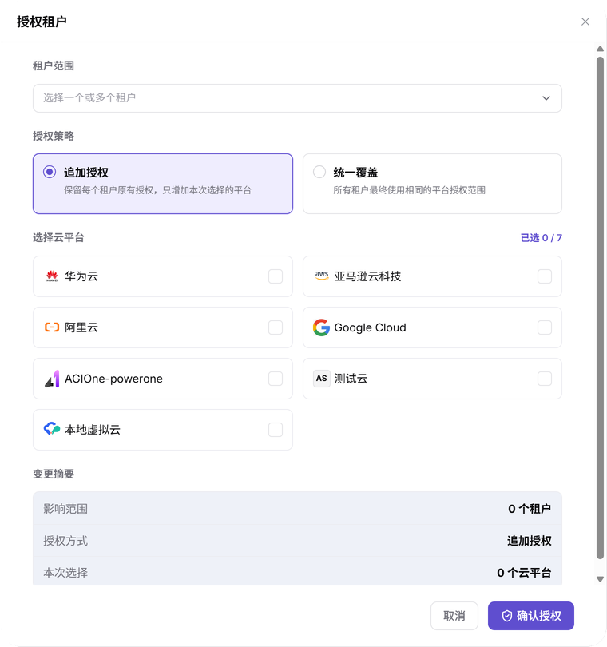

# 租户-云平台授权

本任务决定哪些租户可以看到并使用已接入的云平台，是资源可见性的第一层控制。

## 场景目标

目标租户能看到被授权云平台，未授权租户看不到该平台。

## 适用角色

- 平台运营方

## 开始前准备

- 目标租户已存在，云平台已启用。
- 已确认本次是追加授权（保留现有授权）还是统一覆盖（以本次选择为准）。

## 操作步骤

### 新增授权

1. 进入 **On-Cloud > 授权管理 > 租户-云平台授权** 菜单（路由 `/infrahub/op/auth/platform-auth`），进入云平台授权管理页面。
2. 点击页面上的 **授权租户** 按钮，打开授权窗口。

3. 在 **选择云平台** 中勾选需要授权的云平台（支持多选，如阿里云、AWS、{{DOCS_CLOUD_PLATFORM_ZH}}）。
4. 在 **租户范围** 中选择 **选择一个或多个租户**，勾选目标租户。
5. 选择 **授权策略**：**追加授权** 保留已有授权，**统一覆盖** 以本次选择替换；提交前在 **变更摘要** 核对本次新增和移除的租户-云平台组合。
6. 核对无误后点击 **确认授权** 完成授权；如需放弃，点击 **取消**。取消前先确认没有运行中部署或高可用实例依赖本次要移除的授权。

> 注：管理员可在此为不同租户分配云平台的使用权限，授权完成后租户仅能访问和使用已被授权的云平台资源与服务，以此实现对租户云平台使用范围的精准管控，保障资源访问的规范性与安全性。

#### 参数说明

| 字段名称 | 字段类型 | 示例 | 说明 |
|----------|----------|------|------|
| 选择云平台 | 多选 | `阿里云`、`AWS`、`{{DOCS_CLOUD_PLATFORM_ZH}}` | 必填，支持同时勾选多个已接入云平台 |
| 租户范围 | 租户选择 | `选择一个或多个租户` | 必填，决定本次授权覆盖的租户 |
| 授权策略 | 单选 | `追加授权` / `统一覆盖` | 必填；追加保留已有授权，统一覆盖替换为本次选择 |
| 变更摘要 | 只读核对 | — | 提交前确认新增和移除的租户-云平台组合，避免误删运行中部署依赖的授权 |

## 完成检查

核对下表；任一项未满足时，先按“常见失败分支”排查。

| 检查项 | 通过标准 |
| --- | --- |
| 1 | 只有目标租户获得云平台权限。 |
| 2 | 目标租户重新登录后能看到授权结果。 |
| 3 | 撤销授权后平台不再可见。 |

## 常见失败分支

| 现象 | 优先检查 |
| --- | --- |
| 租户看不到云平台 | 租户范围是否漏选目标租户、平台状态和重新登录后的会话 |
| 非目标租户也能看到平台 | 是否用 **统一覆盖** 时多选了租户，或上一次追加授权尚未清理 |

## 操作手册

[查看“租户-云平台授权”的完整规则和常见问题](/zh-CN/usermanual/ai-infra-on-cloud/operator/auth-management/tenant-cloud-auth/)
