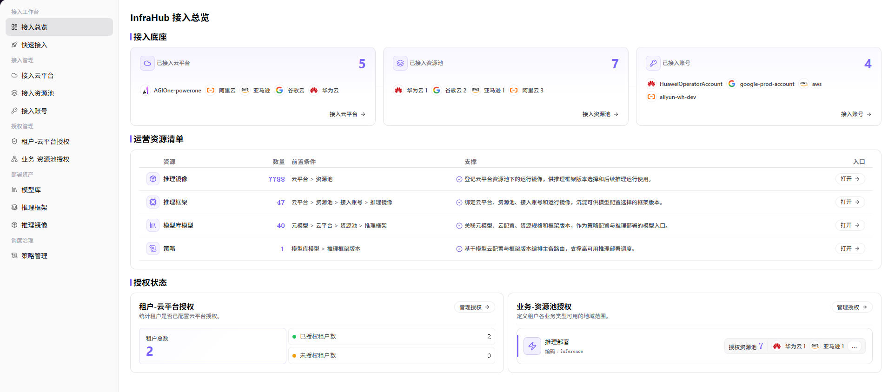

# 配置并验证多平台调度策略

本任务为已关联的模型版本配置主备路由拓扑与健康探测，并通过获批测试部署核对结果。

## 适用角色

- 平台运营方、多云资源管理员、部署策略管理员

## 开始前准备

1. 确认云平台、云账号、资源池状态正常。
2. 确认目标租户和业务地域已获得首选、回退资源池授权。
3. 确认关联模型至少有一个可用部署点，并已准备对应框架版本、规格、主备节点规划和健康探测要求。

## 操作流程

### 1. 检查接入与授权基础

进入[接入总览](../../../usermanual/ai-infra-on-cloud/operator/access-workbench/access-overview/)，确认目标云账号和资源池状态；再核对租户云授权、业务地域授权和资源池可用容量。缺少授权时不要直接创建调度策略。

### 2. 配置调度策略

进入 **On-Cloud > 调度治理 > [策略管理](../../../usermanual/ai-infra-on-cloud/operator/scheduling-governance/policies/)**，按当前三步向导配置：

1. **基础信息与模型关联**：点击 **添加策略**，填写名称、应用场景和描述，选择目标模型及版本，核对可用路由节点后点击 **下一步**。
2. **定义主备路由拓扑**：选择主路由与备路由节点，配置备路由优先级，核对各节点的云平台、地域、规格、框架版本和费用。
3. **定义健康探测规则**：按页面设置探测方式及所需路径、检测频率、失败阈值、恢复逻辑和超时时间，复核后点击 **提交**。

租户授权和地域容量是配置前提，不是该向导中的“适用租户”或“容量阈值”字段。跨云或跨地域的成本与合规评估应在变更前完成，不凭策略保存结果推断自动满足。

### 3. 执行测试部署

使用一个低风险模型执行测试部署，记录所选资源池、地域、部署状态和事件。先验证首选资源池；在可控条件下验证容量不足时的回退或明确失败行为。

### 4. 复核结果并建立巡检

确认部署结果与策略一致，并记录实际成本、启动时延和资源占用。定期复核资源池容量、授权关系和策略优先级，避免基础条件变化后策略失效。

## 完成检查

用获授权的测试部署验证策略；失败时先排查授权、容量和策略配置。

| 检查项 | 通过标准 |
| --- | --- |
| 基础授权 | 首选和回退资源池对目标范围均可用。 |
| 策略配置 | 关联模型及版本、主备路由、优先级和健康探测规则与规划一致。 |
| 首选验证 | 正常容量下，测试部署命中首选资源池。 |
| 回退验证 | 首选不可用时，按策略回退或返回明确原因。 |
| 运营复核 | 容量、成本、时延和合规影响已记录。 |

## 常见失败分支

| 现象 | 优先检查 |
| --- | --- |
| 部署未命中首选资源池 | 容量、启用状态、业务地域授权和策略优先级 |
| 首选不可用时没有回退 | 回退资源池配置、授权、容量和跨地域约束 |
| 策略与实际部署结果不一致 | 核对部署实际关联的模型版本、路由节点和生效配置，保留事件交由策略负责人排查；不要直接重建已有实例 |
| 回退后成本或时延异常 | 资源池价格、地域距离、网络和 SLA（服务等级约定）约束 |
