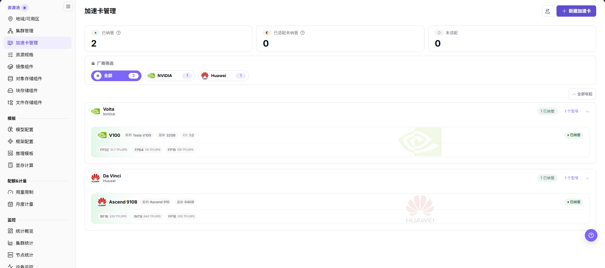

# 维护加速卡型号

## 场景目标

统一登记 NPU 厂商、型号、单卡显存和资源键，让规格与监控使用同一资源身份。

NPU 指神经网络处理器；本页资源键是集群上报与作业申请资源时使用的名称，型号记录本身不代表实际卡数。

## 适用角色

- 平台运营方

## 开始前准备

- 记录目标物理 NPU 卡实际上报的型号和单卡显存。
- 确认平台中没有代表同一型号的重复记录。

## 功能入口

- **角色**：运营管理员
- **菜单**：On-Prem > 资源池 > 加速卡管理
- **路由**：`/powerone/resourcepool/accelerators`

## 操作步骤

1. 在厂商筛选中选择目标 NPU 厂商，例如 Huawei。
2. 查找实际卡型，核对系列、型号、单卡显存和适配状态。
3. 如果型号不存在，点击 **新建加速卡**，填写硬件信息和 Kubernetes 资源名称。
4. 若已有相近卡型、新型号只差个别字段（例如同系列不同显存），悬停该型号卡片并点击 **"以此新增"**，按源型号预填后只改差异字段，详见操作手册「以此新增加速卡」小节。
5. 将卡型关联到与集群设备插件一致的规格指标；已有指标在 **资源池 > 资源规格** 左侧 **规格指标** 面板维护，不是单独的左侧菜单。
6. 保存后确认卡型进入“已纳管”或预期的适配状态。
7. 在规格或推理模板使用此卡型前，确认厂商、型号、显存和资源 key 与集群设备插件实际上报的值一致。

## 4 张 NPU 卡的配置要点

**案例说明：** 本节沿用4张 NPU 的示例，仅在型号、容量和调度拓扑支持时采用相应档位；其他环境按实际设备清单与业务需求核对。

- 卡的数量不在此页面录入；此页面维护的是“卡型字典”。实际数量由集群节点上报。
- 同一型号 4 张卡应使用同一个资源 key，例如设备插件实际暴露的 `vendor.com/npu`。
- 单卡显存和型号信息会影响资源规格、模板选择和部署可行性判断。

## 完成检查

核对下表；任一项未满足时，先按“常见失败分支”排查。

| 检查项 | 通过标准 |
| --- | --- |
| 1 | 列表中能找到目标 NPU 型号。 |
| 2 | 适配状态和规格指标关联正确。 |
| 3 | 资源 key 与集群实际值一致。 |

## 常见失败分支

| 现象 | 优先检查 |
| --- | --- |
| 资源规格中选不到加速卡 | 加速卡状态、型号标识和厂商映射 |
| 监控无法匹配设备 | 集群上报型号是否与此处完全一致 |
| 下游资源规格无法使用此加速卡 | 纳管/适配状态、规格指标关联、资源 key 和集群可见范围 |

## 操作手册

[查看加速卡管理完整字段说明](/zh-CN/usermanual/ai-infra-on-prem/operator/resource-pools/accelerators/)
