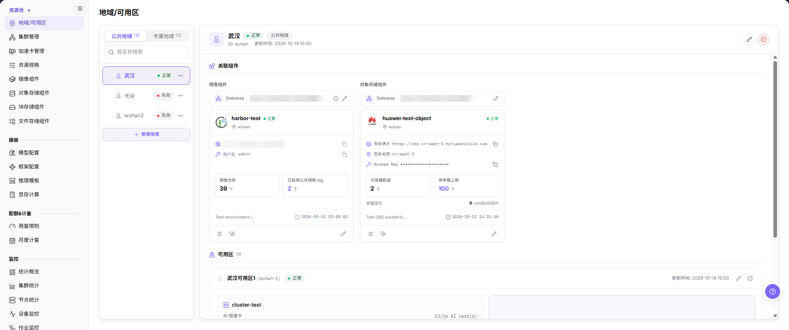
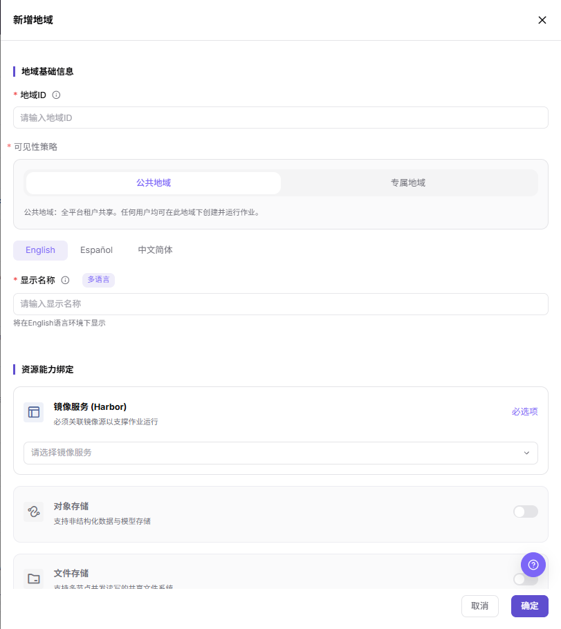

# 创建地域与可用区

## 场景目标

为待接入的本地集群建立地域和可用区，使集群、规格、镜像、存储及后续作业使用一致的资源边界。

## 适用角色

- 平台运营方

## 开始前准备

- 明确机房、园区或资源组与地域、可用区的对应关系。
- 准备不会与现有记录重复的中英文名称和唯一标识。
- 确认目标集群应归属的可用区，以及网络和存储边界。

## 功能入口

- **角色**：运营管理员
- **菜单**：On-Prem > 资源池 > 地域/可用区
- **页面路由**：`/powerone/resourcepool/region`

## 操作步骤

1. 进入地域 / 可用区页面，先核对现有地域、可用区及启用状态，避免重复创建。

2. 点击地域列表底部的 **新增地域**，填写地域 ID、选择 `公共地域` / `专属地域` 可见性策略、在各语言页签维护显示名称，并绑定必选的镜像服务（Harbor），确认状态为可用于后续资源接入。

3. 需要为地域配置数据 Gateway 入口时，选中目标地域，在 `关联组件` 区域点击镜像组件卡片上的 **配置数据 Gateway 入口**。填写 `镜像 Gateway 地址` 和 `对象存储 Gateway 地址`（可填域名、`IP:端口` 或带协议的地址；未填协议时默认使用 `HTTPS`），点击 **保存**。弹窗中的 **前往系统设置管理全部 Gateway** 链接会打开 `On-Prem > 系统 > 系统设置`，用于集中管理全部 Gateway。

4. 选中目标地域后，在可用区区块点击 **新增可用区**；`地域` 字段自动带入且只读，填写可用区 ID 和各语言页签的显示名称。

5. 返回列表，确认地域和可用区均可见、状态正常，并记录后续集群注册时应选择的可用区。新建后尚无集群的可用区会显示 `异常` 状态并提示 `当前资源下没有可用集群`；展开该可用区，使用展开区右侧的 `关联集群` 虚线占位卡片即可进入对应地域/可用区的集群注册向导。

6. 如果需要暂时停止地域接收新的资源使用，打开地域行的 `...` 操作菜单并选择 **"禁用"**；可用区则点击行右侧的 **"禁用"** 图标。可用区行图标随状态而变：`正常` 行显示 **编辑**、**禁用**；已禁用行显示 **启用**；`异常` 行显示 **编辑**、**删除**。如果列表中看不到目标对象，先清空 `按名称搜索` 输入框并切换 `公共地域` / `专属地域` 页签。
7. 需要让已禁用的地域或可用区重新可用时，在该对象处于已禁用状态后点击其行内出现的 **"启用"** 动作（地域还可在详情头部启用）。地域**没有删除**动作，可用区额外提供 **"删除"**（按状态在行右侧出现）用于永久移除——请优先用 禁用/启用 暂停与恢复，确需下线可用区时才用 删除，并先确认无集群或作业依赖它。运维手册 `On-Prem > 资源池 > 地域/可用区` 页把可用区删除与关联集群作为页面行为描述、未单列为分步操作，这两个流程请以页面实际显示的动作和提示为准。
8. 刷新列表并确认状态已经变化，再继续注册集群或调度作业。禁用不会删除已有资源，但可能限制新的注册、创建或调度。

## 完成检查

> **用途：** 以下检查用于确认资源边界已经可供集群接入使用。任一项不满足时，不应继续注册集群。

| 检查项 | 通过标准 |
| --- | --- |
| 地域 | 目标地域名称、唯一标识和状态正确。 |
| 可用区 | 可用区位于正确地域下，名称和唯一标识不重复。 |
| 下游选择 | 注册集群时能够选择目标地域和可用区。 |

## 常见失败分支

| 现象 | 优先检查 |
| --- | --- |
| 无法新增地域或可用区 | 账号权限、必填字段、唯一标识和重复记录 |
| 集群注册时选不到可用区 | 地域和可用区状态、归属关系及当前租户范围 |
| 资源出现在错误区域 | 集群、规格、镜像和存储选择的地域边界是否一致 |
| 看不到启用入口 | 对象可能仍处于正常状态（正常态显示禁用而非启用）；请核对状态徽标、所选对象与运营管理员权限。可用区还会显示删除动作，地域则无删除 |
| 禁用后的地域或可用区无法恢复 | 先确认对象状态徽标为已禁用以使 **"启用"** 出现，再点击行内 **"启用"**；恢复前检查父级地域状态、下游集群或作业依赖，以及当前账号是否具备对应资源范围的操作权限 |

## 操作手册

[查看地域与可用区的完整字段和维护说明](/zh-CN/usermanual/ai-infra-on-prem/operator/resource-pools/regions-zones/)
