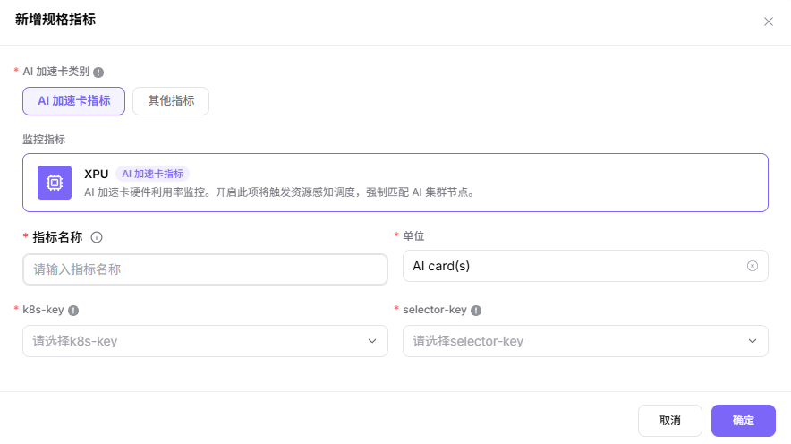
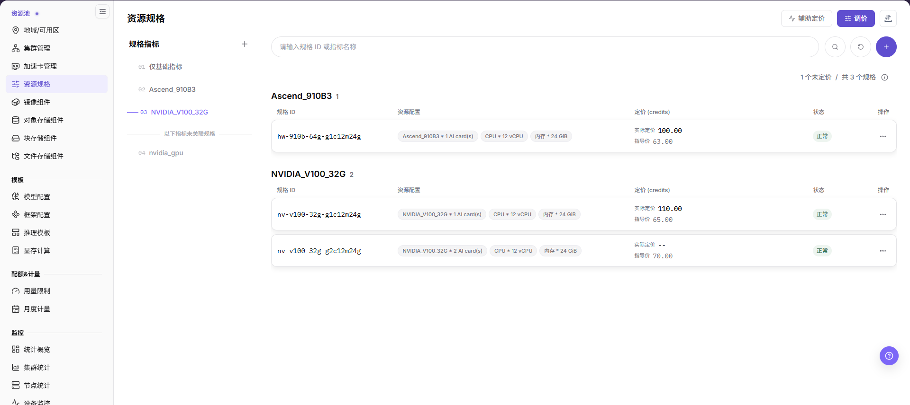

# 配置规格指标与资源规格

## 场景目标

用户可以选择符合实际需求和容量的 NPU 资源档位，每种方案都映射到正确的调度资源键。

资源规格是作业申请的资源组合；k8s-key 是资源名称，selector-key 是用于匹配节点标签的键，二者不能相互替代。

## 适用角色

- 平台运营方

## 开始前准备

- 确认加速卡型号和集群设备插件上报的资源键。
- 明确支持的卡数组合，以及 CPU、内存与 NPU 数量的配比。

## 功能入口

- **角色**：运营管理员
- **菜单**：On-Prem > 资源池 > 资源规格（左侧规格组导航内维护规格指标）
- **路由**：`/powerone/resourcepool/flavor/list`

## 操作步骤

1. 进入 **资源规格**，在左侧 **规格组导航 > 规格指标** 面板确认目标指标。缺少加速卡指标时点击 **新增规格指标**，选择 **AI 加速卡指标**，核对指标名称、单位、k8s-key 和 selector-key，再提交；候选必须与节点实际资源一致。

2. 进入**资源规格**，按获批需求创建所需卡数的规格，不要求同时创建1/2/4卡三档。
3. 使用搜索行右端的圆形加号新增规格，填写规格 ID，在 **配置** 表格维护 CPU、内存和目标加速卡指标的数量与单位。定价在 **辅助定价/调价** 维护，不在新增弹窗填写；创建后到集群的 **配置 > 已关联规格** 核对关联。

图示为资源规格主页面：左侧是规格组导航中的规格指标，右侧为规格、资源配置、定价与状态表格，搜索行右端提供圆形加号；本图不是规格创建成功或测试作业调度结果。

4. 先用获批的小规格测试核对基础配置，再验证业务实际需要且容量允许的目标规格。

5. 向用户开放规格前，确认规格状态、关联集群、地域/可用区范围和租户配额都允许下游模板或作业选择该规格。

## 4 张 NPU 卡的推荐规划

**案例说明：** 本节沿用4张 NPU 的示例，仅在型号、容量和调度拓扑支持时采用相应档位；其他环境按实际设备清单与业务需求核对。

| 规格 | NPU 数量 | 适用场景 |
| --- | ---: | --- |
| `npu-1` | 1 | 功能验证、小模型推理 |
| `npu-2` | 2 | 双卡并行或中等规模推理 |
| `npu-4` | 4 | 单任务独占全部卡 |

创建 4 卡规格前，应确认 4 张卡能否被同一节点或同一调度拓扑同时分配。若卡分布在多个节点，不要默认单个 Pod（最小容器调度单元）可以跨节点申请全部 4 张卡。

## 完成检查

核对下表；任一项未满足时，先按“常见失败分支”排查。

| 检查项 | 通过标准 |
| --- | --- |
| 1 | 本次规划且获批开放的规格能在模板或作业创建页被选择。 |
| 2 | 规格申请的资源 key 与节点上报一致。 |
| 3 | 已验证基础配置与本次实际需要的目标规格；不为核对而创建无业务需求的其他档位。 |

## 常见失败分支

| 现象 | 优先检查 |
| --- | --- |
| 用户选不到规格 | 规格状态、租户配额、集群关联和地域可用性 |
| 作业长时间排队 | 调度资源键、申请卡数、空闲容量和节点标签 |
| 列表中能看到规格但下游不可用 | 启用状态、集群关联、地域/可用区范围、租户配额和页面缓存 |

## 操作手册

- [资源规格](/zh-CN/usermanual/ai-infra-on-prem/operator/resource-pools/resource-specs/)
