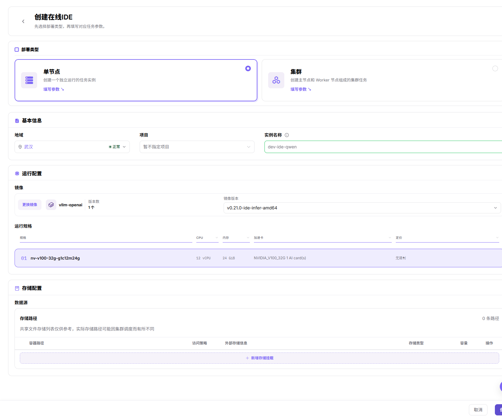
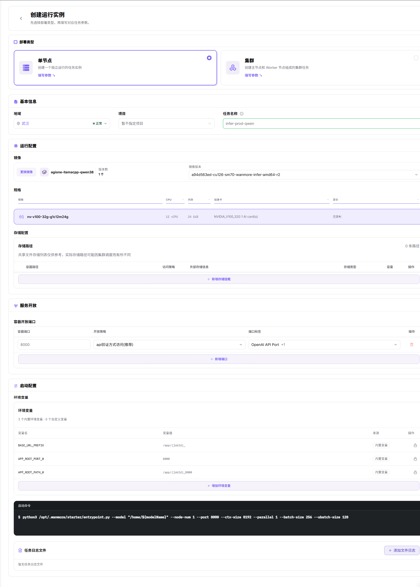

# 异构卡纳管：开发训练与资产沉淀

本场景指导普通用户使用异构卡纳管算力创建在线开发环境或运行实例，并把代码、数据、镜像和模型产物沉淀为可复用资产。

在线 IDE（集成开发环境）用于编写和调试代码；持久化工作目录是计划跨实例生命周期保存数据的位置，不是任意容器目录。

## 适用角色

- 创建开发或训练任务的平台用户
- 准备镜像、存储、算力、配额和监控的平台运营方

## 场景目标

- 用户能选择可用镜像、资源规格和存储创建开发或训练环境。
- 代码与数据放在持久化存储中，不依赖临时容器文件系统。
- 定制环境能够保存为镜像，模型和结果能够保存到受控存储位置。
- 作业完成后可以查看日志、监控和资源用量，并按需释放资源。

## 开始前准备

1. 运营方已开放目标地域、镜像、存储、规格和租户配额。
2. 明确开发、训练或批处理任务需要的 CPU、内存、加速卡和运行时长。
3. 准备代码仓库、数据路径、基础镜像和输出目录。
4. 确认数据合规、镜像来源和外部网络访问边界。

普通用户从下列步骤开始前，应先取得运营管理员确认的镜像、存储、规格和配额范围；这些准备工作不由训练脚本自动完成。

## 操作流程

1. 准备已开放的持久化存储，确认数据与输出位置可访问。若文件存储页面只显示未开放提示，不把共享目录创建或挂载当成可用功能；由管理员确认集群已有共享存储或对象存储的访问方式。参考[对象存储](../../../usermanual/ai-infra-on-prem/user/storage/object-storage/)和[文件存储](../../../usermanual/ai-infra-on-prem/user/storage/file-storage/)。
2. 准备或选择带版本的运行镜像，并确认目标地域能够拉取。参考[镜像服务](../../../usermanual/ai-infra-on-prem/user/extensions/images/)。
3. 进入[在线IDE](../../../usermanual/ai-infra-on-prem/user/dev-resources/online-ide/)，点击 **新增IDE**，选择单节点或集群后点击 **填写参数**；核对地域、项目、镜像版本、运行规格和存储配置，点击 **创建** 后在实例详情确认服务入口。

4. 进入[运行实例](../../../usermanual/ai-infra-on-prem/user/dev-resources/runtime-instances/)，点击 **新增实例**，选择部署类型后点击 **填写参数**，核对地域、项目、镜像及版本、规格、挂载和启动命令。需采集文件日志时通过 **添加文件日志** 登记目标文件，最后点击 **创建** 并检查实际状态与日志。

5. 将镜像、模型和结果保存到受控存储，确保后续任务可以复用。
6. 查看[资源用量](../../../usermanual/ai-infra-on-prem/user/quotas-usage/usage/)，停止不再使用的实例。

## 资产沉淀建议

| 资产 | 推荐保存位置 | 不应只保存在 |
| --- | --- | --- |
| 代码与配置 | 版本库和持久化工作目录 | 临时容器目录 |
| 数据集 | 对象存储或文件存储 | 本地临时盘 |
| 运行环境 | 版本化镜像 | 手工安装记录 |
| 模型权重 | 受控对象存储或模型目录 | 单个实例文件系统 |
| 日志与结果 | 持久化输出目录 | 终端滚动输出 |

## 完成检查

核对下表；任一项未满足时，先按“常见失败分支”排查。

| 检查项 | 通过标准 |
| --- | --- |
| 1 | 开发或训练实例状态正常，日志没有持续错误。 |
| 2 | 重启或重建实例后，持久化代码和数据仍可访问。 |
| 3 | 镜像、模型和结果具备明确版本与所有者。 |
| 4 | 作业消耗的规格、时长和用量记录符合预期。 |
| 5 | 不再使用的实例和临时资源已停止或清理。 |

## 常见失败分支

| 现象 | 优先检查 |
| --- | --- |
| 无可选镜像或规格 | 地域、授权、镜像状态、集群关联和配额 |
| IDE 无法打开 | 实例状态、服务端口、网络入口和日志 |
| 数据不可见 | 存储组件、挂载路径、权限和地域 |
| 作业排队或失败 | 规格容量、镜像、启动命令、加速卡和配额 |
| 产物丢失 | 是否写入临时目录、任务结束前是否完成上传或同步 |
