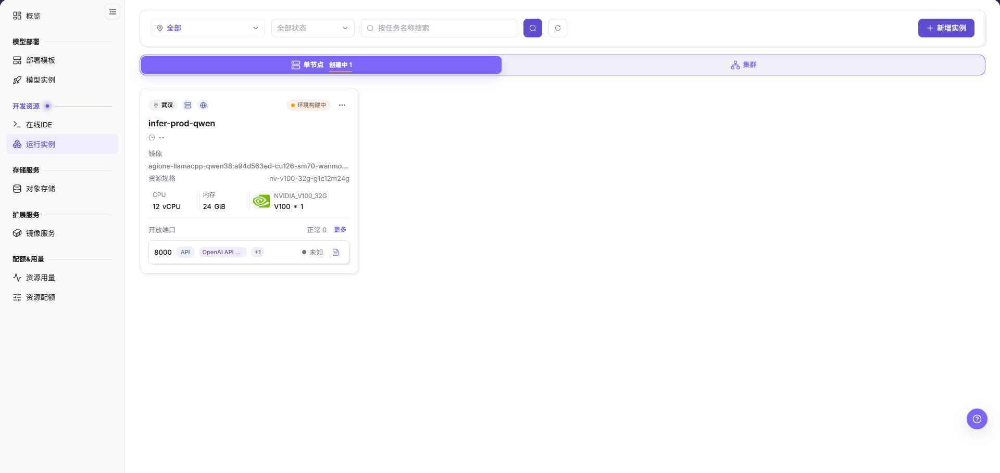

# 场景概览 - 异构卡纳管：开发训练与资产沉淀

本场景介绍用户如何创建开发环境、通过运行实例执行训练脚本，并把模型、镜像、数据集和输出结果沉淀为可复用资产。

IDE（集成开发环境）用于在线编写与调试代码；镜像提供运行环境，持久化存储用于保存需要跨实例生命周期保留的数据，不能把任意容器路径当作持久化位置。

## 适用角色

- 平台用户
- 负责镜像、存储和资源配置的运营管理员

**角色交接：** 运营管理员先准备已开放的镜像、存储、规格与配额；用户创建 IDE 或运行实例并保存产物。基础设施异常时，用户提供任务标识、时间与必要日志，由管理员核对资源侧问题。

## 场景目标

- 开发环境和训练任务能够使用已授权算力。
- 数据和输出写入持久存储。
- 训练产物能够进入后续模型部署流程。

## 场景流程

**主线：** 准备存储与镜像 → 创建开发环境 → 执行训练或批处理 → 沉淀并复用资产

| 阶段 | 核心结果 |
| --- | --- |
| 1. 准备依赖 | 数据、输出目录、镜像、算力和配额可用 |
| 2. 开发调试 | 在线 IDE 能访问代码、数据和持久化工作目录 |
| 3. 执行任务 | 运行实例正常执行并持续输出日志和监控数据 |
| 4. 沉淀资产 | 模型、镜像、数据和结果保存到可复用位置 |

图示为在线 IDE 列表中的示例卡片，当前标记为 **环境构建中**，服务入口为 **未知**；可用于定位筛选、新增入口和状态字段，不能据此认定 IDE 已就绪。

图示为运行实例列表中的示例卡片，当前为 **环境构建中**，开放端口状态为 **未知**；它说明任务与资源字段，不代表训练已运行或完成。

## 开始前准备

- 已有可用镜像、资源规格和租户配额。
- 已准备代码、数据集和持久存储路径。

## 推荐阅读顺序

1. 创建开发环境
2. 挂载代码、数据和存储
3. 在运行实例中配置并执行训练脚本
4. 保存模型和日志等产物

## 文档索引

| 文档 | 说明 |
| --- | --- |
| [开发训练与资产流程](./development-training-workflow) | 开发、训练、存储和资产沉淀的完整流程及截图 |

## 完成检查

按下表确认结果；未通过时，返回对应操作页排查后再继续。

| 检查项 | 通过标准 |
| --- | --- |
| 1 | 在线 IDE 或训练实例进入运行状态，日志中没有持续启动错误。 |
| 2 | 数据、模型和输出结果已写入持久化存储，并能由后续任务重新读取。 |
| 3 | 作业用量和监控记录可定位，闲置实例已经停止或释放。 |
