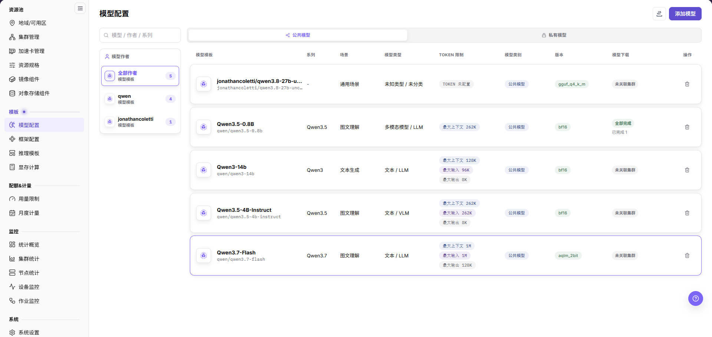
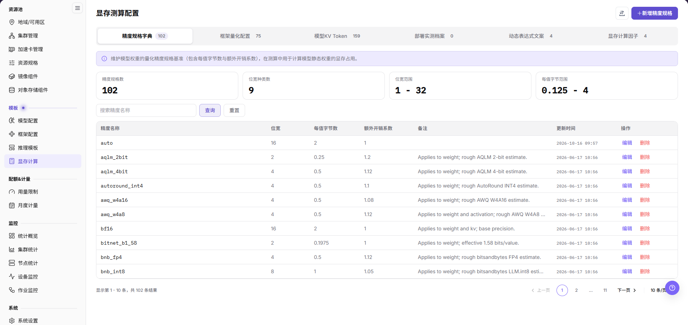
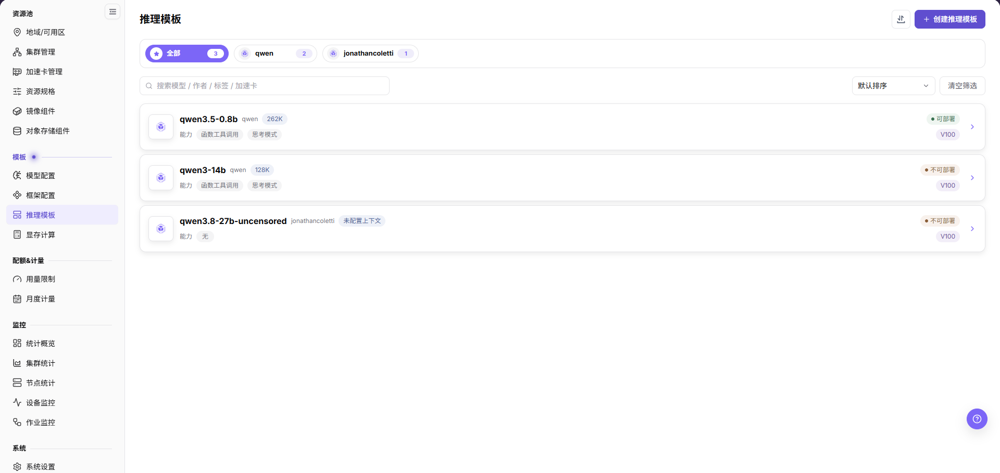

# 构建 NPU 推理模板

## 场景目标

模板正确关联框架、模型与运行参数，部署时可核对所需 NPU 卡数对应的适配方案。

推理模板关联模型版本与适配的框架版本；NPU 指神经网络处理器，显存是加速卡运行模型时使用的内存。

## 适用角色

- 平台运营方

## 开始前准备

- 准备模型配置、框架、镜像、资源规格、端口和存储要求。
- 明确实际卡数、单节点或多节点拓扑，以及是否拆分为多个较小实例。

## 功能入口

- **角色**：运营管理员
- **菜单**：On-Prem > 模板 > 推理模板
- **路由**：`/powerone/fast-build-v2/inference-templates`

## 操作步骤

1. 进入[模型配置](../../../../usermanual/ai-infra-on-prem/operator/templates/models/)，确认模型名称、类型、存储位置和状态可用。

2. 进入[框架配置](../../../../usermanual/ai-infra-on-prem/operator/templates/frames/)，确认框架版本、运行镜像和目标 NPU 兼容。
3. 进入[显存计算](../../../../usermanual/ai-infra-on-prem/operator/templates/vram-config/)，根据参数规模、精度和并行方式确认单卡及多卡显存需求。

4. 回到 **On-Prem > 模板 > 推理模板**，点击 **创建推理模板**，选择 **模型** 和必填的 **模型版本**，再选择适配的 **框架版本**，核对模板名称后点击 **保存**。同一模型版本与框架版本组合不能重复创建。
5. 打开模板详情，在 **模型版本切换** 与 **框架关联** 中定位刚创建的组合，核对 **关联框架信息** 的运行镜像、**模板扩展参数** 和 **绑定加速卡**，并检查关联显存计算因子表单。
6. 列表的 **可部署/不可部署** 与框架关联的 **可用** 是不同层级状态。不要把“把整个模板切为 Available”写成创建步骤；应逐项核对依赖和关联状态。
7. 卡数和具体资源方案在用户部署向导中结合业务参数与规格确认。创建模板弹窗不提供卡数、端口或健康检查配置；框架命令与服务开放项在 **框架配置** 维护。
8. 用获批测试部署核对卡型、卡数、显存与启动结果；模板记录保存成功不等于服务已经运行。

## 4 张 NPU 卡的模板策略

**案例说明：** 本节沿用4张 NPU 的示例，仅在型号、容量和调度拓扑支持时采用相应档位；其他环境按实际设备清单与业务需求核对。

- 按同一模型版本与框架版本组合维护模板；1 卡、2 卡或 4 卡部署方案在部署时核对，不为同一组合重复创建模板。
- 4 卡模板应明确是单节点 4 卡还是多节点部署；不要仅凭总卡数判断可行。
- 模板发布前先用最小模型验证驱动、运行时、集合通信和健康检查。

## 完成检查

核对下表；任一项未满足时，先按“常见失败分支”排查。

| 检查项 | 通过标准 |
| --- | --- |
| 1 | 模型、框架、显存测算和模板记录可见且状态正常。 |
| 2 | 框架关联绑定的加速卡型号正确，部署时所选规格与目标卡数一致。 |
| 3 | 测试部署进入运行状态，并完成服务健康或最小调用核对；仅显示创建中不算验证通过。 |

## 常见失败分支

| 现象 | 优先检查 |
| --- | --- |
| 选不到框架或模型 | 状态、地域、兼容性和模板前置项 |
| 4 卡实例无法启动 | 资源规格、分布式参数、空闲卡数、端口和存储 |
| 模板一直不可用 | 模型或框架状态、加速卡关联、显存系数、必填项，以及列表可部署状态和各框架关联状态 |
| Extra parameters 导致启动失败 | 参数名称、值格式、框架支持情况，以及该参数是否需要专业服务校验 |

## 操作手册

[查看推理模板完整字段说明](/zh-CN/usermanual/ai-infra-on-prem/operator/templates/inference-templates/)
