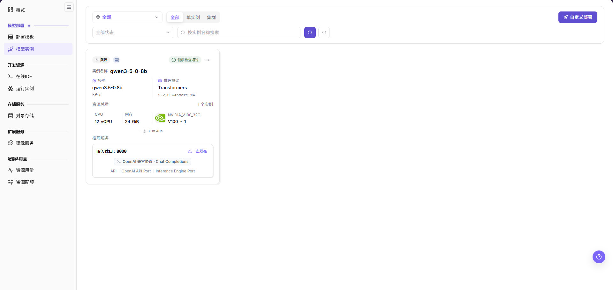

# 部署模型并检查状态

## 场景目标

模型实例进入运行状态，事件和日志无持续错误，并通过受控请求验证所选 NPU 方案。

NPU 指神经网络处理器；资源规格描述请求的资源组合，实际卡数需在实例与任务信息中核对。

## 适用角色

- 平台用户
- 模型提供方
- 协助排查基础设施的平台运营方

## 开始前准备

- 确认模板、租户配额、存储和实际所需卡数的部署方案可用。
- 准备无副作用的测试请求，并记录实例名称。

## 功能入口

- **角色**：模型提供方 / 最终用户
- **菜单**：On-Prem > 模型部署 > 部署模板 / 模型实例
- **实例路由**：`/powerone/quickstart/model-service`

## 操作步骤

1. 进入 **On-Prem > 模型部署 > 部署模板**，选择标记为 **可部署** 的模型，核对支持的模型版本与已纳管 NPU 卡型。
2. 在 **业务参数** 中确认框架、加速卡、并发、上下文、权重格式与 KV cache 精度等选项，再比较 **单实例/集群部署** 推荐规格，核对卡数与物理显存。
3. 按页面部署设置确认名称、地域、规格与副本数量，复核费用和影响后执行最终部署；不要在此模板向导中寻找自定义部署专用的镜像、端口和存储字段。提交后进入 **模型实例** 按名称定位记录。
4. 实例长时间创建中时，查看作业事件、镜像拉取和资源调度结果。
5. 实例运行后，核对服务地址、健康状态和实际 NPU 占用。

图示为标记 **健康检查通过** 的模型实例示例卡片，包含模型与框架、CPU/内存、1张 NVIDIA V100 和服务端口信息；这不是目标 NPU 部署的成功证据，本次实际卡型、卡数、事件和调用结果仍需分别核对。

## 状态判断

| 状态 | 处理建议 |
| --- | --- |
| 创建中 | 等待镜像拉取和调度，持续查看作业事件 |
| 运行中 | 检查健康状态、访问入口和设备占用 |
| 排队中 | 检查租户配额、资源规格和剩余 NPU 数量 |
| 失败 | 检查镜像、启动参数、驱动、存储和多卡通信 |

## 4 张 NPU 卡的验证重点

**案例说明：** 本节沿用4张 NPU 的示例，仅在型号、容量和调度拓扑支持时采用相应档位；其他环境按实际设备清单与业务需求核对。

- 4 卡实例应实际占用 4 张卡，不应只看模板名称。
- 如果 4 卡规格无法调度，先验证 1 卡，再验证 2 卡，最后验证 4 卡。
- 节点上总卡数足够不代表单个调度拓扑满足 4 卡需求。

## 完成检查

核对下表；任一项未满足时，先按“常见失败分支”排查。

| 检查项 | 通过标准 |
| --- | --- |
| 1 | 实例状态为运行中。 |
| 2 | 设备监控显示对应卡被该作业占用。 |
| 3 | 服务健康检查和一次最小调用成功。 |

## 常见失败分支

| 现象 | 优先检查 |
| --- | --- |
| 实例长时间排队 | 租户配额、空闲 NPU、规格、集群关联和调度事件 |
| 实例运行但调用失败 | 日志、模型路径、端口、协议、请求参数和限流 |

## 操作手册

[查看模型实例完整说明](/zh-CN/usermanual/ai-infra-on-prem/user/model-deployment/instances/)
