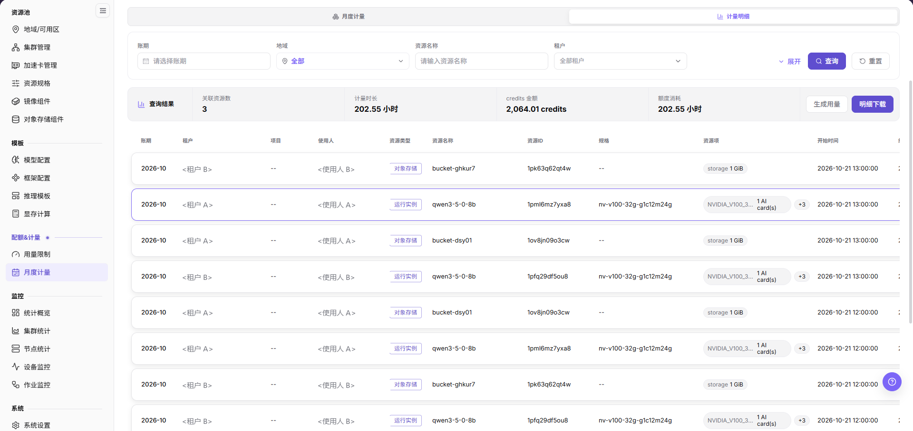
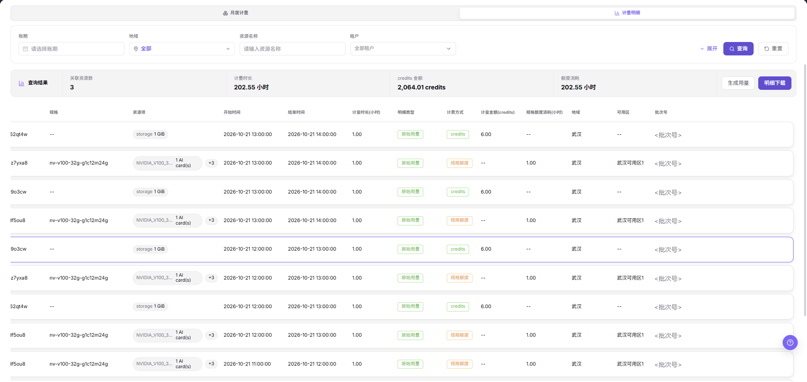

# 核对本地资源月度计量与明细

## 场景目标

在同一租户和账期内，将租户额度、月度用量和计量明细对应到实际实例或作业。

credits 是平台记账点数，规格额度消耗以小时计量；对账时应分开核对，不将二者直接相加。

## 适用角色

- 平台运营方
- 查看自身资源消耗的模型提供方和平台用户

## 开始前准备

- 明确目标租户、账期、实例或作业标识和计量单位。
- 确认监控与计量采集持续上报，任务开始和结束时间可定位。

## 操作步骤

1. 进入[用量限制](../../../../usermanual/ai-infra-on-prem/operator/quotas-metering/usage-limits/)，选择目标地域和租户，展开资源配额与规格额度；在只读充值/消费明细中追溯规格额度来源和消耗。资源配额看数量，规格额度看小时，不混用。

2. 进入[月度计量](../../../../usermanual/ai-infra-on-prem/operator/quotas-metering/monthly-usage/)，选择同一租户和账期，核对资源类型、规格和汇总用量。

图示实际高亮 **计量明细**，用于说明记录与汇总区域布局，不代表已切换到 **月度计量** 或已按本次目标账期查询；操作时需先确认当前页签和筛选条件。

3. 先在月度计量核对汇总条的关联资源数、计量时长、credits 金额与额度消耗。列表按小时切分，同一资源可占多行；资源数量按资源 ID 去重，不按行数计算。需要进一步追溯时切换 **计量明细**，按实际提供的条件定位。

4. 对照设备、节点和作业监控中的运行时间及规格，确认停止时间、卡数和计量单位一致。

5. 需要获批的离线核对时，在相同筛选范围内使用 **明细下载** 下载明细。只读核对不要点击 **生成用量**，该操作会改写计量数据。导出文件应在受控范围内保存，并记录本次选择的租户、地域或可用区、资源类型和时间范围。

## 完成检查

将额度变化和月度汇总追溯到具体任务，不只核对汇总数字。

| 检查项 | 通过标准 |
| --- | --- |
| 额度变化 | 期初、分配、扣减和剩余额度可解释。 |
| 月度汇总 | 租户、账期、资源类型和计量单位一致。 |
| 明细追溯 | 汇总用量可追溯到实例或作业及其时间范围。 |
| 监控对应 | 卡数、运行时长和停止时间与监控记录一致。 |

## 常见失败分支

| 现象 | 优先检查 |
| --- | --- |
| 月度用量与明细合计不一致 | 账期边界、时区、聚合延迟和计量单位 |
| 实例停止后仍有用量 | 作业结束时间、残留实例和状态同步 |
| 额度充足但任务不能创建 | 租户配额、规格容量、模板和集群空闲资源 |
| 下载明细与页面数据不一致 | 重新应用相同的租户、地域/可用区、资源类型、账期、时区和分页条件后再比较 |
