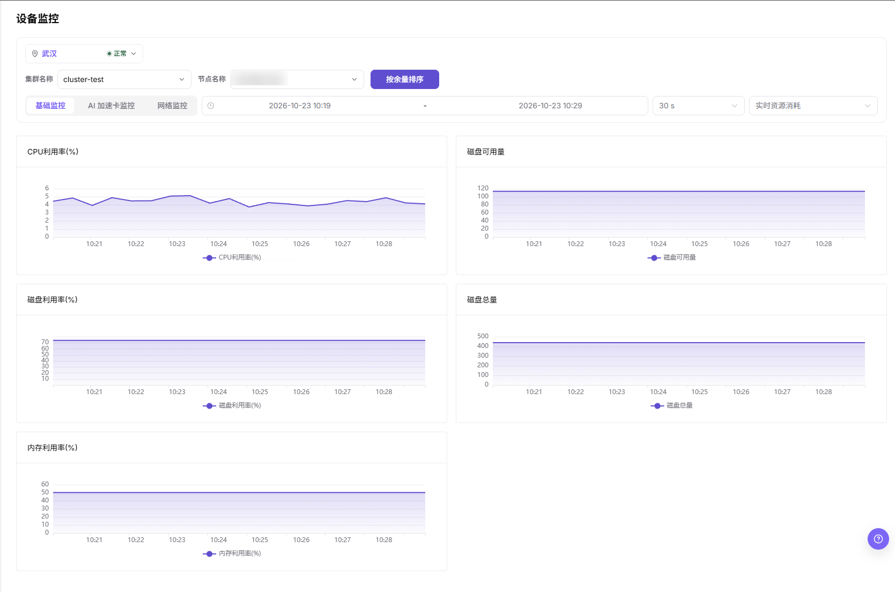
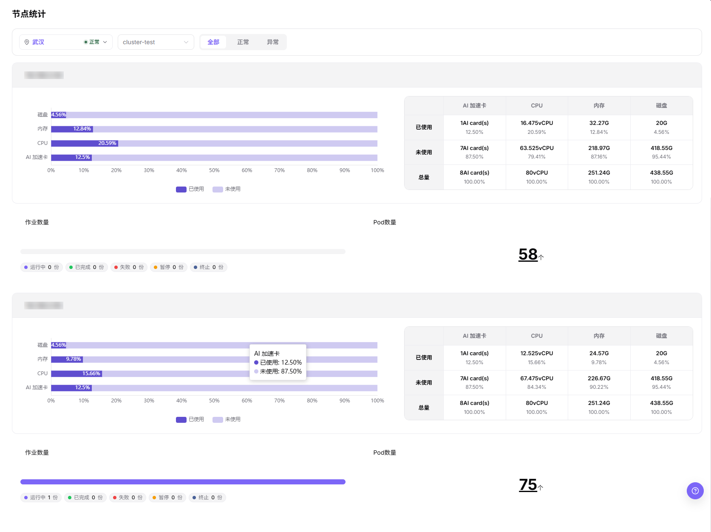
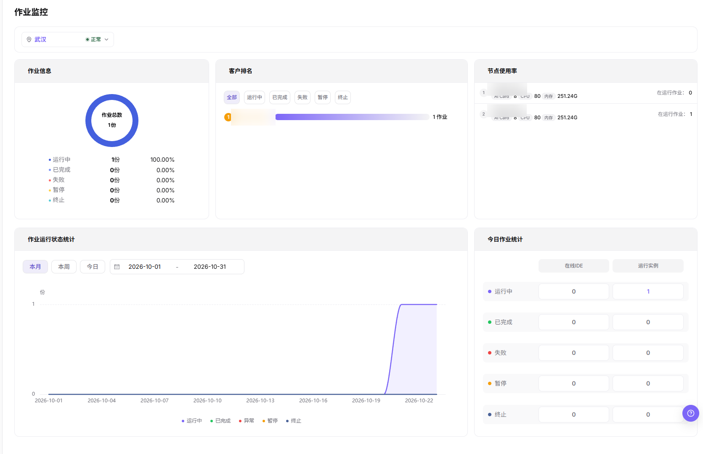

# 监控设备、节点与作业

## 场景目标

按实际硬件清单核对目标 NPU 的健康和利用率，并结合节点与实例记录关联异常。

NPU 指神经网络处理器；设备利用率反映运行负载，不能直接当作作业申请的卡数或租户配额。

## 适用角色

- 平台运营方
- 查看已授权作业监控的平台用户

## 开始前准备

- 记录纳管和部署时使用的集群、节点、设备及作业名称。
- 设备、节点和作业页面使用同一时间范围进行对比。

## 功能入口

- **角色**：运营管理员
- **菜单**：On-Prem > 监控 > 设备监控 / 节点统计 / 作业监控
- **路由**：`/powerone/monitor/device`、`/powerone/monitor/node`、`/powerone/monitor/work`

## 操作步骤

1. 进入 **设备监控**，先选地域、集群和节点。默认 **基础监控** 展示主机指标；查看加速卡时切换 **AI 加速卡监控**，只对页面实际返回的设备和指标做逐项核对，不假定默认页签已列出硬件清单中的全部目标卡。

图示为 **基础监控** 页签，展示所选集群、节点和时间范围内的 CPU、磁盘及内存趋势；它不是 NPU 设备指标，也不能证明全部加速卡已识别。

2. 进入**节点统计**，确认加速节点处于就绪状态且没有资源压力。

3. 进入 **作业监控**，先核对作业状态分布和节点使用率，再结合具体部署或运行实例详情核对任务及其资源分配，不从汇总看板直接推断每张卡的占用关系。

图示只展示作业与节点的聚合分布，不包含物理 NPU 卡与具体作业的一对一映射。

4. 先建立“异常设备—所属节点—占用作业”的关联，再判断应处理硬件、驱动、配额还是应用问题。

三个页面先对齐地域、集群、节点和记录时间。设备监控可选时间范围；节点统计当前手册未展示时间范围控件，不要求在该页设置不存在的条件。作业监控先读状态分布与节点使用率，再到具体实例详情核对，不能仅凭汇总图断言某张物理卡已映射到某个作业。

## 4 张 NPU 卡的巡检表

**案例说明：** 本节沿用4张 NPU 的示例，仅在型号、容量和调度拓扑支持时采用相应档位；其他环境按实际设备清单与业务需求核对。

| 检查项 | 预期结果 |
| --- | --- |
| 设备数量 | 4 张卡全部可见 |
| 健康状态 | 无离线、掉卡或持续告警 |
| 设备占用 | 与运行中作业申请卡数一致 |
| 节点状态 | Ready，指标持续更新 |
| 作业状态 | 无异常排队或反复失败 |

## 完成检查

核对下表；任一项未满足时，先按“常见失败分支”排查。

| 检查项 | 通过标准 |
| --- | --- |
| 1 | 已记录设备所属节点，并用实例或作业详情核对资源分配，不以汇总图替代逐实例证据。 |
| 2 | 作业实际分配与申请的卡数一致，租户资源使用量未超过其配额；配额上限不要求等于实际占用。 |
| 3 | 异常设备能够被单独识别，不会误判为整个集群不可用。 |

## 常见失败分支

| 现象 | 优先检查 |
| --- | --- |
| 设备指标为空 | 监控 Agent、设备插件、时间范围、集群状态和设备映射 |
| 有卡空闲但作业排队 | 申请规格、调度事件、节点标签、配额和卡健康状态 |
| 设备、节点和作业汇总不一致 | 地域/可用区范围、时间范围、更新时间、汇总层级和采集延迟 |

## 操作手册

- [设备监控](/zh-CN/usermanual/ai-infra-on-prem/operator/monitoring/devices/)
- [节点统计](/zh-CN/usermanual/ai-infra-on-prem/operator/monitoring/nodes/)
- [作业监控](/zh-CN/usermanual/ai-infra-on-prem/operator/monitoring/jobs/)
