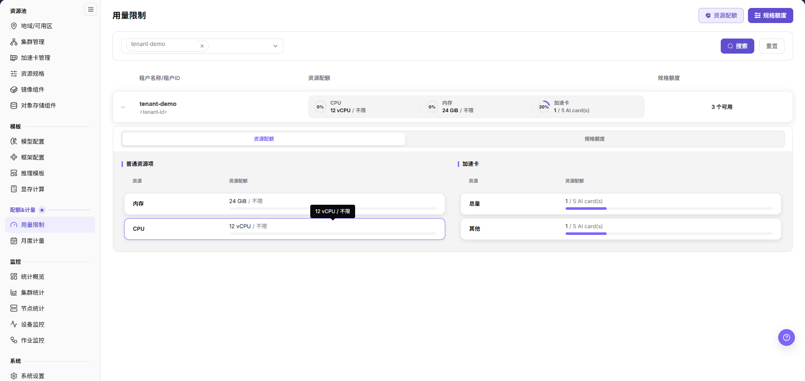

# 配置租户 NPU 配额

## 场景目标

租户能申请获批的 NPU 方案，同时不超过其在实际资源池中的授权上限。

资源配额是数量上限，规格额度是可用时长；设置加速卡数量上限不等于预留了对应物理卡。

本页由有权维护租户额度的运营管理员执行；用户负责读回自身可用范围，不能借本流程修改其他租户或平台默认额度。

## 适用角色

- 平台运营方

## 开始前准备

- 确认总容量、现有分配，以及配额按卡数还是按规格计量。
- 明确租户实际需要的任务档位与并发资源上限。

## 功能入口

- **角色**：运营管理员
- **菜单**：On-Prem > 配额&计量 > 用量限制
- **操作手册**：[用量限制](../../../../usermanual/ai-infra-on-prem/operator/quotas-metering/usage-limits/)

## 操作步骤

1. 进入 **用量限制**，选择目标地域，通过租户选择器选中租户并点击 **搜索**；展开租户行，查看资源配额与规格额度。
2. 点击页头 **资源配额**，切换到 **分配资源配额**，在 **选择租户** 中再次确认目标租户；不要误改影响其他租户的 **默认资源配额**。
3. 在 **加速卡** 组选择对应类别，按批准值填写 **分配资源**，单位为 **AI card(s)**。需要单任务使用 4 卡时，除配额外还需核对可调度容量和资源规格。
4. 点击 **确定** 后展开租户行读回结果，再用获批测试作业核对已用量。
5. **规格额度** 以 **小时** 计量，与加速卡数量配额不是同一口径。若需要调整规格额度，按手册区分 **默认规格额度**、**覆盖式初始化额度** 与 **调整规格额度**；覆盖式初始化会移除未列出的额度，不应作为普通追加操作。

## 配额策略

**案例说明：** 以下4卡资源池与4卡单任务只是数量示例，实际按物理容量和获批需求设置。

- 只有 4 张卡时，不建议默认给多个租户各分配 4 张可同时使用的保证额度。
- 区分“资源规格为 4 卡”和“租户配额上限为 4 卡”；两者必须同时满足。
- 保留必要的运维或验证余量，避免所有卡长期被单个作业占满。

## 完成检查

核对下表；任一项未满足时，先按“常见失败分支”排查。

| 检查项 | 通过标准 |
| --- | --- |
| 1 | 目标租户的 NPU 配额已更新。 |
| 2 | 用户能够选择授权范围内的 NPU 规格。 |
| 3 | 已记录资源配额与规格小时额度的读回结果，并核对测试作业的实际状态与提示。 |

## 常见失败分支

| 现象 | 优先检查 |
| --- | --- |
| 配额充足但创建失败 | 规格可用性、租户额度、集群容量和已有任务 |
| 释放后配额未恢复 | 实例最终状态、计量延迟和残留分配 |
| 调整后仍选不到目标规格 | 规格是否启用、集群关联、地域/可用区范围、租户额度和当前卡容量 |

## 操作手册

运营侧核对可继续查看[月度计量](../../../../usermanual/ai-infra-on-prem/operator/quotas-metering/monthly-usage/)及其 `计量明细` 页签。
