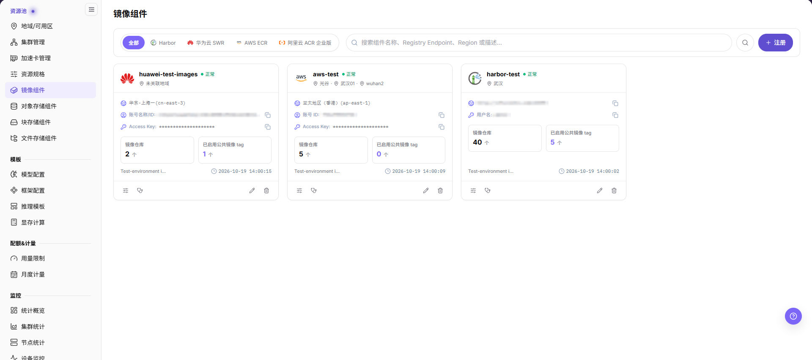
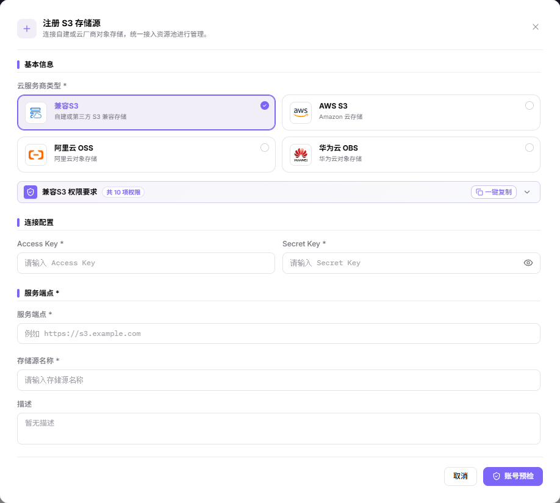

# 配置本地运行镜像与存储底座

本任务用于为一个已接入的本地集群准备运行镜像和所需存储能力。

## 适用角色

- 平台运营方、本地算力资源管理员、存储管理员

## 开始前准备

1. 确认目标地域和集群已接入且节点健康。
2. 确认集群节点可以访问镜像仓库和存储服务。
3. 准备最小权限的仓库、存储认证材料及证书策略。
4. 明确测试工作负载、镜像版本、容量和读写要求。

## 操作流程

### 1. 注册并验证镜像组件

进入[镜像组件](../../../usermanual/ai-infra-on-prem/operator/resource-pools/image-services/)，点击 **注册**，先选择可用的服务商，再填写对应凭据、Harbor 的 Endpoint（服务访问地址） 或云服务商地域、公共与租户私有 Namespace（仓库命名空间）、组件名称。点击 **账号预检** 提交，返回卡片核对健康状态；注册弹窗没有独立保存动作，地域绑定在地域配置中核对。只在浏览器能打开仓库不代表集群节点能够拉取镜像。

### 2. 同步或上传运行镜像

运营管理员交付可用组件和地域范围后，由具备镜像推送权限的用户进入用户侧[镜像服务](../../../usermanual/ai-infra-on-prem/user/extensions/images/)，核对镜像组、仓库与 Tag（镜像版本标签）；需要上传时按 **上传指南** 获取受控推送方式。使用明确版本标签，并确认目标节点可拉取，不把组件注册当作镜像内容已经同步或上传成功。

### 3. 按工作负载选择存储组件

- 对象数据使用[对象存储组件](../../../usermanual/ai-infra-on-prem/operator/resource-pools/object-storage/)：点击 **注册**，选择服务商，填写凭据及服务端点或服务地域、存储源名称，点击 **账号预检**。容量、桶额度与定价在注册后的 **配置限制** 中维护，不是注册表单字段。
- [块存储组件](../../../usermanual/ai-infra-on-prem/operator/resource-pools/block-storage/)与[文件存储组件](../../../usermanual/ai-infra-on-prem/operator/resource-pools/file-storage/)文档继续保留，但应先确认当前环境已开放相应能力。若入口只显示未开放提示，不执行注册或挂载，不以菜单或历史截图证明能力可用。
- 已有集群共享目录时，在 **集群管理 > 配置 > 共享存储** 中核对实际挂载配置；不能把共享存储配置与独立文件存储组件注册混为同一个入口。

### 4. 绑定地域并运行联合验证

在 **地域/可用区** 中核对镜像组件及按需关联的对象存储；当前地域详情并不提供文件存储和块存储绑定区块。其他挂载在集群或实例配置中按实际开放能力核对。创建一个最小测试工作负载，验证镜像拉取、启动、卷挂载或对象访问；结束后检查数据保留和资源回收是否符合策略。

删除或替换镜像组件、存储组件前，先检查其关联的地域、集群、模板和作业依赖，并先完成迁移或解除关联；否则后续镜像拉取、挂载或对象访问可能失败。

## 完成检查

运行环境与存储未通过检查前，不继续批量创建工作负载。

| 检查项 | 通过标准 |
| --- | --- |
| 镜像仓库 | 集群节点可访问，认证和同步状态正常。 |
| 运行镜像 | 测试实例能拉取明确版本的目标镜像。 |
| 存储能力 | 已开放且本次实际使用的存储通过访问验证；未开放能力不列为已完成。 |
| 地域绑定 | 镜像和存储在正确地域、集群和租户范围可用。 |
| 运维责任 | 容量、备份、删除和凭据轮换责任人清晰。 |

## 常见失败分支

| 现象 | 优先检查 |
| --- | --- |
| 实例出现镜像拉取失败 | 完整镜像地址、标签、仓库认证、证书和节点网络 |
| 平台有镜像但用户侧不可选 | 镜像同步、地域绑定、租户权限和标签状态 |
| 卷创建或挂载失败 | CSI（容器存储接口）/存储驱动、访问模式、容量、网络和认证信息 |
| 对象或共享目录不可访问 | Endpoint、路径/Bucket、权限策略和租户隔离 |
| 组件无法安全删除或替换 | 地域和集群关联、模板或作业引用、活动挂载以及组件当前健康状态 |
