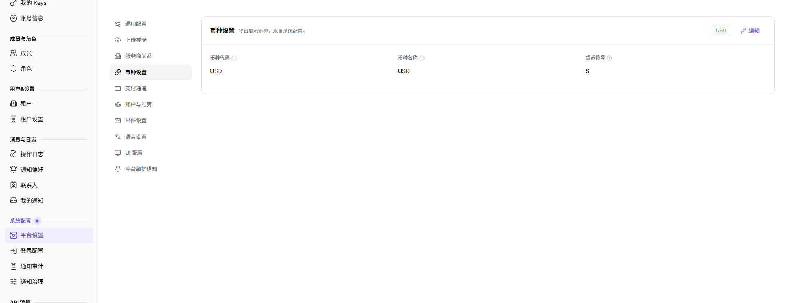
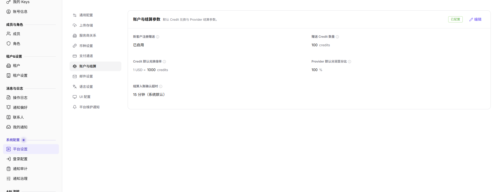
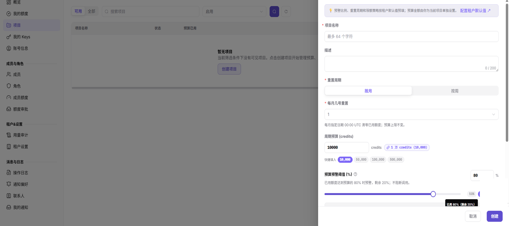
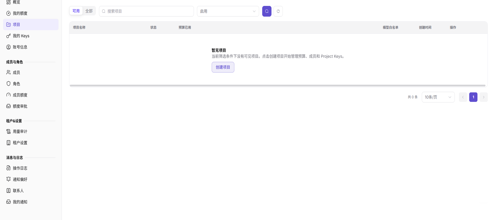
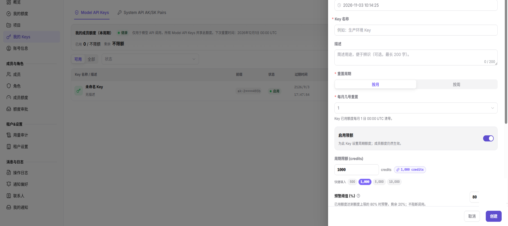
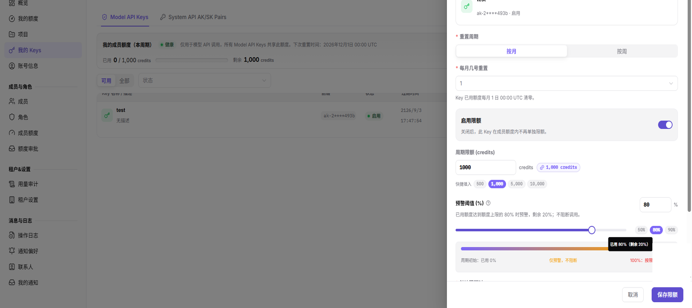

# 项目、Key 与预算配置

本任务建立具备预算、模型范围和独立调用凭据的项目。平台币种与兑换倍率通常沿用已有配置，仅首次设置或确需获批变更时由运营管理员处理，不是每次创建项目的必做动作。

## 适用角色

- 平台运营方、模型提供方、平台用户、服务商管理员

## 开始前准备

- 确认在目标租户内具备项目和 Key 创建权限。
- 如果由平台运营方执行，确认具备编辑平台设置的权限，并已确定审批通过的币种和 Credit 兑换倍率。
- 明确项目负责人、成员、预算周期、模型范围和超预算策略。
- 确认使用 Model API Key 还是 System API AK/SK。API（应用程序接口）供程序访问平台；Model API Key 用于模型接口，AK/SK 是访问标识与秘密密钥组成的系统接口凭据对，不能把两类凭据混用。

## 运营方设置：币种与 Credit 默认兑换倍率

仅适用于首次设置或已获授权的配置变更。已有配置正确时跳过本节，从“创建项目”开始；普通用户不应为创建项目修改全平台配置。

运营管理员负责必要的全局配置核对，将现用币种和 Credit 换算口径交给项目负责人；项目负责人核对预算、成员和模型范围后，把调用所需的凭据类型、适用范围、有效期及验证要求交给接入人员。密钥值只经既有安全渠道交付，不写入普通交接说明；接入人员返回受控调用结果，由项目负责人复核限制。

1. 从 `设置 > 系统配置 > 平台设置` 进入[平台设置](../../../usermanual/settings/operator/system-settings/platform-settings/)，选择 `币种设置`。
2. 点击 `编辑`，设置 `币种代码`、`币种名称` 和 `货币符号`，确认全局影响后点击 `保存`。

3. 选择 `账户与结算`，点击 `编辑`。
4. 按 `1 <币种代码> = <N> credits` 设置 `Credit 默认兑换倍率`，然后点击 `保存`。请以当前环境页面显示的币种和倍率为准。

该倍率用于把平台币种下的授权充值金额换算为账户 Credits，与模型用量价格分开。用户调用具备权限的模型时，平台按模型配置的计费方式和价格，对可计费 Token、图片、字符、时长或其他单位进行折算，从账户可用余额中扣减 Credits，同时执行项目和 Key 限额。核对余额变化时，应同时查看充值订单、交易流水、模型用量和账期汇总。

## 操作流程

### 1. 创建项目

进入[项目](../../../usermanual/settings/user/personal/projects/)，点击创建项目，填写名称、描述、重置周期、周期预算、预警阈值、超预算策略和模型白名单。

### 2. 核对项目详情

在项目列表中进入详情，检查概览、成员、用量、API Keys、活动和设置页签，确认项目状态和预算规则已保存。

图示为当前没有匹配项目的列表，不包含项目详情页签，也不能证明预算规则已经保存。列表为空时，先完成获准的项目创建或核对当前筛选；有目标项目后再打开其实际详情检查。

### 3. 创建独立用途的 Key

从可见菜单进入[我的 Keys](../../../usermanual/settings/user/personal/my-keys/)，选择 `Model API Keys` 或 `System API AK/SK Pairs`。两种创建窗口都有 `Key 名称`、可选的 `描述` 和 `过期时间`；只有 Model API 创建窗口包含重置周期和限额配置。用途写入描述，不把“用途”当成独立字段。生产、测试和临时用途应使用不同 Key。

### 4. 设置 Key 限额并验证

对 Model API Key，打开行内更多菜单并选择 `限额`，查看 `重置周期`、条件显示的重置日期和 `启用限额`；启用时，再按项目预算核对 `周期限额 (credits)` 和 `预警阈值 (%)`。未获得明确修改授权时停在 `取消`，不要单击 `保存限额`。完成获准的保存后，再使用受控请求验证模型白名单、项目预算和 Key 限额是否共同生效。

### 5. 使用 Credits 并核对消耗

1. 平台用户完成已授权的充值。平台根据已配置的币种和 `Credit 默认兑换倍率` 为账户增加 Credits，充值订单或交易流水应能体现余额变化。
2. 平台用户调用项目、成员和 Key 范围允许的模型。
3. 平台依据模型配置的计费规则，按可计费 Token、图片、字符、时长或其他单位计算消耗。按 Token 计费的模型使用其配置的 Credits/Token 单位价格；其他模态使用对应的计费单位价格。
4. 平台扣减计算得到的 Credits。在调用记录或用量明细中确认扣减结果，并与交易流水和账期汇总核对。

> 币种与 Credit 的兑换倍率只控制充值换算，不替代模型用量价格；任一配置变化都可能影响后续对账结果。

## 完成检查

项目和凭据检查未通过前，不向业务调用方分发密钥。

| 检查项 | 通过标准 |
| --- | --- |
| 账务基础 | 币种字段和 Credit 默认兑换倍率已保存，并符合当前部署的审批配置。 |
| 项目规则 | 预算、预警、超预算策略和模型白名单已保存。 |
| Key 边界 | Key 名称、描述、有效期和适用限额清晰；责任人在项目或成员范围中核对。 |
| Credits 流程 | 授权充值后账户增加 Credits，允许的模型调用产生用量，扣减结果可追溯。 |
| 调用验证 | 允许模型可调用，禁止模型或超限请求按规则受限。 |
| 审计记录 | 项目和 Key 变更能够在活动或操作日志中定位。 |

## 常见失败分支

| 现象 | 优先检查 |
| --- | --- |
| 充值到账 Credits 与预期不符 | 币种设置、Credit 默认兑换倍率、充值金额、订单状态和交易流水 |
| 模型扣减与预期不符 | 模型计费方式和价格、可计费 Token 或单位用量、项目/Key 限额及交易或用量记录 |
| 项目达到预算后不能调用 | 预算已用、超预算策略和重置周期 |
| Key 调用失败 | Key 状态、过期时间、项目预算、成员额度和模型白名单 |
| 看不到项目或 Key | 账号角色、租户归属和菜单权限 |
| 轮换 Key 后业务失败 | 调用方配置是否已替换、旧 Key 是否过早停用 |
