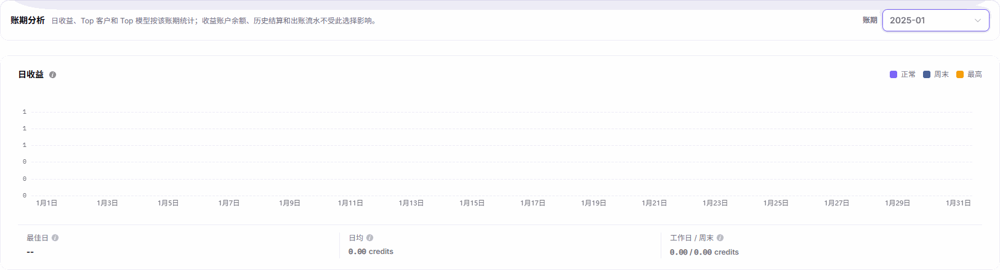
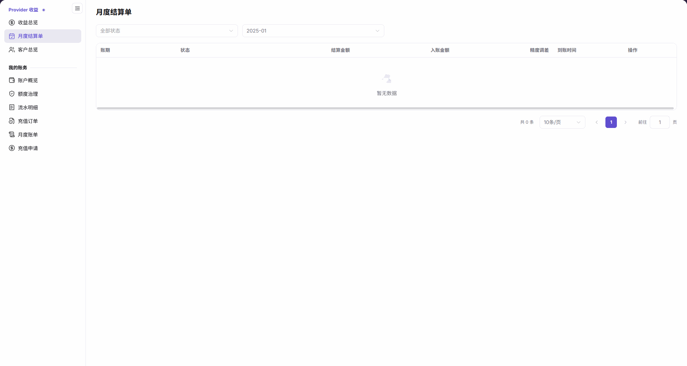

# 服务商收益与结算核对

本任务用于解释服务商收益来源并确认月度结算结果。Credit 是平台账户使用的记账额度单位，不等同于某笔原币支付金额。

模型提供方或其获授权的财务查看人员先核对本方收益；有差异时，将账期、结算单标识、预估或已入账口径及差异说明交给平台账务人员继续核查。平台的核查结论返回后，仍由提供方在自己的收益页面复核；余额转入只由具备对应权限且获授权的人员执行。

## 适用角色

- 模型提供方、服务商财务查看人员、收益运营人员

## 开始前准备

- 明确目标账期及需要核对的客户或模型。
- 确认当前账号具备服务商收益和结算查看权限。
- 涉及余额转入时，先确认目标账户、操作人和复核人。

## 操作流程

### 1. 查看收益总览

从 `账务 > Provider 收益 > 收益总览` 进入[收益总览](../../../usermanual/billing/user/earnings/revenue/)，分别核对实时余额、当前账期预估、下次结算提示和账期分析。预估未结算、不计入收益账户余额；下次结算提示仅为时间提示。分析账期只影响日收益及客户、模型排行，不改变实时余额与历史出账范围。

图示为历史账期分析区域，不包含实时账户余额；账户汇总需在页面中单独核对。

### 2. 解释收益来源

选择目标账期，查看 Top 客户和 Top 模型；再进入[客户总览](../../../usermanual/billing/user/earnings/customers/)，按客户或标签筛选并打开详情核对收益贡献。

图示为客户结果空表，不展示查询控件、客户身份、汇总卡或详情结果；账期和筛选条件需在实际页面单独核对。

### 3. 核对月度结算单

进入[月度结算单](../../../usermanual/billing/user/earnings/settlements/)，按状态和账期筛选，核对结算金额、入账金额、精度调差、到账时间和处理状态。当前“预估(待结算)”行的“详情”进入完整预估明细页面，尚未生成结算单、未入收益账户；历史记录按各行实际状态核对，不把预估金额当到账金额。

### 4. 处理余额转入

返回[收益总览](../../../usermanual/billing/user/earnings/revenue/)，从“Provider 收益转 Credit”打开表单，核对可转余额、必填转入金额及备注；入口不在月度结算单列表。只有金额与业务授权已确认时才使用“确认转入”。只读核对或存在差异时点击“取消”，不要通过提交验证是否可用。

## 完成检查

收益来源与结算结果未核对一致前，不执行余额转入。

| 检查项 | 通过标准 |
| --- | --- |
| 收益汇总 | 余额、预估收益和账期趋势已确认。 |
| 收益来源 | 主要客户和模型贡献能够解释。 |
| 结算状态 | 应结算、实际到账和状态一致。 |
| 转入条件 | 金额、账户、权限和复核人已确认。 |

## 常见失败分支

| 现象 | 优先检查 |
| --- | --- |
| 收益余额与预期不一致 | 账期、模型调用、价格规则和同步时间 |
| 客户收益为空 | 客户范围、标签筛选和有效调用 |
| 应结算与实际到账不一致 | 结算状态、抹零、到账时间和出账流水 |
| 转入按钮不可用 | 结算状态、账号权限和目标账户 |
