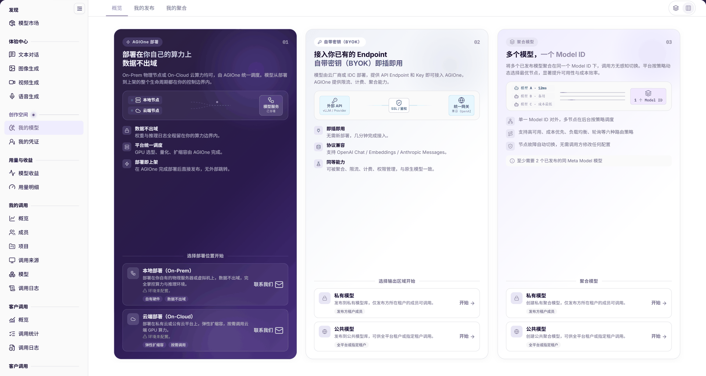

# 添加聚合模型

## 适用角色

- 模型提供方

## 开始前准备

- 已准备至少两个已发布且属于同一元模型（Meta Model）的成员模型，并核对可用状态、模态、协议、价格与可见范围。元模型是能力档案，不同供应方实例可引用同一档案。
- 已明确本次路由目标与发布范围。聚合配置不能替代成员模型的实际能力和授权。

## 操作步骤

1. 进入 **模型及AI服务 > 创作空间 > 我的模型**，切换到 **我的聚合**。
2. 点击 **创建聚合模型**，选择 **私有模型** 或 **公共模型**。

图示为概览页的三种上线方式；聚合区域提供私有与公共入口，并明确提示至少需要两个已发布的同一元模型（Meta Model）模型。

3. 按页面选择参与聚合的已发布模型，核对模型与供应方，再配置当前页面提供的路由策略、计费和限流。
4. 提交前核对服务范围和费用影响，提交后回到 **我的聚合** 检查目标记录及状态。
5. 在目标授权范围内通过[模型的体验与调用](../model-experience-api-calling/)完成受控请求验证。提供方交接聚合模型标识、协议和授权范围，调用方使用自己的获授权密钥，不通过交接材料共享真实密钥。不以“禁用一个成员后必然自动切换”作为未经核实的成功保证。

## 完成检查

| 检查项 | 通过标准 |
| --- | --- |
| 成员 | 至少两个已发布成员属于同一元模型（Meta Model），可用状态、供应方及授权符合要求。 |
| 策略与费用 | 当前配置的路由策略、计费及限流已经核对。 |
| 保存 | 我的聚合中可定位目标记录与状态。 |
| 调用 | 已授权账号对聚合入口完成受控调用并检查结果。 |

## 常见失败分支

| 现象 | 优先检查与继续入口 |
| --- | --- |
| 找不到聚合记录 | 确认我的聚合页签及筛选条件，见[我的模型](../../../usermanual/model-services/user/studio/my-models/)。 |
| 无法完成配置 | 核对是否至少选择两个已发布且属于同一元模型（Meta Model）的成员，再检查其可用状态和页面必填项。 |
| 调用失败 | 核对模型与授权并查看[我的调用日志](../../../usermanual/model-services/user/my-calls/call-logs/)。 |

## 操作手册

[我的模型：聚合创建与结果校验](../../../usermanual/model-services/user/studio/my-models/)
