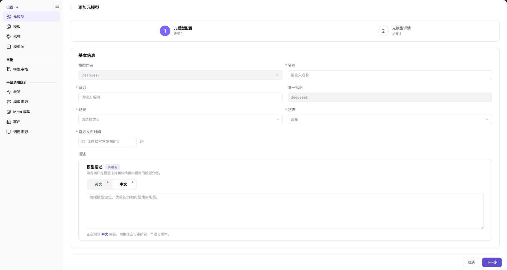

# 元模型

## 场景目标

把已确认的模型身份、模态、能力、Token（模型处理的文本单元）限制和协议维护为可供模板与发布引用的能力档案。模态指输入输出的数据类型，协议约定请求与响应的格式。

## 适用角色

- 运营管理员

## 开始前准备

- 具备 **模型及AI服务 > 设置 > 元模型** 权限，目标模型作者已存在。
- 已按官方模型规格确认名称、系列、唯一标识、场景、发布时间及能力；不凭其他模型的示例填写上限。

## 操作步骤

1. 进入 **设置 > 元模型**，在左侧模型作者区搜索并选中目标作者。作者不存在时先交由基础数据负责人维护，不在此假定存在某个新建作者按钮。
2. 点击右上角 **添加元模型**，进入 **元模型配置 > 元模型详情** 两步向导。
3. 核对作者，填写基础信息和多语言描述；按实际能力配置模型类型、输入输出模态、函数/工具支持、思考模式、Token 限制和协议。

图示为添加元模型的配置步骤，作者由入口带入；名称、系列、场景与官方发布时间等带星号字段需要填写。

4. 点击 **下一步** 补齐元模型详情，按页面提交。
5. 回到同一作者下检索目标记录，核对唯一标识与状态；再在[模板](../Model-Templates/)中确认目标元模型可选择。

## 完成检查

| 检查项 | 通过标准 |
| --- | --- |
| 记录 | 目标作者下能检索到新元模型，标识与状态正确。 |
| 能力 | 模态、高级能力、Token 限制与协议对应真实规格。 |
| 引用 | 模板创建流程可以选择该元模型。 |

## 常见失败分支

| 现象 | 优先检查与继续入口 |
| --- | --- |
| 列表找不到记录 | 核对左侧作者、搜索条件与分页，见[元模型常见问题](../../../../usermanual/model-services/operator/settings/meta-models/#常见问题)。 |
| 无法进入下一步 | 核对带星号字段与协议配置。 |
| 找不到服务地址 | 地址属于[模型源](../Model-Source/)的 Endpoint，不在元模型中配置。 |

## 操作手册

[元模型：完整字段与操作](../../../../usermanual/model-services/operator/settings/meta-models/)
