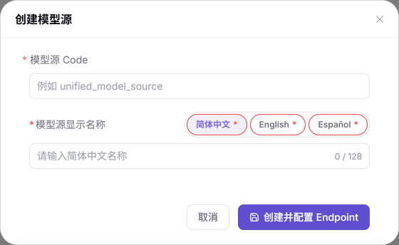

# 模型源

## 场景目标

维护上游来源及其 Endpoint（接入点），让发布方能准确选择服务地址和支持的协议。模型源本身不保存调用地址，Base URL（调用根地址）属于 Endpoint。

## 适用角色

- 运营管理员

## 开始前准备

- 具备 **模型及AI服务 > 设置 > 模型源** 维护权限。
- 已取得上游接入点的 Base URL、区域标签、控制台和文档地址及协议清单；真实认证信息不写入公开材料。

## 操作步骤

1. 进入 **设置 > 模型源**。不要误入 **平台调用统计 > 模型来源**，后者只查看调用数据。
2. 点击 **新建模型源**，填写唯一 **模型源 Code**（用于识别上游来源，不是具体模型的调用标识），补齐简体中文、English、Español 三个语言页签的显示名称。
3. 点击 **创建并配置 Endpoint** 进入配置页。

图示为创建弹窗，只包含 Code 与多语言显示名称；调用地址需要在后续 Endpoint 配置中维护。

4. 在 **Endpoint 管理** 点击 **添加 Endpoint**，填写显示名称、区域标签与 Base URL，并按需维护官方 Endpoint 标记、控制台地址和文档地址。
5. 在 **协议配置** 选择该接入点实际支持的协议，点击 **保存 Endpoint**。
6. 回到配置页核对模型源信息，使用页头 **保存模型源** 保存模型源级修改。两个保存动作属于不同层级，不能相互替代。
7. 返回列表或打开 **详情**，核对 Code、Endpoint 数量、区域、Base URL 和协议，再进入[模板](../Model-Templates/)组合发布预设。

## 完成检查

| 检查项 | 通过标准 |
| --- | --- |
| 模型源 | 唯一 Code 与三语名称正确，列表能定位记录。 |
| Endpoint | 详情能看到目标接入点、Base URL 与协议。 |
| 下游引用 | 模板所选供应方与地域匹配目标模型源。 |

## 常见失败分支

| 现象 | 优先检查与继续入口 |
| --- | --- |
| 找不到新建入口 | 确认当前不是平台调用统计页，见[模型源](../../../../usermanual/model-services/operator/settings/model-source/)。 |
| 创建无法完成 | 核对 Code 唯一性与三语名称。 |
| 没有调用地址或接入点数量不变 | 核对是否完成 Endpoint 配置并点击保存 Endpoint，见[模型源常见问题](../../../../usermanual/model-services/operator/settings/model-source/#常见问题)。 |

## 操作手册

[模型源：完整字段与分层保存说明](../../../../usermanual/model-services/operator/settings/model-source/)
