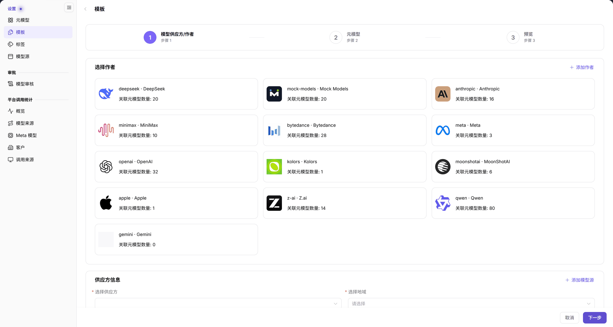

# 模板

## 场景目标

将已准备的模型作者、模型源供应方、地域和元模型组合为可复用的发布预设。元模型是能力档案，模板是引用它及服务来源的预设，不是已发布的模型实例。

## 适用角色

- 运营管理员

## 开始前准备

- 具备 **模型及AI服务 > 设置 > 模板** 权限。
- 模型作者、元模型、模型源及接入点已维护，并已确认实际模型能力与协议（请求与响应格式约定）。

## 操作步骤

1. 进入 **设置 > 模板**，在左侧选择目标模型源，再点击 **添加**。
2. 在 **1 模型供应方/作者** 中选择作者卡片，在 **供应方信息** 选择供应方和地域；缺少来源时先到[模型源](../Model-Source/)核对。

图示为模板向导第一步：作者卡片与关联元模型数量位于上方，供应方和地域在供应方信息区选择。

3. 点击 **下一步** 进入 **2 元模型**，选择目标元模型，核对页面显示的模态、能力、Token（模型处理的文本单元）限制和协议。这里的配置应与实际服务一致，不沿用旧截图中的固定字段或值。
4. 在 **3 预览** 核对配置后提交。
5. 回到相同模型源，使用作者、元模型、状态或 Keyword（关键字）筛选定位新模板，核对列表结果与总量。运营管理员将模板所属模型源、地域和元模型交给提供方，提供方据此核对发布时的目标配置。

## 完成检查

| 检查项 | 通过标准 |
| --- | --- |
| 归属 | 左侧模型源与右侧标题一致，供应方和地域正确。 |
| 依赖 | 作者、元模型及能力和协议匹配目标服务。 |
| 保存 | 提交后在正确模型源下能检索到目标模板。 |

## 常见失败分支

| 现象 | 优先检查与继续入口 |
| --- | --- |
| 添加后列表为空 | 重置筛选并确认左侧模型源，见[模板常见问题](../../../../usermanual/model-services/operator/settings/model-templates/#常见问题)。 |
| 作者、供应方或地域缺失 | 回到元模型和模型源检查前置基础数据。 |
| 向导无法继续 | 核对当前步骤选择，不跳过步骤 1 直接检查后续字段。 |

## 操作手册

[模板：完整操作和筛选说明](../../../../usermanual/model-services/operator/settings/model-templates/)
