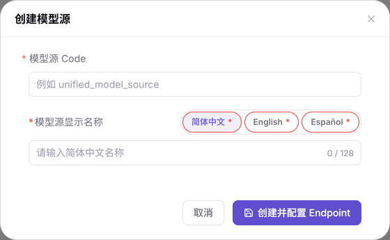

# 模型发布：预配置说明

本任务将运营侧基础配置交付给模型提供方使用，不在本文重复各功能页的完整字段表。

## 场景目标

元模型（模型能力档案）、模型源接入点（Endpoint）与模板能相互对应，提供方可以开始发布；需要审核时，有明确运营负责人处理。

## 适用角色

- 运营管理员；模型提供方配合验证发布选项。

运营管理员交付元模型、模型源 Code、Endpoint 和模板归属；提供方接手后核对可选项并完成协议测试。需要审核时，提供方再交出目标模型与提交版本，由运营管理员处理对应记录。

## 开始前准备

- 具备 **模型及AI服务 > 设置** 和对应审批权限。
- 已取得官方模型规格、上游服务地址与协议资料，确认计价口径、发布范围和审核责任人。
- 凭证不写入名称、描述、共享文档或公开请求示例。

## 操作流程

1. 进入 **设置 > 元模型**，选择已有作者，按[元模型指引](./Meta-models/)维护模型能力与协议。
2. 进入 **设置 > 模型源**，按[模型源指引](./Model-Source/)创建 Code（模型源唯一标识）和三语名称，再维护 Endpoint 与协议。地址在 Endpoint 上配置，不再使用旧“地域行+认证头”流程。
3. 进入 **设置 > 模板**，按[模板指引](./Model-Templates/)选择作者、供应方、地域与元模型，预览提交后回到列表核对。

图示为模型源创建弹窗；提交模型源后还需配置 Endpoint，只有名称与 Code 并不能形成可调用地址。

4. 在[标签](../../../usermanual/model-services/operator/settings/tags/)核对模型分类所需标签；计价币种先与平台设置负责人确认，本任务不要求为了发布单个模型修改全平台币种。
5. 由提供方打开[我的模型](../../../usermanual/model-services/user/studio/my-models/)，核对元模型、模型源、Endpoint 和凭证选项，完成协议测试后继续发布。
6. 需要审核时，由运营管理员进入 **审批 > 模型审核**，点击行内 **审核** 打开抽屉核对版本、能力、协议与费用；处理步骤见[模型发布审批](../model-publishing-approval/)。

## 完成检查

| 检查项 | 通过标准 |
| --- | --- |
| 基础数据 | 元模型可定位，模型源详情包含正确 Endpoint 和协议。 |
| 模板 | 正确模型源下可检索到模板，作者、地域和元模型一致。 |
| 提供方验证 | 提供方能选择所需配置并完成协议连通性测试。 |
| 审核交接 | 需要审核的版本能在模型审核中定位，责任人明确。 |

## 常见失败分支

| 现象 | 优先检查与继续入口 |
| --- | --- |
| 缺少元模型 | 核对作者上下文、状态和筛选，见[元模型](../../../usermanual/model-services/operator/settings/meta-models/)。 |
| 来源无接入地址 | 核对 Endpoint 是否保存，见[模型源](../../../usermanual/model-services/operator/settings/model-source/)。 |
| 模板列表为空 | 重置筛选并切回正确模型源，见[模板](../../../usermanual/model-services/operator/settings/model-templates/)。 |
| 无法发布或审核 | 分别按[我的模型](../../../usermanual/model-services/user/studio/my-models/)与[模型审核](../../../usermanual/model-services/operator/approvals/model-reviews/)检查当前版本。 |
