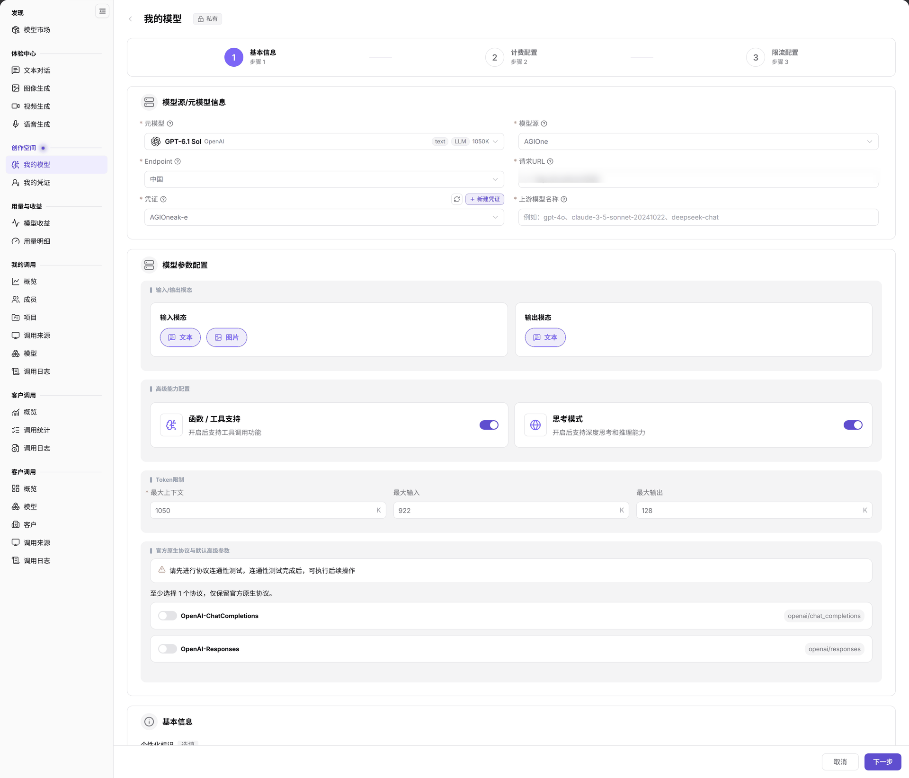

# 发布模型（语音模型）

本页保留语音模型的发布与验证任务；通用入口见[发布公有模型](../provider-quick-guide)。

## 场景目标

将已验证的语音服务发布到约定范围，协议测试通过，并能核对发布记录与调用结果。

## 适用角色

- 模型提供方

## 开始前准备

- 已准备元模型（模型能力档案）、模型源（上游来源）及 Endpoint（该来源下的接入点）、上游模型名称、请求 URL（请求地址）与凭证。
- 已确认该模型的模态（输入输出的数据类型）、协议（请求与响应格式约定）、计费单位和限流策略。
- 按目标服务的语音能力准备文本或音频样例，核对返回结果的格式和内容；不要将语音合成、识别或音乐生成混为同一操作。

## 操作步骤

1. 进入 **模型及AI服务 > 创作空间 > 我的模型 > 我的发布**，点击 **发布模型**，选择 **私有模型** 或 **公共模型** 后进入向导。
2. 在 **步骤 1 基本信息** 选择对应的元模型、模型源和 Endpoint，填写请求 URL、凭证和 **上游模型名称**，按真实能力核对模态与高级能力。

图示为私有文本模型的基本信息示例，仅说明元模型、模型源、Endpoint 和协议等共用字段，不证明公共发布流程或结果，也不是语音模型的专用配置图。Access Mode 不在本图显示范围内；按所选模型核对实际字段和参数。

3. 选择该服务支持的原生协议，按协议配置进行连通性测试；测试通过后核对个性化标识、发布方式与 **Access Mode（访问控制模式）**。
4. 完成 **计费配置** 和 **限流配置** 后提交。价格与计价单位按当前服务核对，不直接照抄其他模态的示例。
5. 返回 **我的发布** 核对状态和版本；需要审核时进入[模型发布审批](../../model-publishing-approval/)，发布后的受控验证见[模型的体验与调用](../../model-experience-api-calling/)。

## 完成检查

| 检查项 | 通过标准 |
| --- | --- |
| 协议与能力 | 目标模型协议测试通过，声明的模态与验证样例一致。 |
| 发布版本 | 我的发布可定位目标记录，状态、生效版本与待生效版本已核对。 |
| 费用与范围 | 计费单位、价格、限流和访问范围与约定一致。 |
| 调用结果 | 已授权账号按目标语音能力完成受控调用，结果可检查。 |

## 常见失败分支

| 现象 | 优先检查与继续入口 |
| --- | --- |
| 无法继续发布 | 核对元模型、Endpoint、凭证与协议测试，见[我的模型](../../../../usermanual/model-services/user/studio/my-models/#常见问题)。 |
| 发布后找不到或不可调用 | 核对版本、审核状态与授权范围，见[模型市场](../../../../usermanual/model-services/user/discover/models/)。 |
| 输出不符合预期 | 按上游模型规格和已选协议复核输入模态、模型名称及测试样例；不要通过改写能力标签掩盖测试失败。 |

## 操作手册

[我的模型：字段、步骤与发布结果校验](../../../../usermanual/model-services/user/studio/my-models/)
