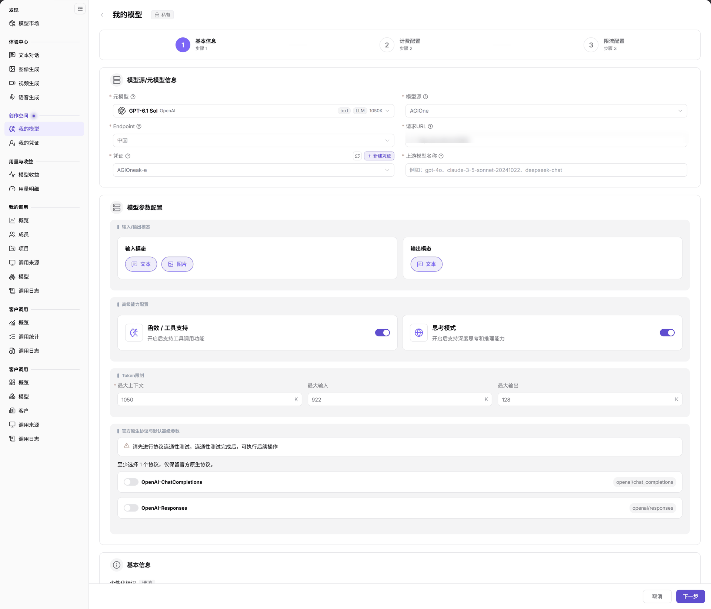

# 发布公有模型

本指南使用自带密钥（BYOK，接入已有上游服务）的发布方式，将已确认的服务发布为公共模型。算力部署不是本向导中的部署方式选择项，部署任务请先阅读[模型部署与状态检查](../on-prem-model-deployment-status/)。

## 场景目标

完成协议连通性测试、计费与限流配置，并核对发布版本和目标用户的调用权限。

## 适用角色

- 模型提供方；需要审核时由运营管理员处理。

## 开始前准备

- 账号可访问 **模型及AI服务 > 创作空间 > 我的模型**。
- 已确认元模型（模型能力档案）、模型源（上游来源）、Endpoint（模型源下的接入点）、请求 URL（请求地址）、凭证及上游模型名称。
- 已确认发布范围、计费和限流，并准备无敏感信息的测试输入。测试和发布后的调用可能消耗额度，先确认价格与授权。

## 1. 打开发布入口

1. 登录 {{DOCS_PRODUCT_NAME_ZH}}，进入 **创作空间 > 我的模型**，切换到 **我的发布**。
2. 点击 **发布模型**，在 **选择发布类型** 弹窗中选择 **公共模型**，再点击 **发布为公共模型**。
3. 也可从 **概览 > 自带密钥（BYOK）** 的公共入口开始；部署卡片显示 **环境未配置。** 时，不要在该卡片上寻找直接部署按钮。

## 2. 配置基本信息并测试协议

1. 在 **步骤 1 基本信息** 中选择元模型、模型源和 Endpoint，填写请求 URL、凭证与 **上游模型名称**，核对输入输出模态。
2. 按模型已验证的能力配置函数/工具支持、思考模式及 Token（模型处理的文本单元）限制。
3. 在 **官方原生协议与默认高级参数** 至少选择一个协议，并完成连通性测试后再继续。
4. 核对个性化标识、模型名称预览、发布方式和 **Access Mode（访问控制模式）**。**Global** 无需额外租户授权；**Authorized** 仍需按租户授权，不能把“市场可见”当成“所有用户可调用”。

图示为私有文本模型的基本信息示例，仅用于说明元模型、模型源、Endpoint、请求 URL、凭证、上游模型名称和协议等共用字段，不证明公共模型发布流程或结果。Access Mode 位于本图未显示的下方区域；公共发布时仍须在当前页面核对发布类型与访问控制。

## 3. 完成计费、限流与发布核对

1. 点击 **下一步**，完成 **步骤 2 计费配置**，核对计费方式、单位和价格。
2. 继续完成 **步骤 3 限流配置**，确认是否启用限流后按页面提交。
3. 返回 **我的发布**，核对目标模型的状态、**生效版本** 与 **待生效版本**。需要审核时，将目标模型、提交版本和发布范围交给运营管理员，再转交[模型发布审批](../model-publishing-approval/)处理，提交并不等于已上架。
4. 使用目标用户账号进入 **发现 > 模型市场**，点击模型名称，在供应方卡片中核对价格、路由标识和权限，再进入 **Playground** 或 **Quick Start** 验证调用。

## 完成检查

| 检查项 | 通过标准 |
| --- | --- |
| 协议 | 目标模型和协议的连通性测试通过。 |
| 发布记录 | 我的发布中能定位目标记录，版本和状态符合本次发布。 |
| 费用与权限 | 价格、计费单位、限流和 Access Mode 已核对。 |
| 用户验证 | 目标用户按授权范围找到模型并完成一次受控调用。 |

## 常见失败分支

| 现象 | 优先检查与继续入口 |
| --- | --- |
| 基本信息无法继续 | 核对必填项与协议测试，见[我的模型](../../../usermanual/model-services/user/studio/my-models/#常见问题)。 |
| 找不到发布记录 | 确认我的发布页签，重置搜索，并核对审核状态。 |
| 市场可见但调用失败 | 核对 Access Mode、租户授权及目标供应方，见[模型市场](../../../usermanual/model-services/user/discover/models/)。 |

## 操作手册

- [我的模型](../../../usermanual/model-services/user/studio/my-models/)
- [模型市场](../../../usermanual/model-services/user/discover/models/)
